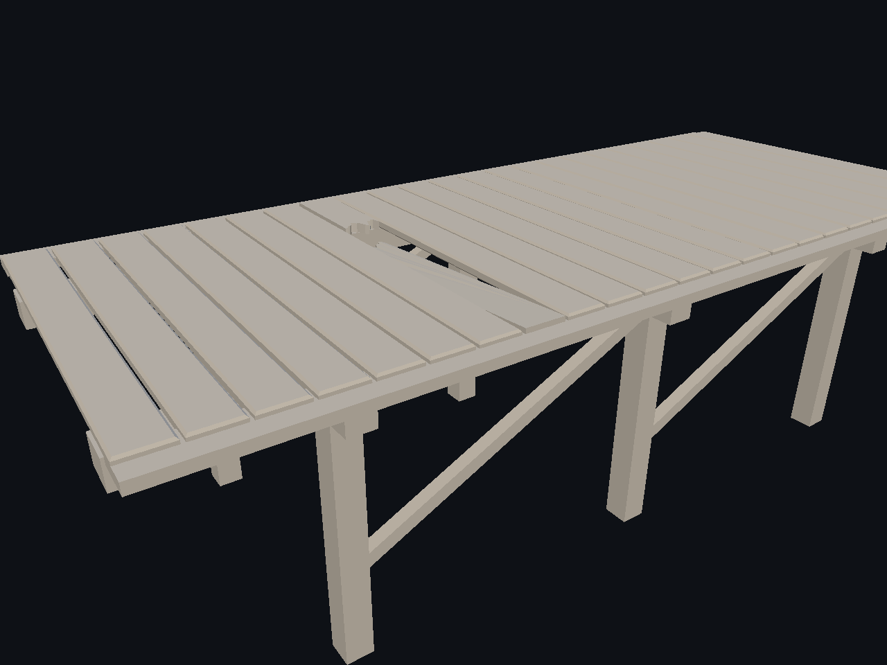
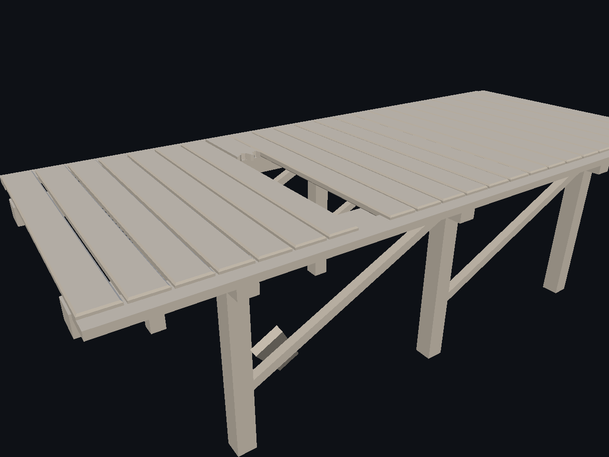
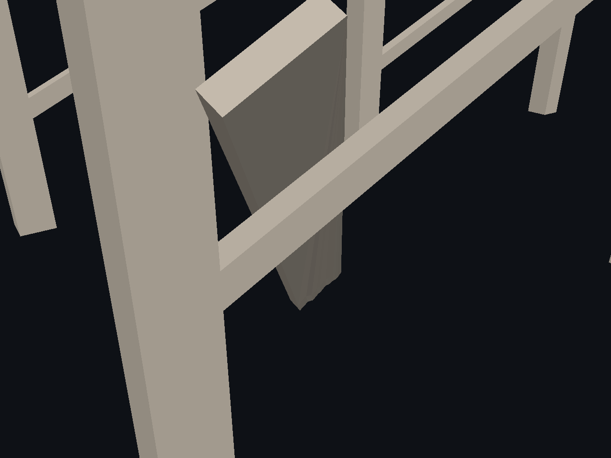

# Activación física del fragmento seleccionado

El Playground permite seleccionar un fragmento cerrado de un Part roto y activar sólo ese fragmento como cuerpo Jolt dinámico. El resto del ensamblaje es colisión estática. La simulación usa pasos fijos de 1/60 s; la vista transforma únicamente la geometría del fragmento y conserva los ID de triángulo y de región. Pausa y Reset no alteran la receta ni la malla fuente. El runtime Jolt se comparte con WebPhysics mientras ambos laboratorios están vivos.

## Verificación

- Build Release completo y **26/26 CTest PASS**. El nuevo fixture verifica activación, desplazamiento, geometría vecina inmóvil, topología semántica, Reset/replay idéntico y coexistencia con WebPhysics. El fragmento de tabla recorrió 1,3119 m en 120 pasos.
- Vulkan en NVIDIA GeForce RTX 3090, 1280×960: las tres capturas antes/después/detalle repitieron los mismos SHA-256 en una segunda ejecución. La posición final y los hashes de malla también coincidieron; sólo varió la medición de tiempo por paso. [Datos](fragment-physics-proof.json).
- Antes: 
- Después: 
- Detalle del contacto: 

## Límites

Se promueve un fragmento seleccionado a la vez. El proxy convexo se rechaza si excede los límites de vértices o un 35 % de diferencia de volumen, para evitar una colisión que rellene demasiado la forma real. El suelo es un proxy de laboratorio y no un cuerpo exportado. La interacción de los botones en la ventana normal aún no tiene prueba manual; la compilación, el fixture y la captura por la ruta de render sí pasaron. La rotura y el material de madera siguen con **Beauty PARCIAL**. El objetivo transversal de daño continúa **ACTIVE**.
