# Boca y dientes — 1/2

Secuencia de apertura/cierre y controles dentales del modelo axial. La prueba no garantiza contactos para claves editadas arbitrariamente.

[Página 1](page-1.md) · [Página 2](page-2.md)

[Todas las familias](../README.md)

### stage 0 ui

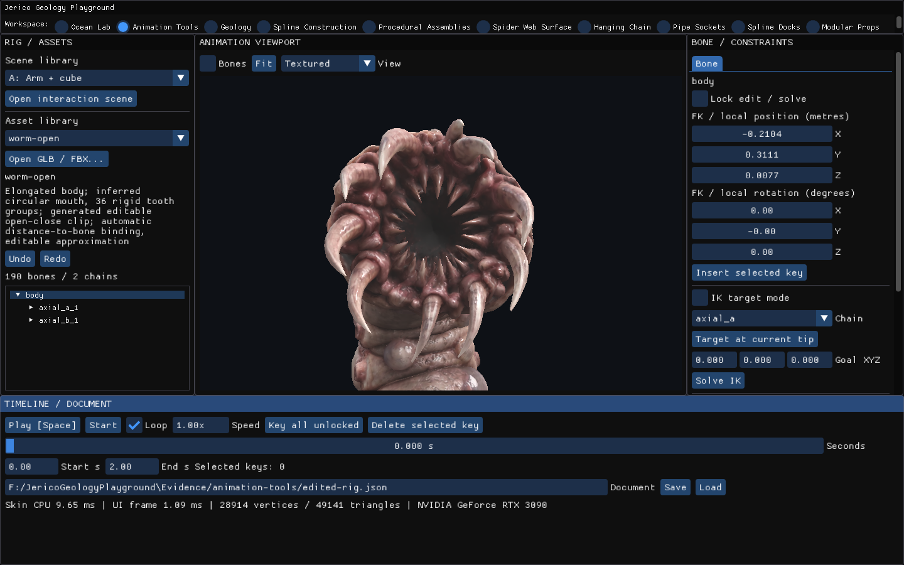

Fuente: `Evidence/animation-tools/resume-2026-11-03/mouth-contact-native/stage-0-ui.png`.

### stage 0 viewport

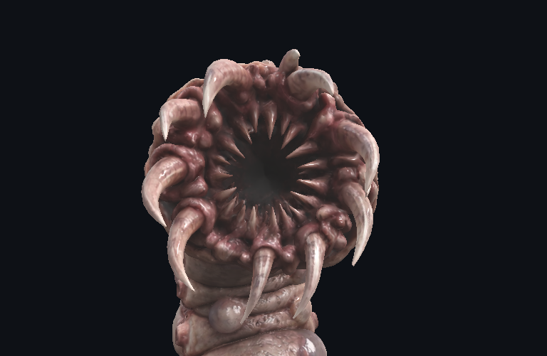

Fuente: `Evidence/animation-tools/resume-2026-11-03/mouth-contact-native/stage-0-viewport.png`.

### stage 1 ui

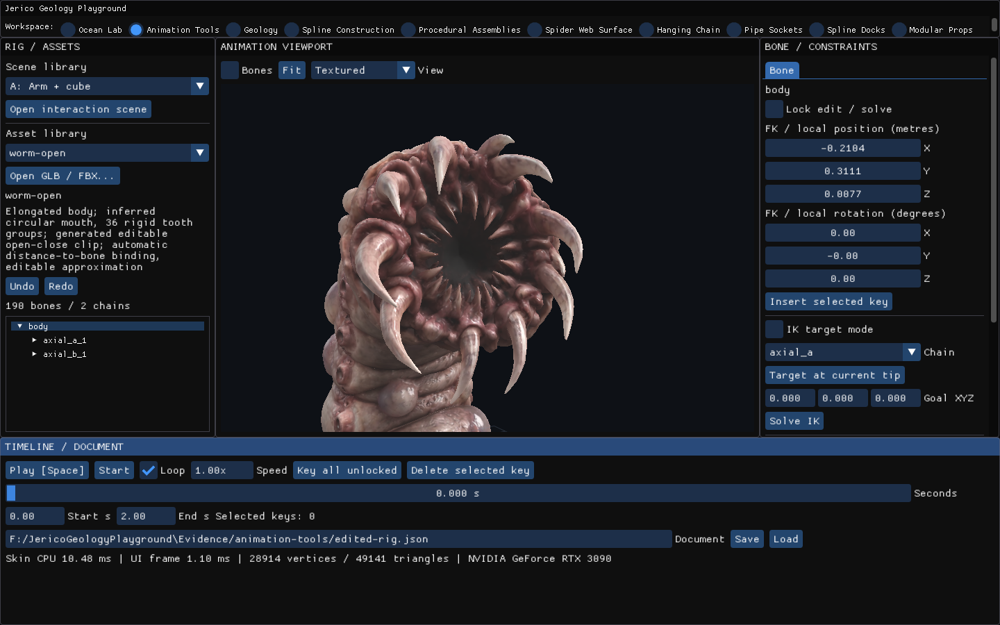

Fuente: `Evidence/animation-tools/resume-2026-11-03/mouth-contact-native/stage-1-ui.png`.

### stage 1 viewport

Fuente: `Evidence/animation-tools/resume-2026-11-03/mouth-contact-native/stage-1-viewport.png`.

### stage 2 ui

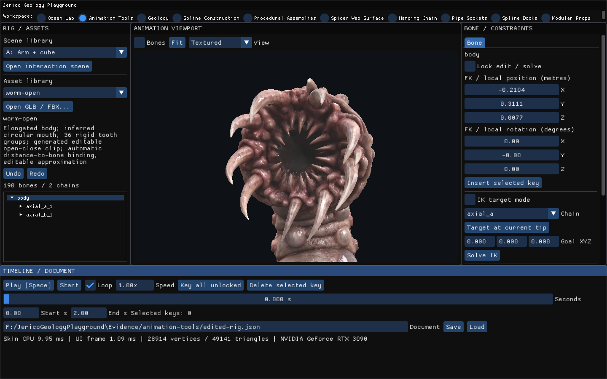

Fuente: `Evidence/animation-tools/resume-2026-11-03/mouth-contact-native/stage-2-ui.png`.

### stage 2 viewport

Fuente: `Evidence/animation-tools/resume-2026-11-03/mouth-contact-native/stage-2-viewport.png`.

### stage 3 ui

Fuente: `Evidence/animation-tools/resume-2026-11-03/mouth-contact-native/stage-3-ui.png`.

### stage 3 viewport

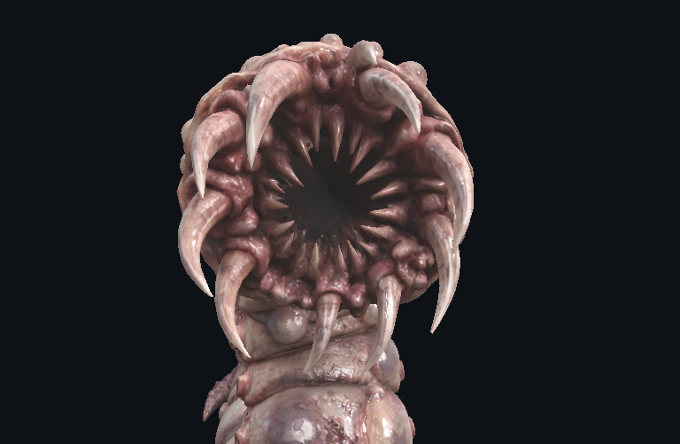

Fuente: `Evidence/animation-tools/resume-2026-11-03/mouth-contact-native/stage-3-viewport.png`.

### stage 4 ui

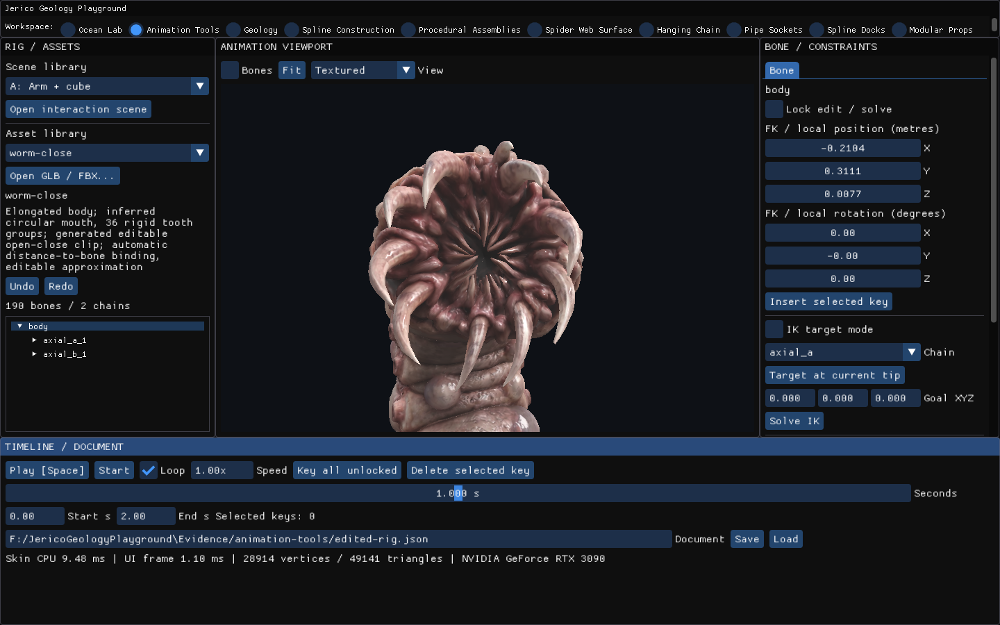

Fuente: `Evidence/animation-tools/resume-2026-11-03/mouth-contact-native/stage-4-ui.png`.

### stage 4 viewport

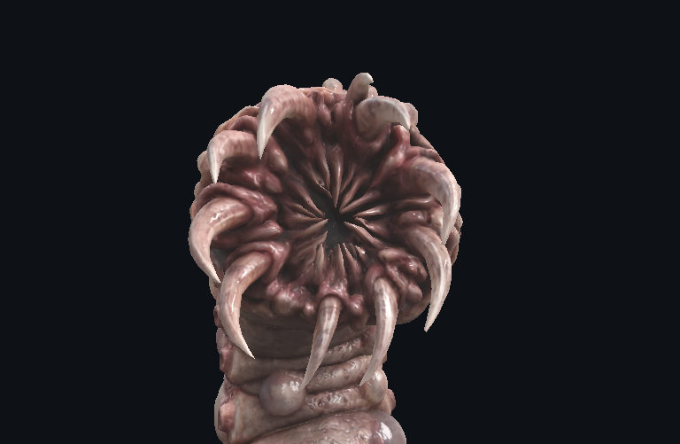

Fuente: `Evidence/animation-tools/resume-2026-11-03/mouth-contact-native/stage-4-viewport.png`.

### stage 5 ui

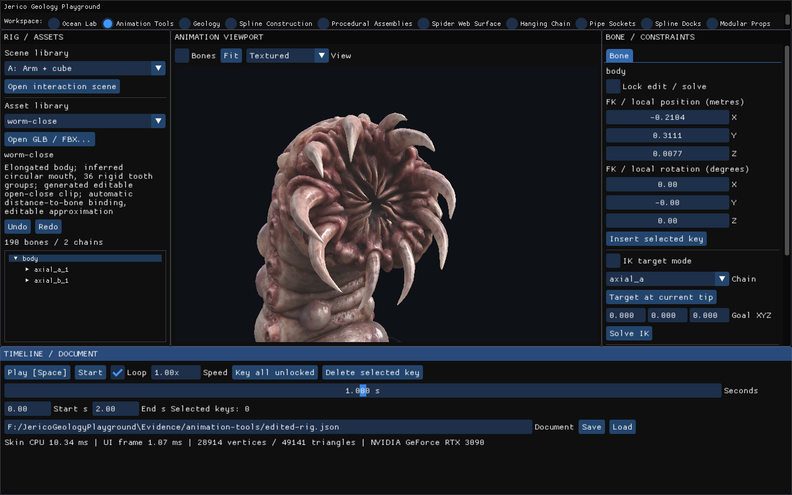

Fuente: `Evidence/animation-tools/resume-2026-11-03/mouth-contact-native/stage-5-ui.png`.

### stage 5 viewport

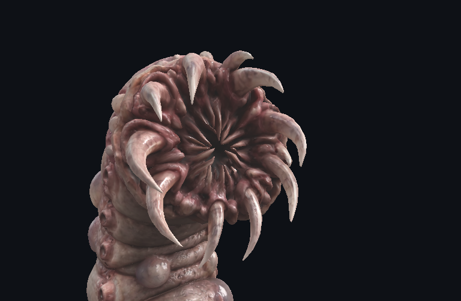

Fuente: `Evidence/animation-tools/resume-2026-11-03/mouth-contact-native/stage-5-viewport.png`.

### stage 6 ui

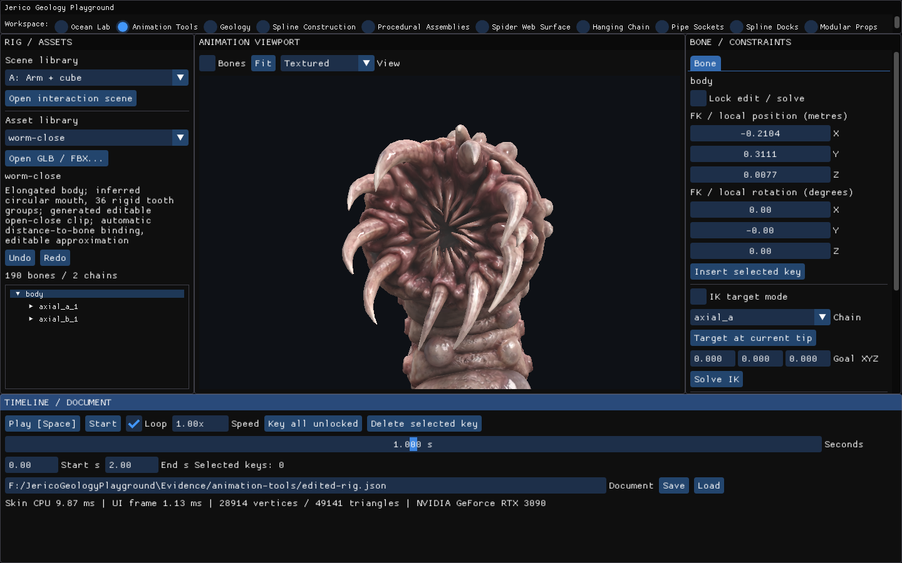

Fuente: `Evidence/animation-tools/resume-2026-11-03/mouth-contact-native/stage-6-ui.png`.

### stage 6 viewport

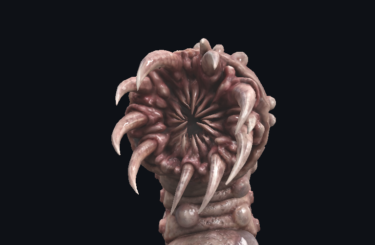

Fuente: `Evidence/animation-tools/resume-2026-11-03/mouth-contact-native/stage-6-viewport.png`.

### stage 7 ui

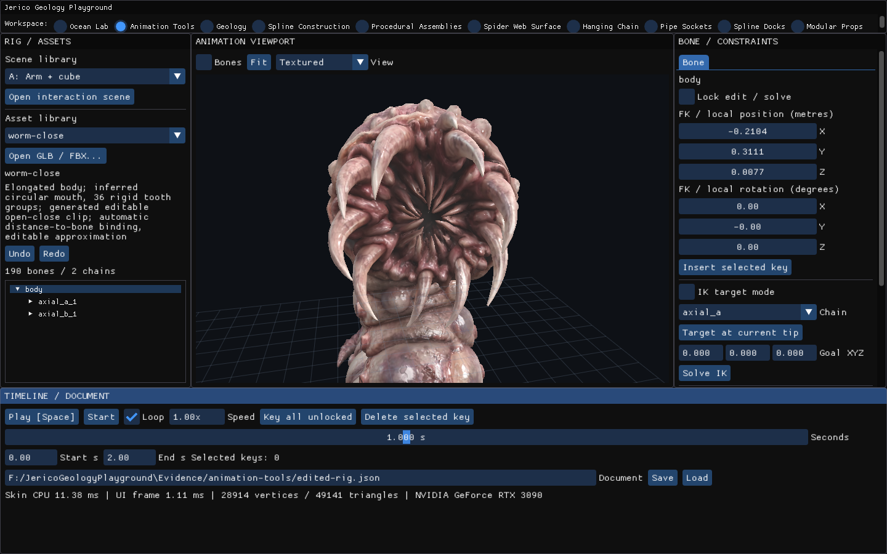

Fuente: `Evidence/animation-tools/resume-2026-11-03/mouth-contact-native/stage-7-ui.png`.

### stage 7 viewport

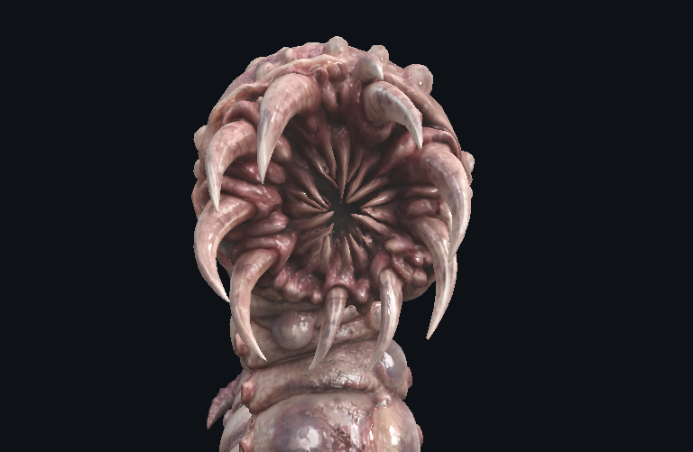

Fuente: `Evidence/animation-tools/resume-2026-11-03/mouth-contact-native/stage-7-viewport.png`.

### stage 8 ui

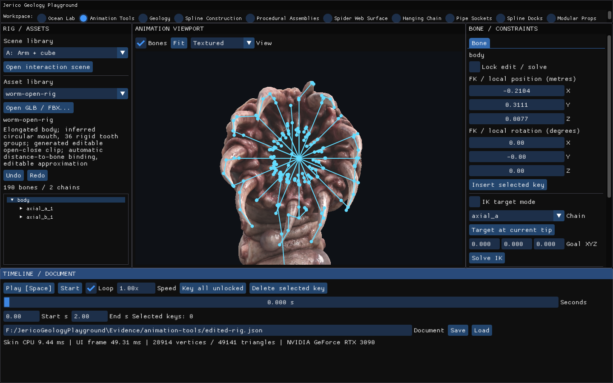

Fuente: `Evidence/animation-tools/resume-2026-11-03/mouth-contact-native/stage-8-ui.png`.

### stage 8 viewport

Fuente: `Evidence/animation-tools/resume-2026-11-03/mouth-contact-native/stage-8-viewport.png`.

### stage 9 ui

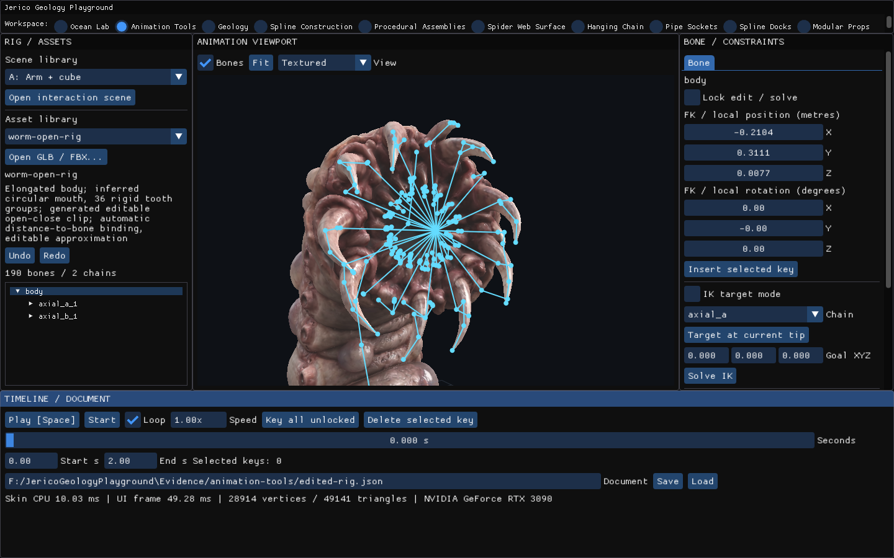

Fuente: `Evidence/animation-tools/resume-2026-11-03/mouth-contact-native/stage-9-ui.png`.

### stage 9 viewport

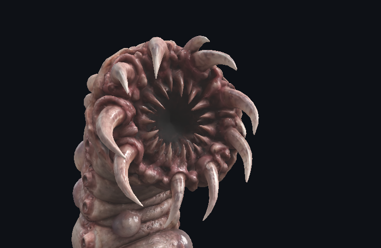

Fuente: `Evidence/animation-tools/resume-2026-11-03/mouth-contact-native/stage-9-viewport.png`.

### stage 10 ui

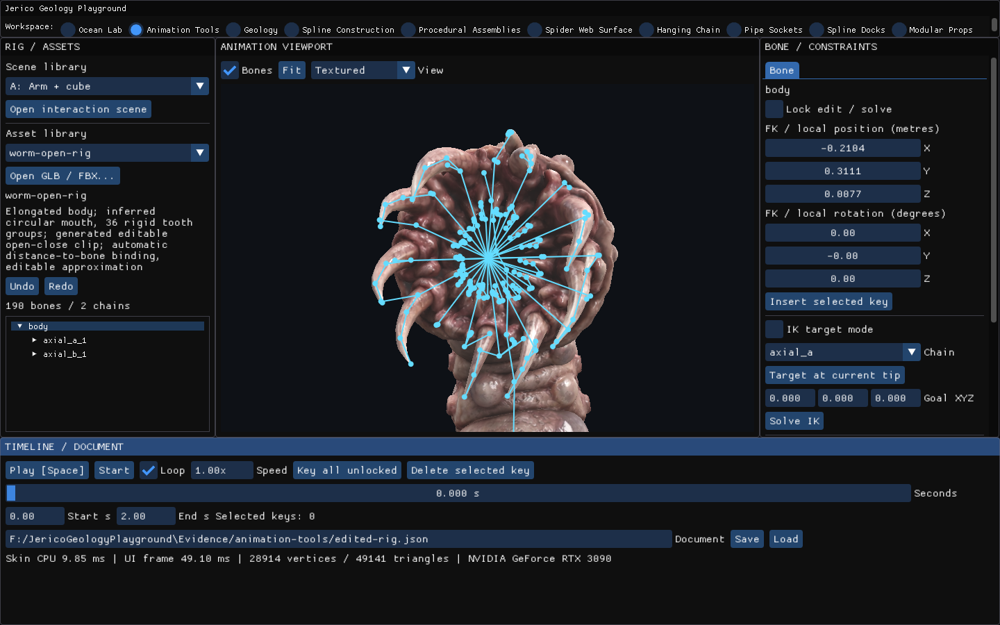

Fuente: `Evidence/animation-tools/resume-2026-11-03/mouth-contact-native/stage-10-ui.png`.

### stage 10 viewport

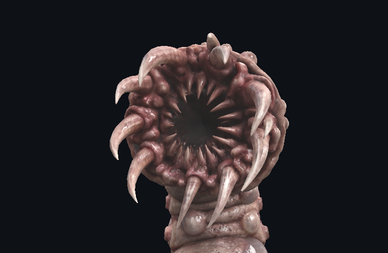

Fuente: `Evidence/animation-tools/resume-2026-11-03/mouth-contact-native/stage-10-viewport.png`.

### stage 11 ui

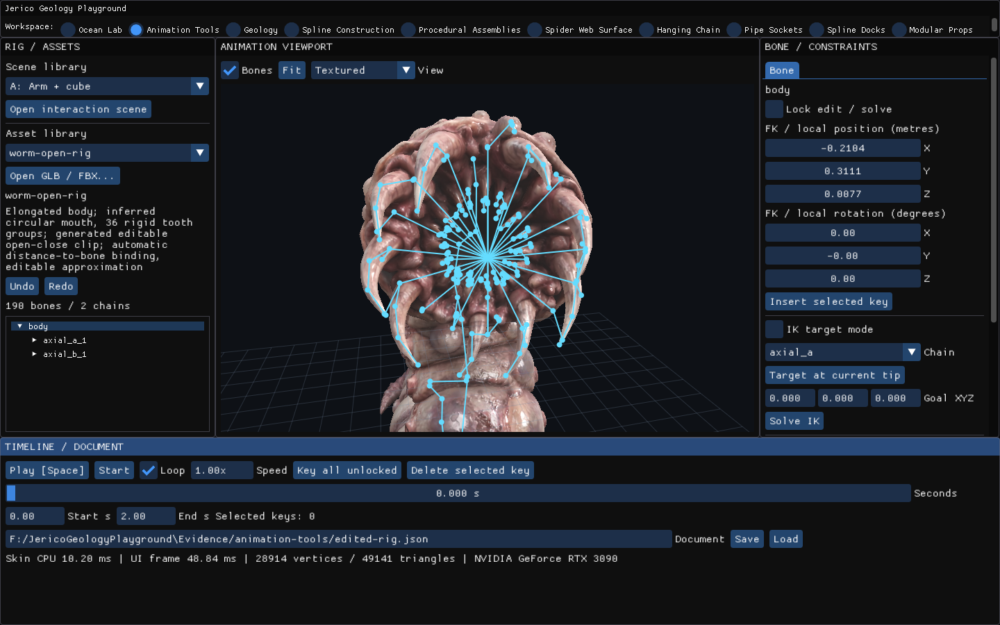

Fuente: `Evidence/animation-tools/resume-2026-11-03/mouth-contact-native/stage-11-ui.png`.

### stage 11 viewport

Fuente: `Evidence/animation-tools/resume-2026-11-03/mouth-contact-native/stage-11-viewport.png`.
