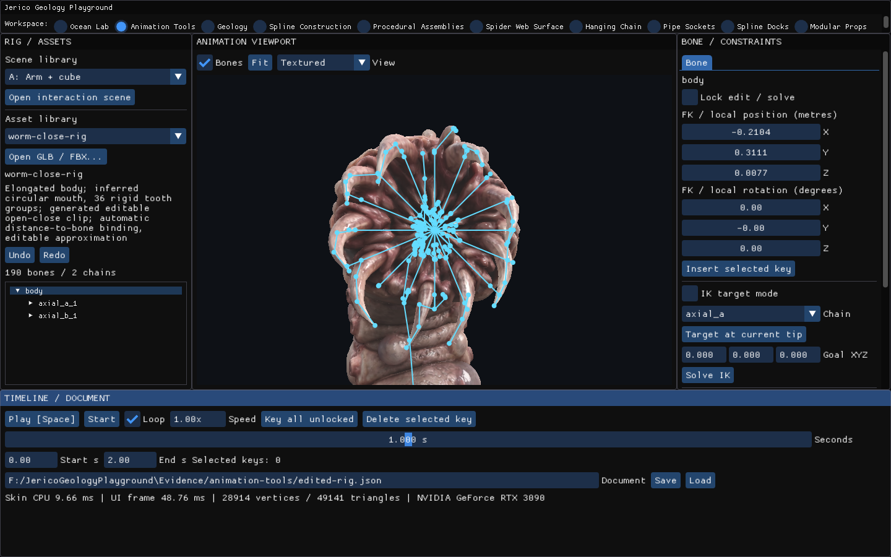
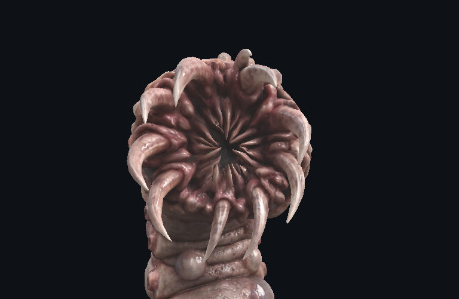
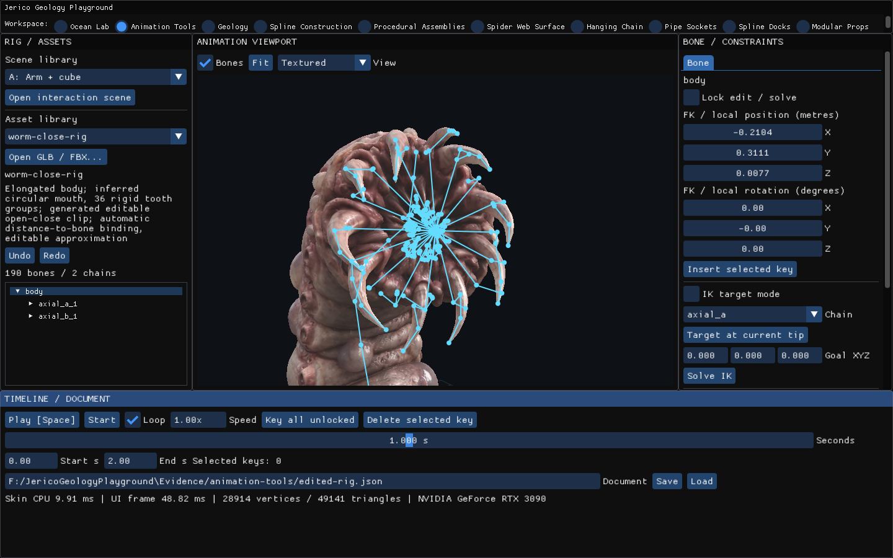
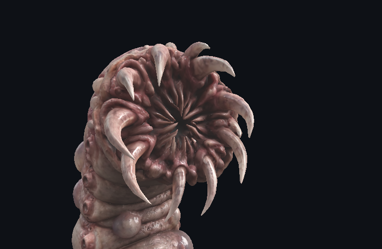
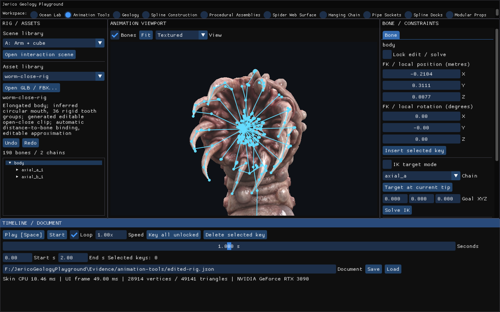
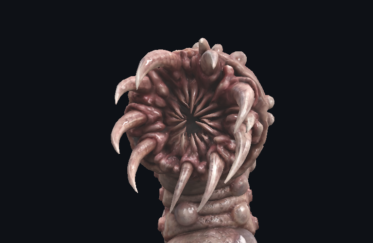
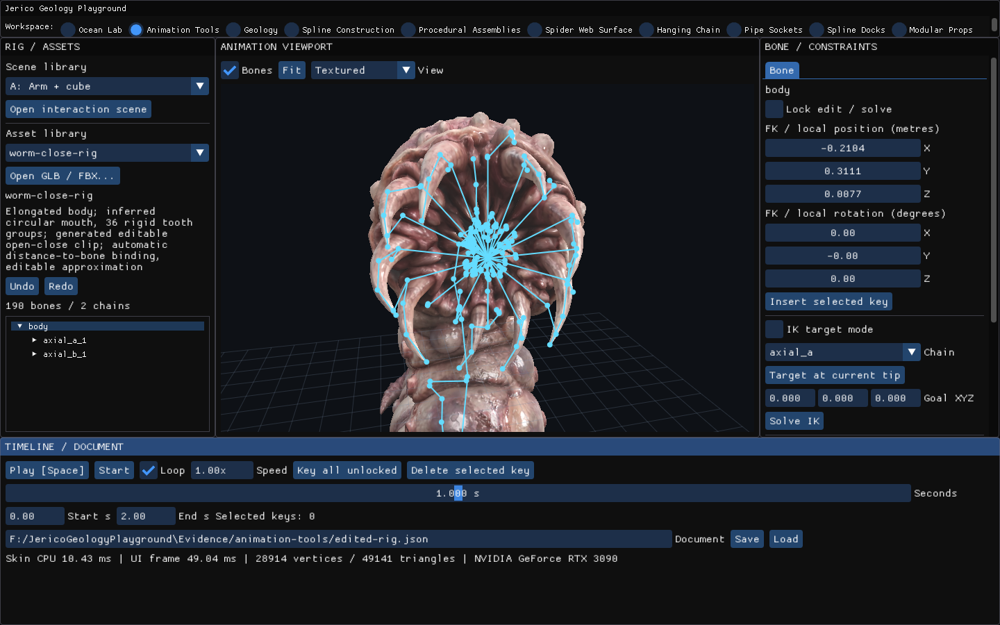
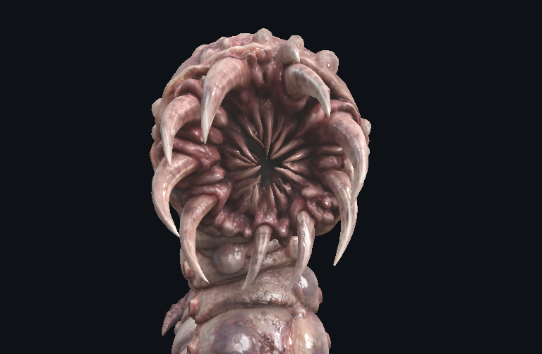

# Boca y dientes — 2/2

Secuencia de apertura/cierre y controles dentales del modelo axial. La prueba no garantiza contactos para claves editadas arbitrariamente.

[Página 1](page-1.md) · [Página 2](page-2.md)

[Todas las familias](../README.md)

### stage 12 ui

Fuente: `Evidence/animation-tools/resume-2026-11-03/mouth-contact-native/stage-12-ui.png`.

### stage 12 viewport

Fuente: `Evidence/animation-tools/resume-2026-11-03/mouth-contact-native/stage-12-viewport.png`.

### stage 13 ui

Fuente: `Evidence/animation-tools/resume-2026-11-03/mouth-contact-native/stage-13-ui.png`.

### stage 13 viewport

Fuente: `Evidence/animation-tools/resume-2026-11-03/mouth-contact-native/stage-13-viewport.png`.

### stage 14 ui

Fuente: `Evidence/animation-tools/resume-2026-11-03/mouth-contact-native/stage-14-ui.png`.

### stage 14 viewport

Fuente: `Evidence/animation-tools/resume-2026-11-03/mouth-contact-native/stage-14-viewport.png`.

### stage 15 ui

Fuente: `Evidence/animation-tools/resume-2026-11-03/mouth-contact-native/stage-15-ui.png`.

### stage 15 viewport

Fuente: `Evidence/animation-tools/resume-2026-11-03/mouth-contact-native/stage-15-viewport.png`.
