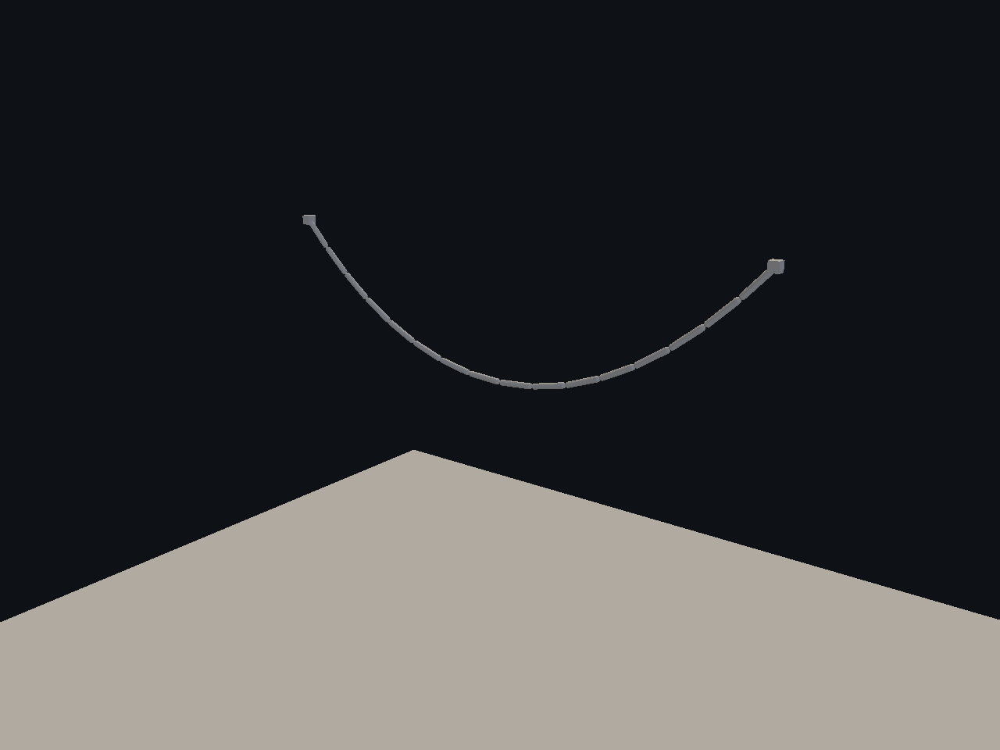
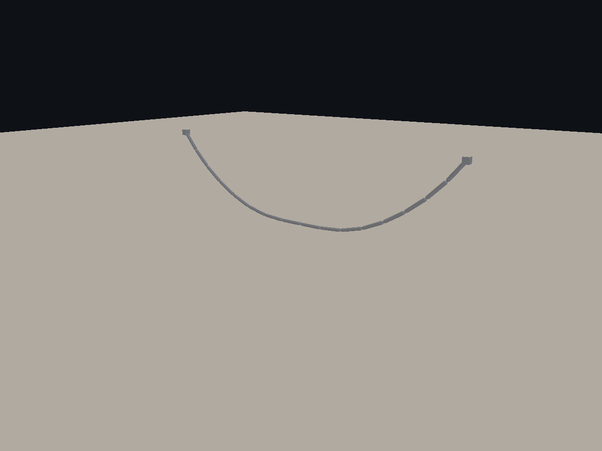
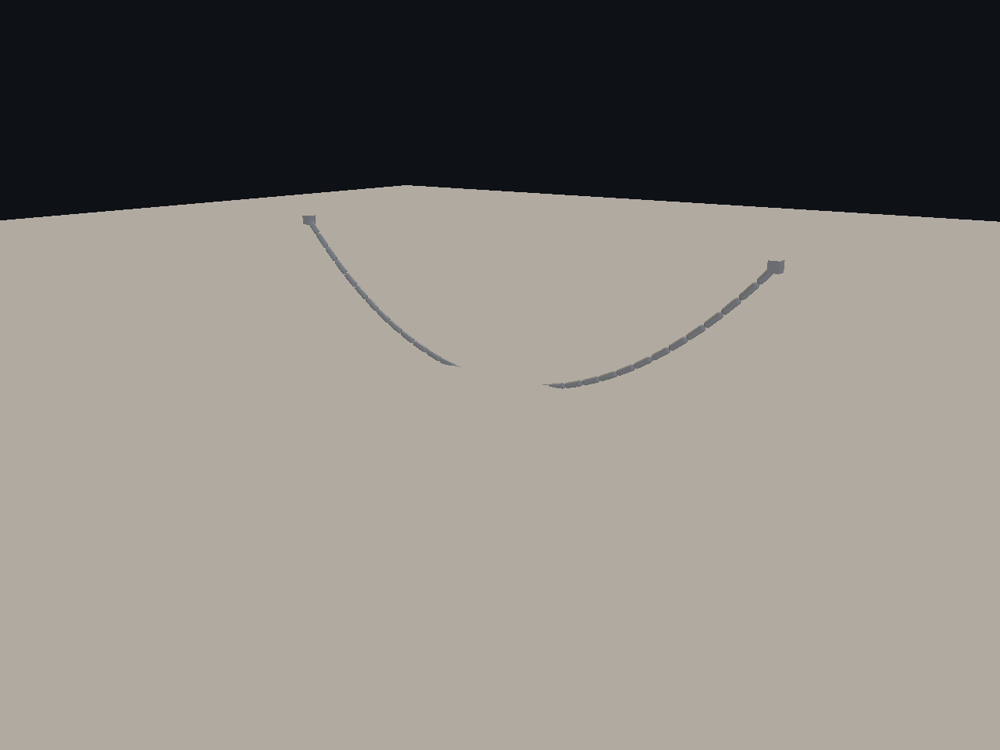
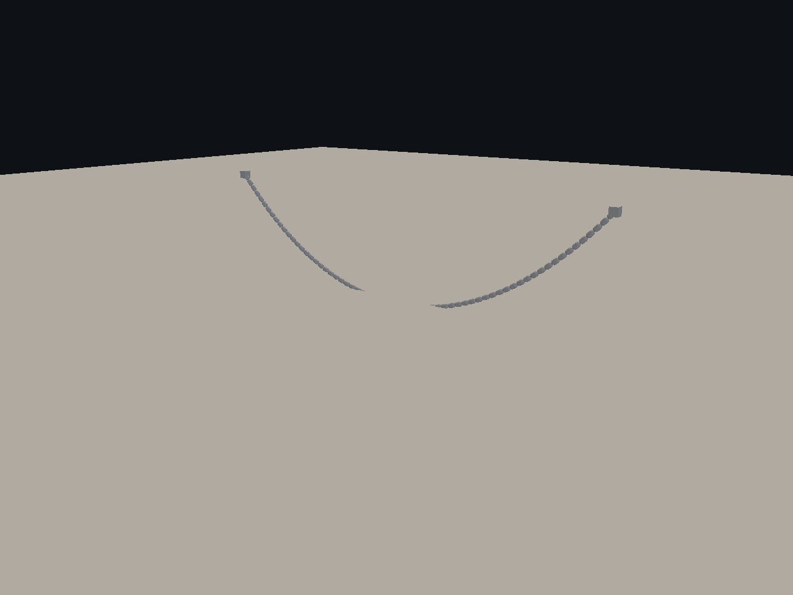
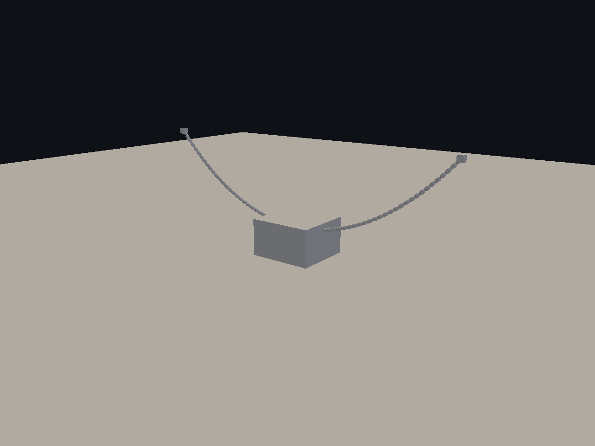
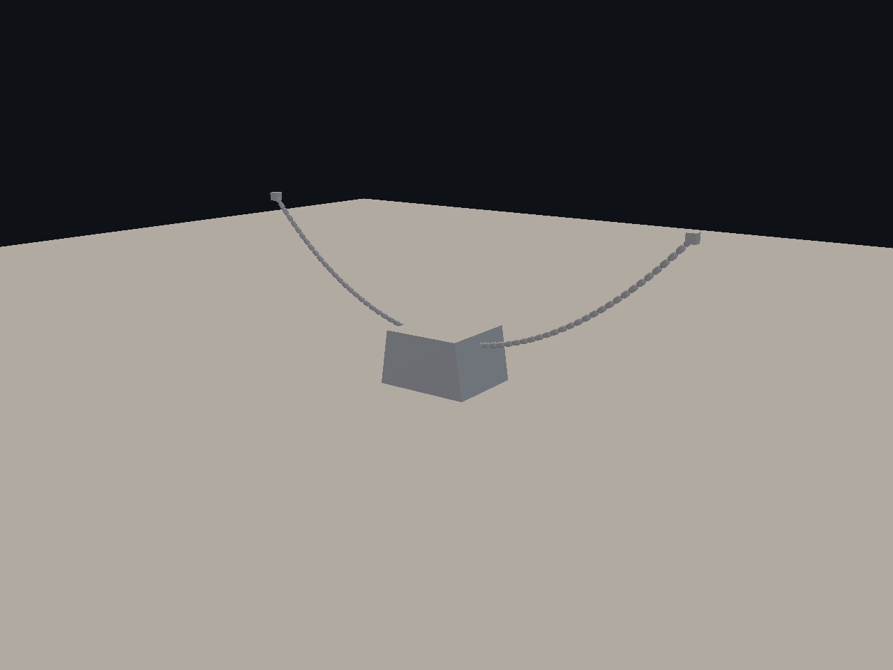

# Cadenas físicas y contactos — 1/1

Comparaciones antes/después y vistas de contactos de cadenas. Sólo se incluye la tanda principal, sin duplicar los ensayos archivados en subcarpetas.

[Página 1](page-1.md)

[Todas las familias](../README.md)

### 16 after

Fuente: `Evidence/2026-10-03-chain-edge/16-after.png`.

### 16 before

Fuente: `Evidence/2026-10-03-chain-edge/16-before.png`.

### 16 contact 0 before

Fuente: `Evidence/2026-10-03-chain-edge/16-contact-0-before.png`.

### 16 contact 0

Fuente: `Evidence/2026-10-03-chain-edge/16-contact-0.png`.

### 16 contact 1 before

Fuente: `Evidence/2026-10-03-chain-edge/16-contact-1-before.png`.

### 16 contact 1

Fuente: `Evidence/2026-10-03-chain-edge/16-contact-1.png`.

### 16 contact 2 before

Fuente: `Evidence/2026-10-03-chain-edge/16-contact-2-before.png`.

### 16 contact 2

Fuente: `Evidence/2026-10-03-chain-edge/16-contact-2.png`.

### 32 after

Fuente: `Evidence/2026-10-03-chain-edge/32-after.png`.

### 32 before

Fuente: `Evidence/2026-10-03-chain-edge/32-before.png`.

### 32 contact 0 before

Fuente: `Evidence/2026-10-03-chain-edge/32-contact-0-before.png`.

### 32 contact 0

Fuente: `Evidence/2026-10-03-chain-edge/32-contact-0.png`.

### 32 contact 1 before

Fuente: `Evidence/2026-10-03-chain-edge/32-contact-1-before.png`.

### 32 contact 1

Fuente: `Evidence/2026-10-03-chain-edge/32-contact-1.png`.

### 32 contact 2 before

Fuente: `Evidence/2026-10-03-chain-edge/32-contact-2-before.png`.

### 32 contact 2

Fuente: `Evidence/2026-10-03-chain-edge/32-contact-2.png`.

### 64 after

Fuente: `Evidence/2026-10-03-chain-edge/64-after.png`.

### 64 before

Fuente: `Evidence/2026-10-03-chain-edge/64-before.png`.

### 64 contact 0 before

Fuente: `Evidence/2026-10-03-chain-edge/64-contact-0-before.png`.

### 64 contact 0

Fuente: `Evidence/2026-10-03-chain-edge/64-contact-0.png`.

### 64 contact 1 before

Fuente: `Evidence/2026-10-03-chain-edge/64-contact-1-before.png`.

### 64 contact 1

Fuente: `Evidence/2026-10-03-chain-edge/64-contact-1.png`.

### 64 contact 2 before

Fuente: `Evidence/2026-10-03-chain-edge/64-contact-2-before.png`.

### 64 contact 2

Fuente: `Evidence/2026-10-03-chain-edge/64-contact-2.png`.
