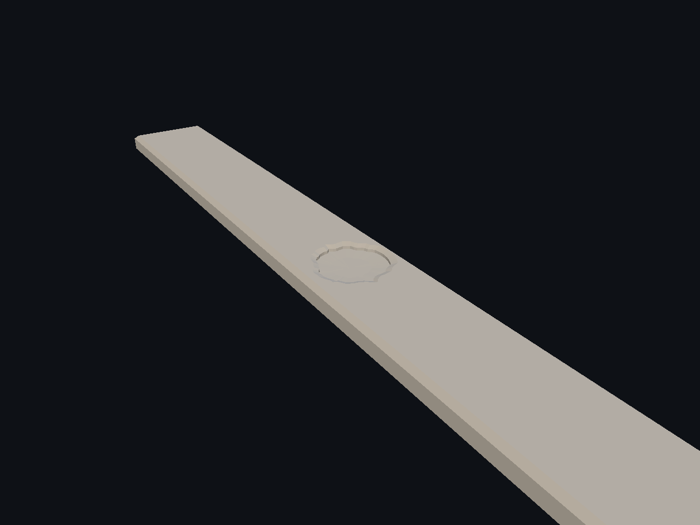
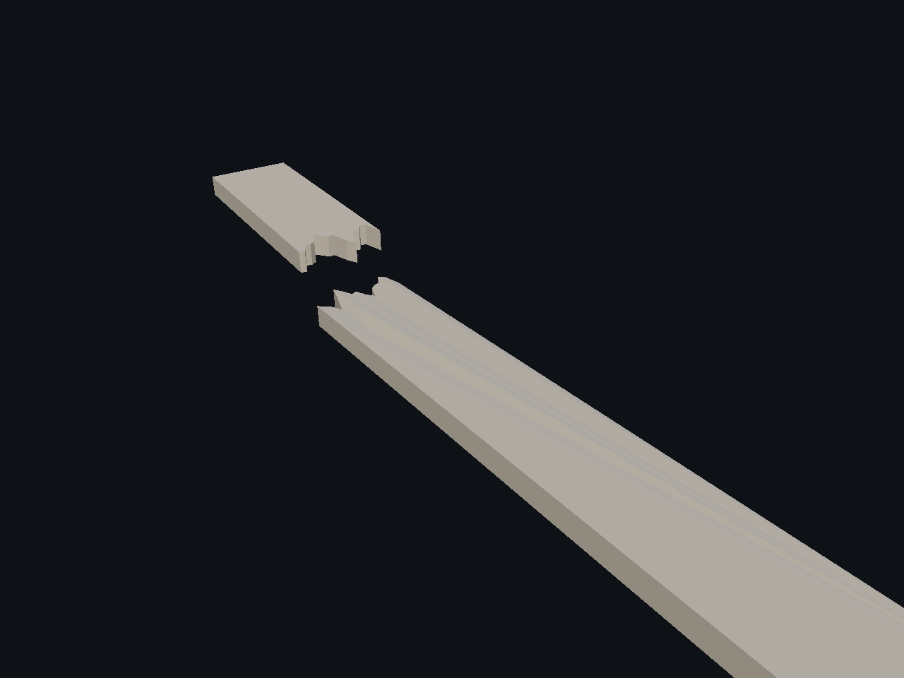
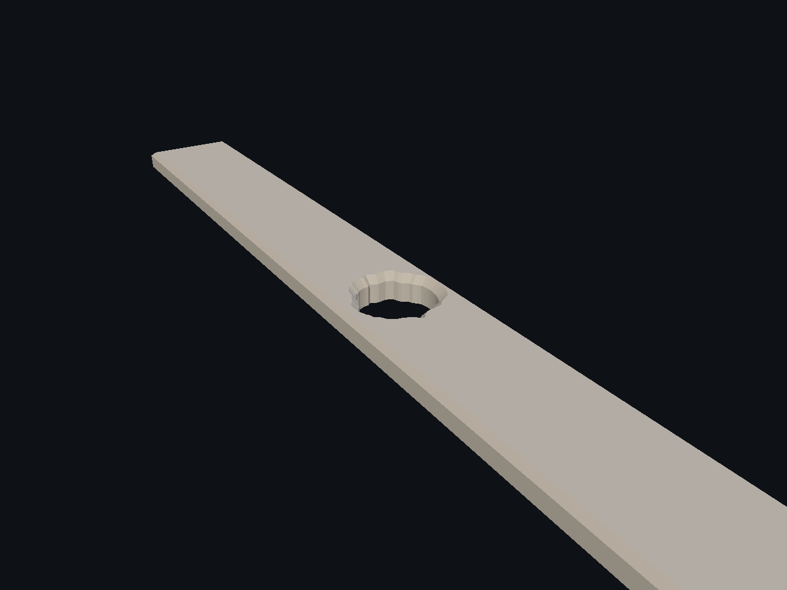
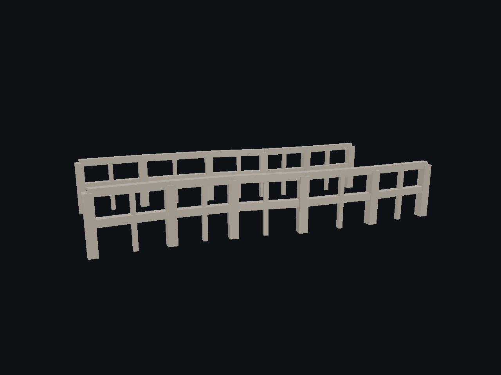
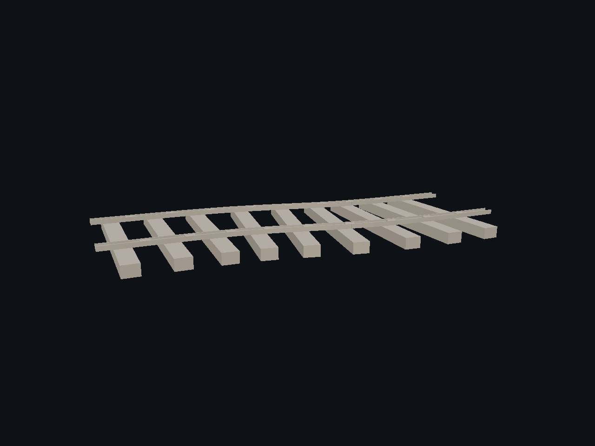
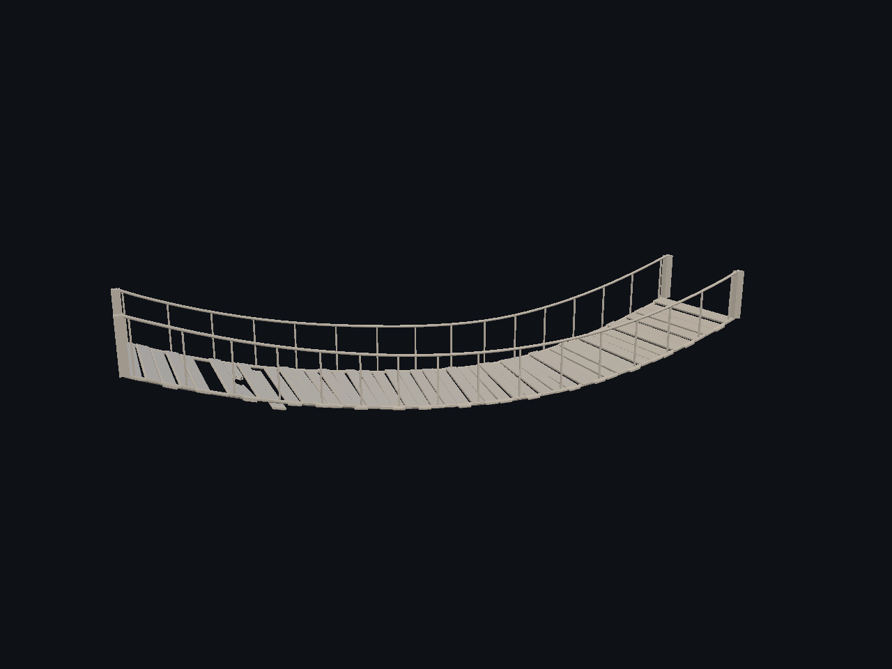
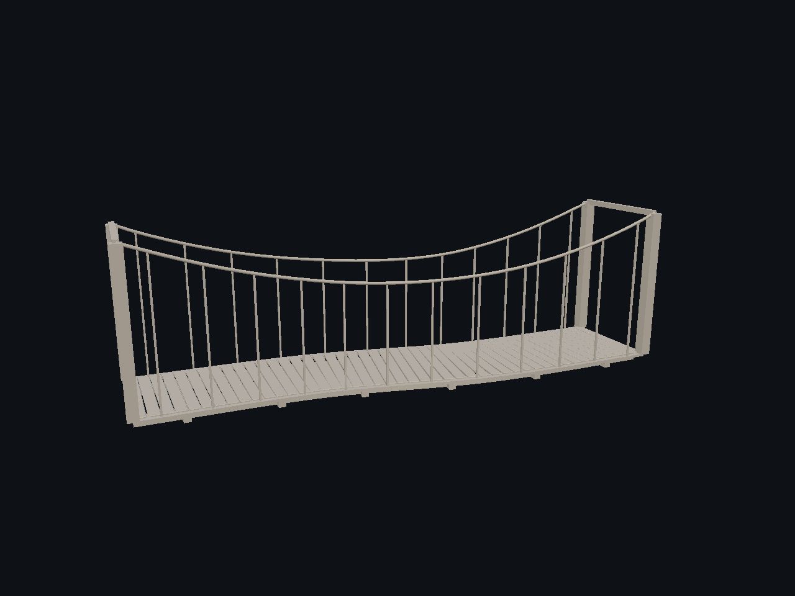
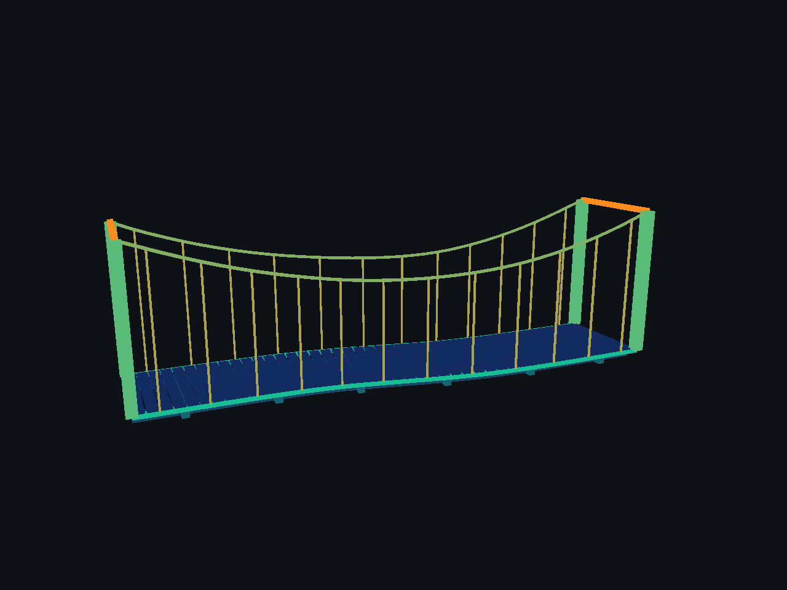
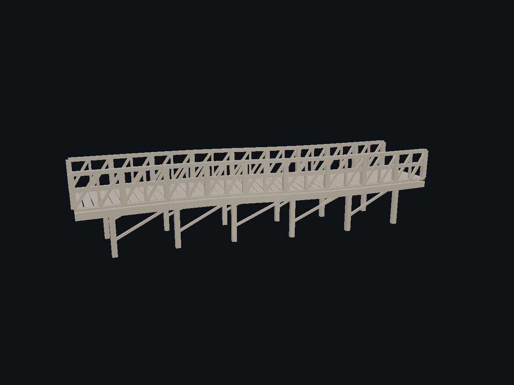
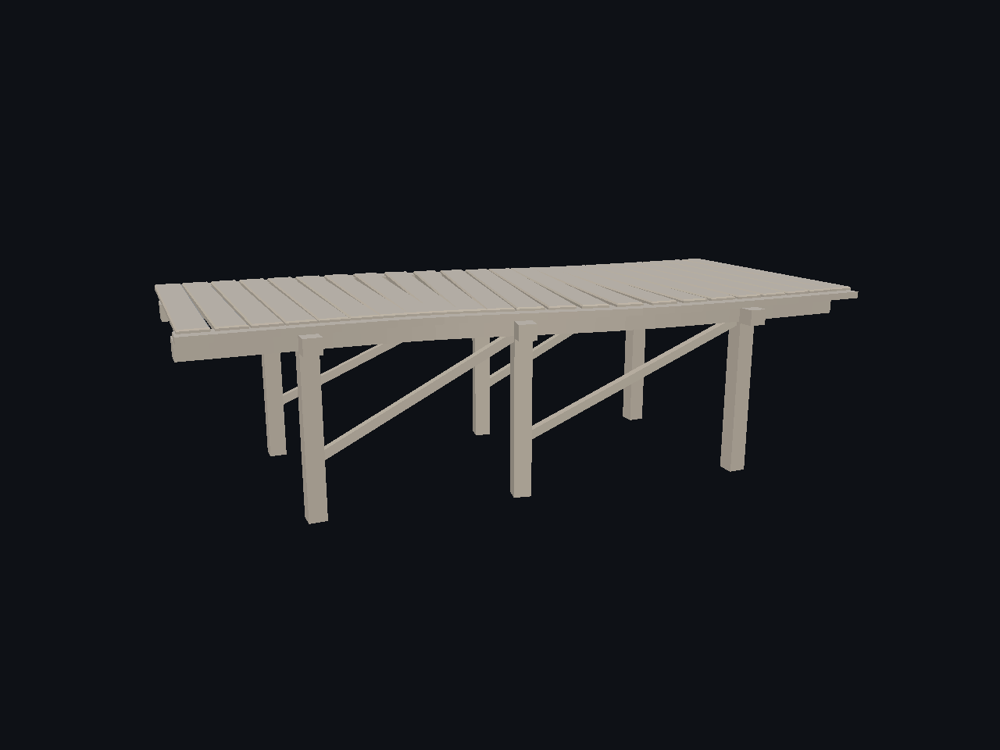

# Damage: cavidades, grietas y roturas — 2/5

Capturas históricas del daño compartido sobre paneles, rocas y estructuras. El recorrido actual del cubo está en la [página 3](page-3.md); su calidad visual sigue parcial. Voronoi se estudia sobre rocas.

[Página 1](page-1.md) · [Página 2](page-2.md) · [Página 3](page-3.md) · [Página 4](page-4.md) · [Página 5](page-5.md)

[Todas las familias](../README.md)

### plank dent

Fuente: `Evidence/2026-09-27-universal-damage-candidate/plank-dent.png`.

### plank fracture isolated

Fuente: `Evidence/2026-09-27-universal-damage-candidate/plank-fracture-isolated.png`.

### plank through hole

Fuente: `Evidence/2026-09-27-universal-damage-candidate/plank-through-hole.png`.

### railing

Fuente: `Evidence/2026-09-27-universal-damage-candidate/railing.png`.

### railway

Fuente: `Evidence/2026-09-27-universal-damage-candidate/railway.png`.

### rope manual damage

Fuente: `Evidence/2026-09-27-universal-damage-candidate/rope-manual-damage.png`.

### rope plank bridge

Fuente: `Evidence/2026-09-27-universal-damage-candidate/rope-plank-bridge.png`.

### suspension bridge

Fuente: `Evidence/2026-09-27-universal-damage-candidate/suspension-bridge.png`.

### suspension hanger debug

Fuente: `Evidence/2026-09-27-universal-damage-candidate/suspension-hanger-debug.png`.

### truss howe

Fuente: `Evidence/2026-09-27-universal-damage-candidate/truss-howe.png`.

### truss pratt

Fuente: `Evidence/2026-09-27-universal-damage-candidate/truss-pratt.png`.

### truss warren

Fuente: `Evidence/2026-09-27-universal-damage-candidate/truss-warren.png`.

### wooden pier

Fuente: `Evidence/2026-09-27-universal-damage-candidate/wooden-pier.png`.
