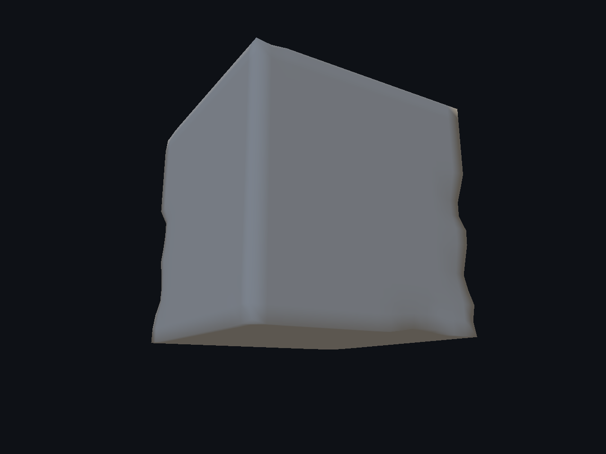
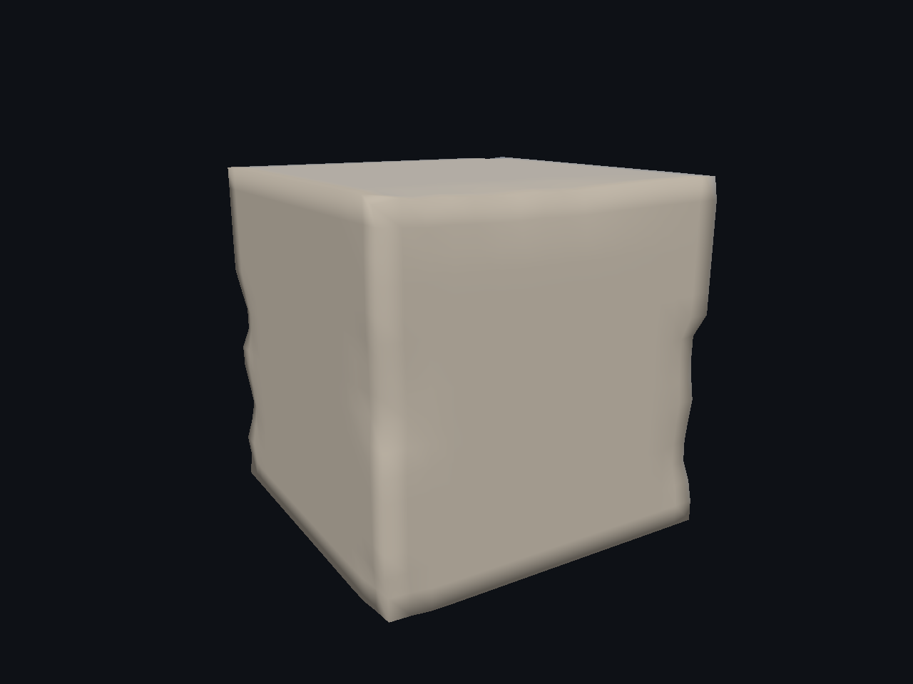
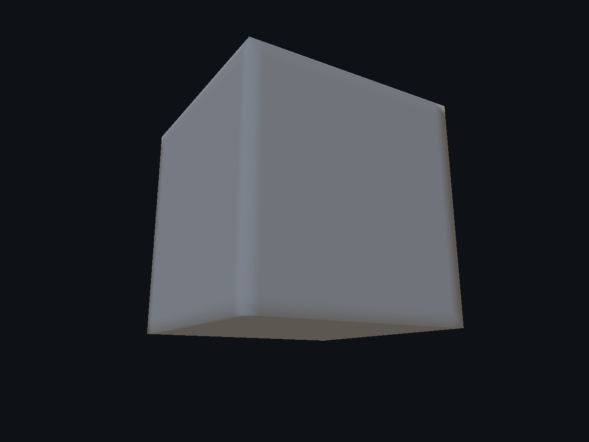
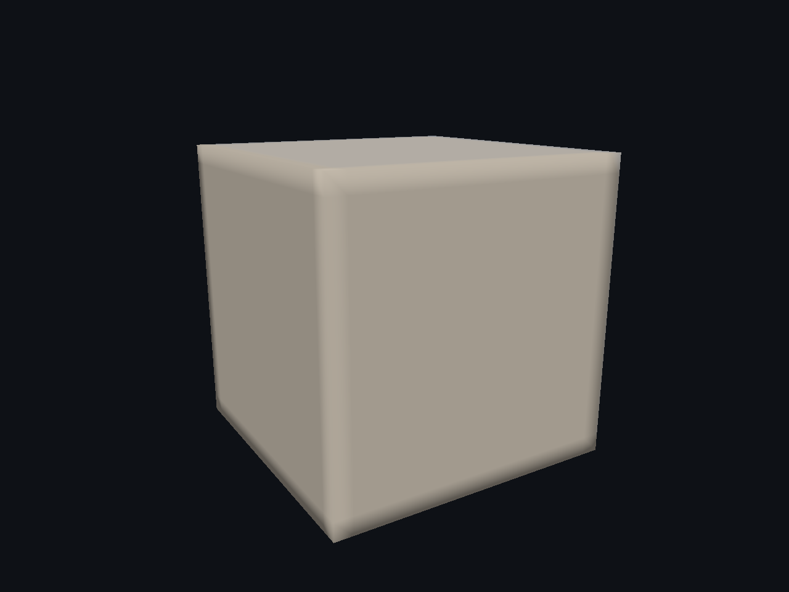

# Damage — 5/7

Nuevo EdgeChips: cortes geométricos, caras interiores e IDs reproducibles sobre cubos de 8 y 1538 vértices. Cámara idéntica antes/después/off. Estado visual parcial: el cubo de 8 vértices muestra sombreado dependiente de la triangulación y el perfil de los cortes todavía parece un cráter radial. Se conserva esta evidencia; no es aceptación Beauty ni prueba de autoría interactiva del modo nuevo.

[Página 1](page-1.md) · [Página 2](page-2.md) · [Página 3](page-3.md) · [Página 4](page-4.md) · [Página 5](page-5.md) · [Página 6](page-6.md) · [Página 7](page-7.md)

[Todas las familias](../README.md)

[Registro de ejecución](edge-chips-2026-11-04/execution.json).

### cube1538 erosion back

Fuente: `Evidence/mesh-modifiers-2026-11-04/chipping-native-2/cube1538-erosion-back.png`.

### cube1538 erosion detail

Fuente: `Evidence/mesh-modifiers-2026-11-04/chipping-native-2/cube1538-erosion-detail.png`.

### cube1538 erosion front

Fuente: `Evidence/mesh-modifiers-2026-11-04/chipping-native-2/cube1538-erosion-front.png`.

### cube1538 off back

Fuente: `Evidence/mesh-modifiers-2026-11-04/chipping-native-2/cube1538-off-back.png`.

### cube1538 off detail

Fuente: `Evidence/mesh-modifiers-2026-11-04/chipping-native-2/cube1538-off-detail.png`.

### cube1538 off front

Fuente: `Evidence/mesh-modifiers-2026-11-04/chipping-native-2/cube1538-off-front.png`.
