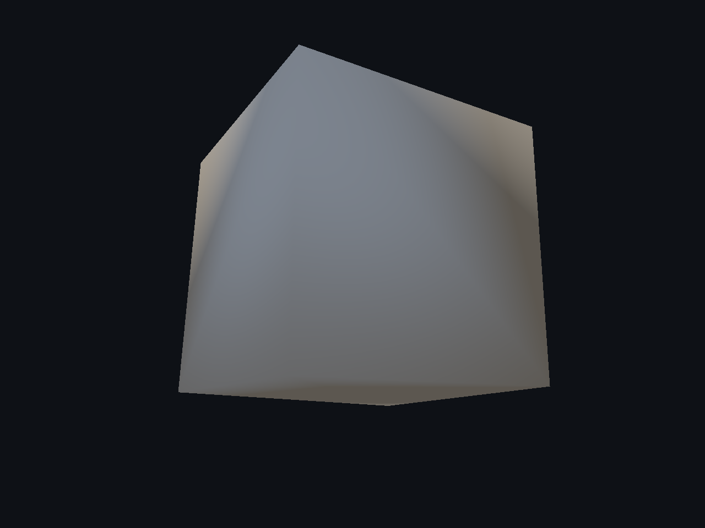
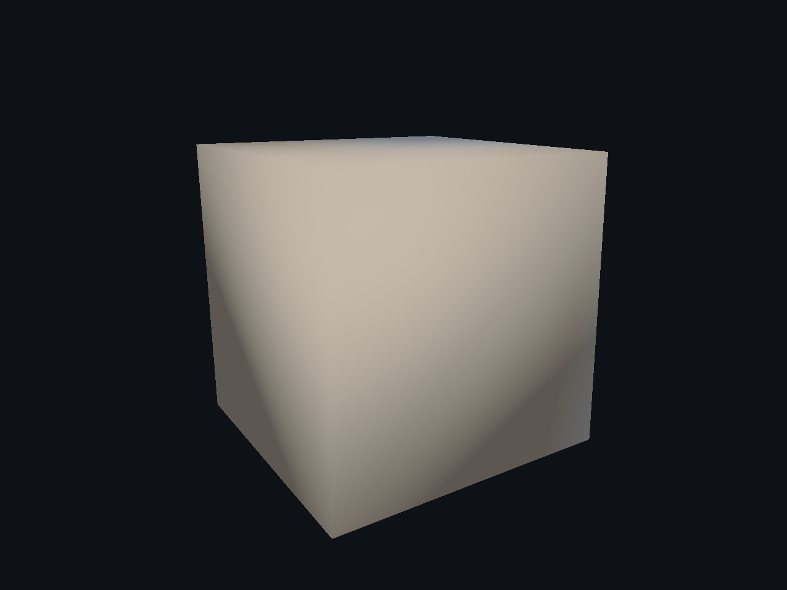
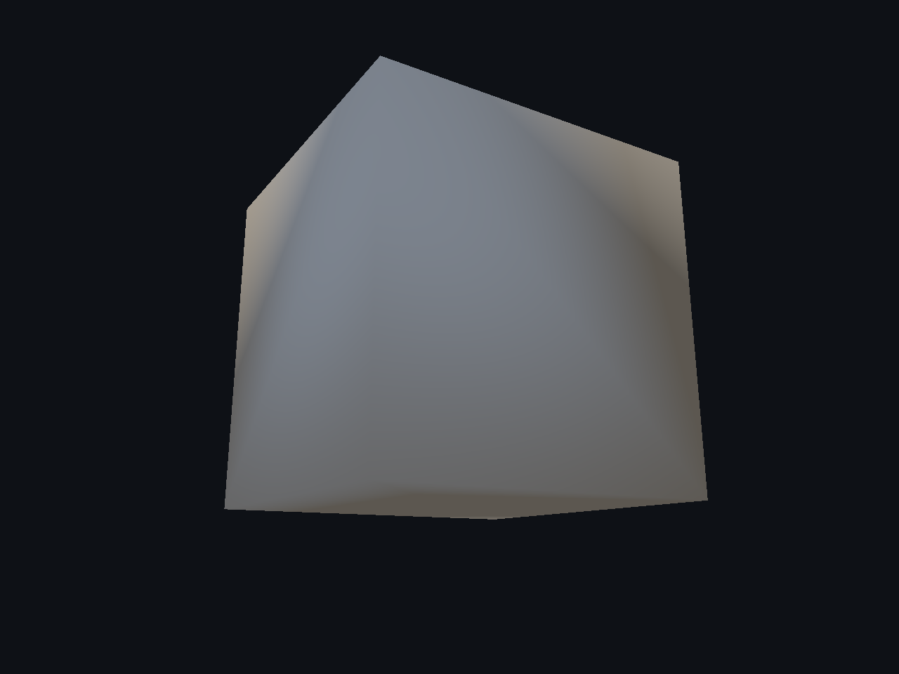
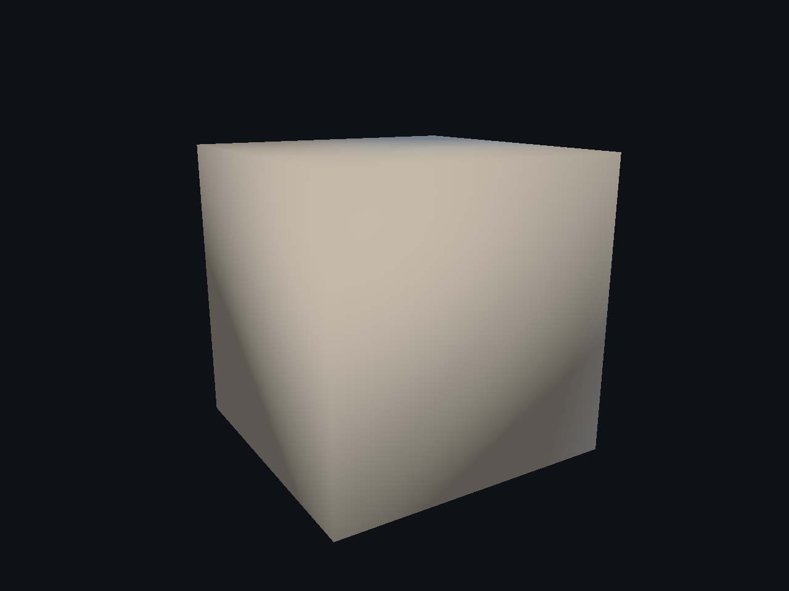

# Damage — 7/7

Corrección de normales comprobada en la aplicación: las caras exteriores del cubo simple conservan su sombreado plano. Geometría idéntica al candidato anterior; error angular exterior menor que 0,000001 grados, cuatro suites PASS y 30 capturas nativas con 343 inputs sin deriva. La forma radial de algunos cortes y el recorrido interactivo del modo nuevo siguen pendientes; no se declara terminada la calidad visual.

[Página 1](page-1.md) · [Página 2](page-2.md) · [Página 3](page-3.md) · [Página 4](page-4.md) · [Página 5](page-5.md) · [Página 6](page-6.md) · [Página 7](page-7.md)

[Todas las familias](../README.md)

[Ejecución y binario](edge-chips-normals-2026-11-04/execution.json) · [Comparación numérica](edge-chips-normals-2026-11-04/normal-comparison.json).

### cube8 erosion back

### cube8 erosion detail

### cube8 erosion front

### cube8 off back

### cube8 off detail

### cube8 off front

