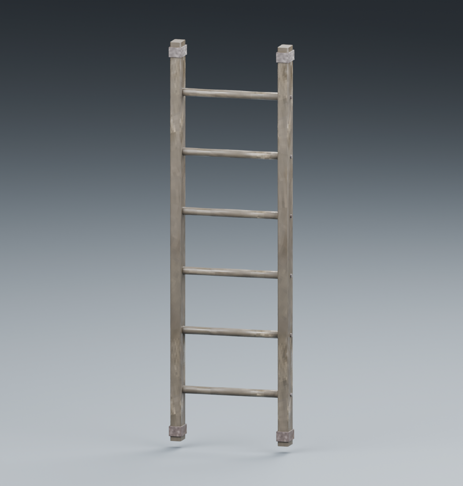
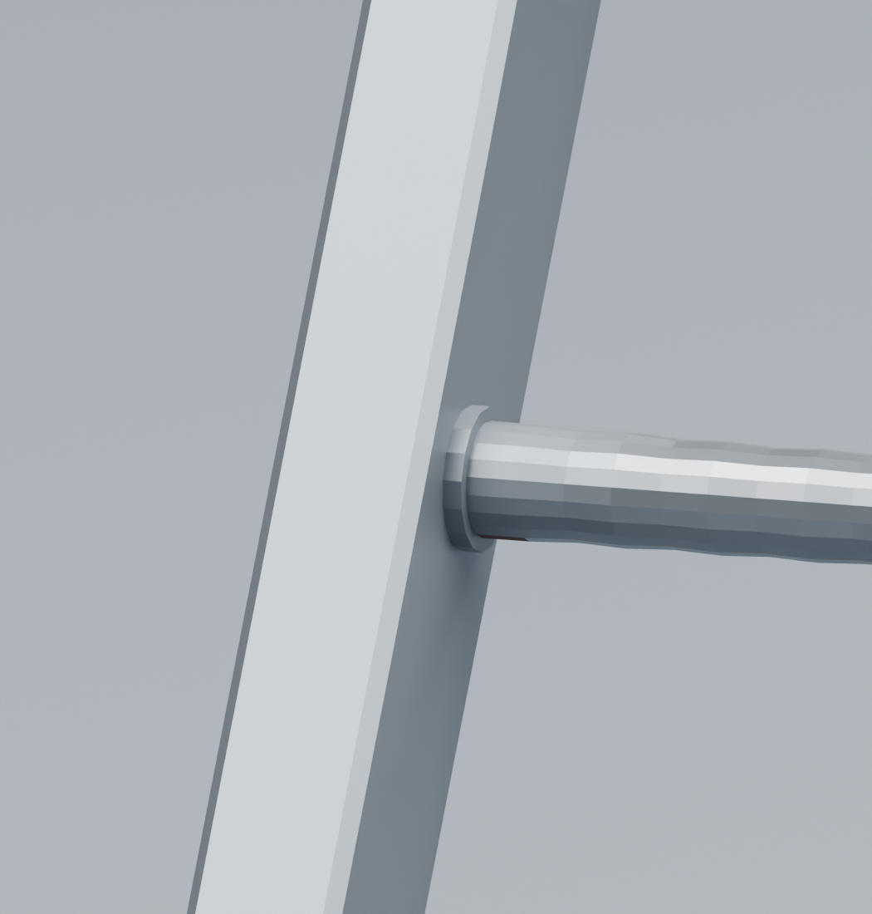
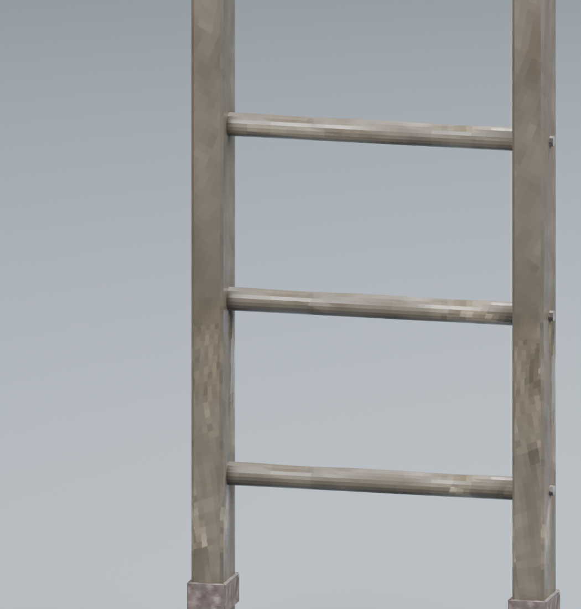
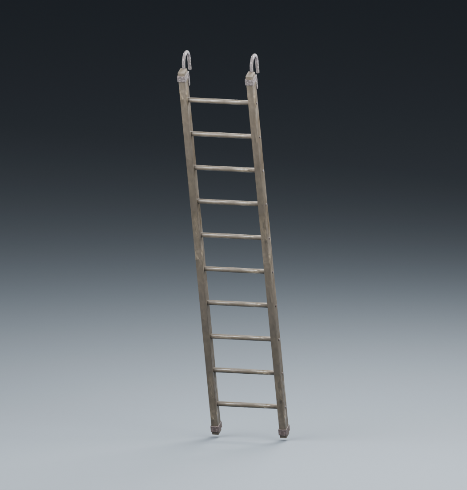
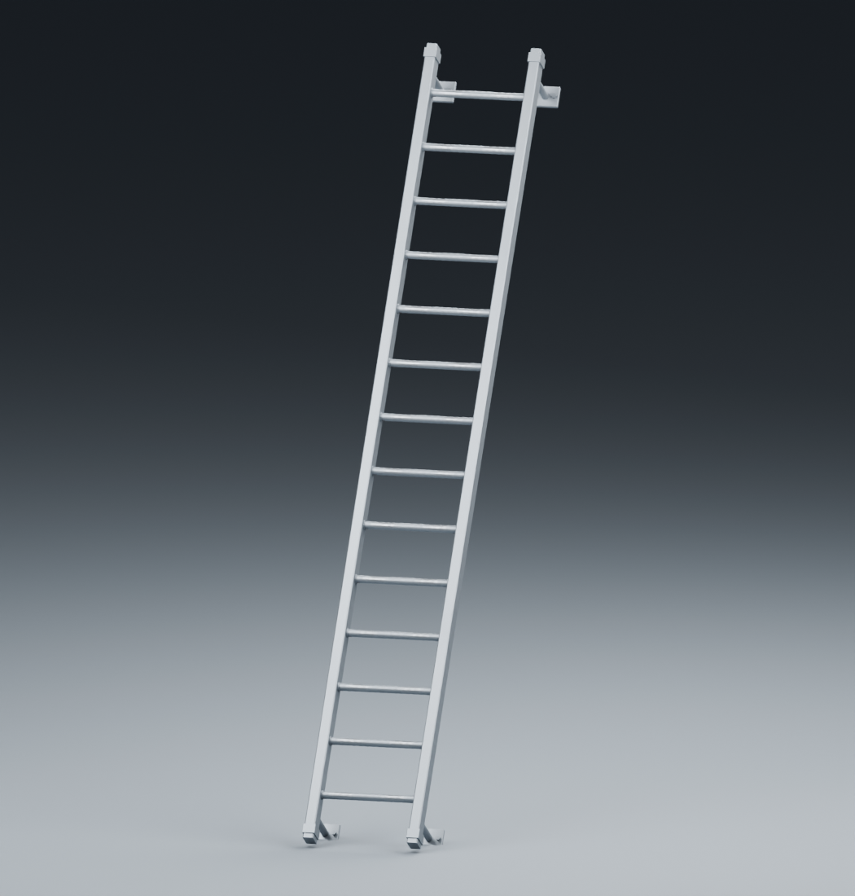
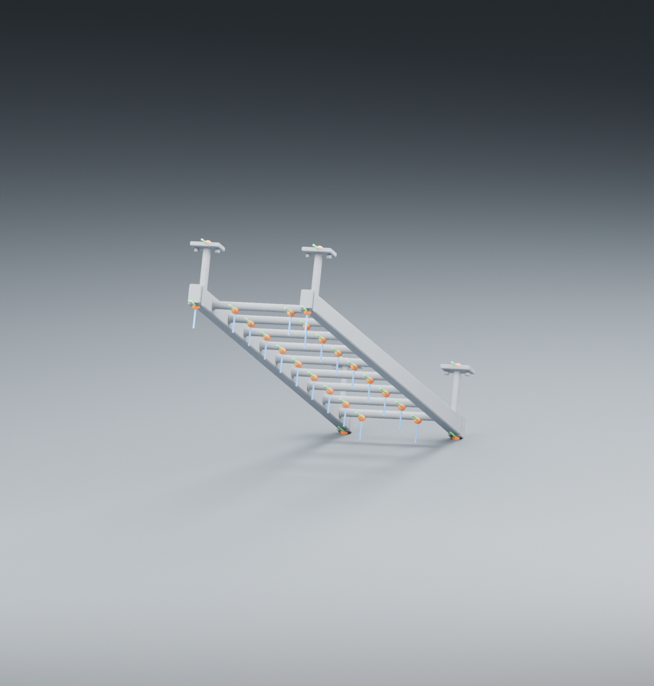
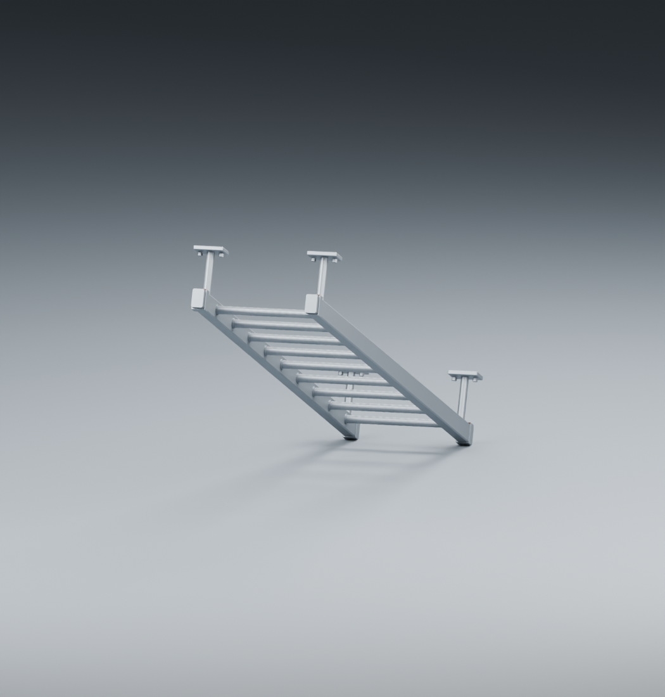
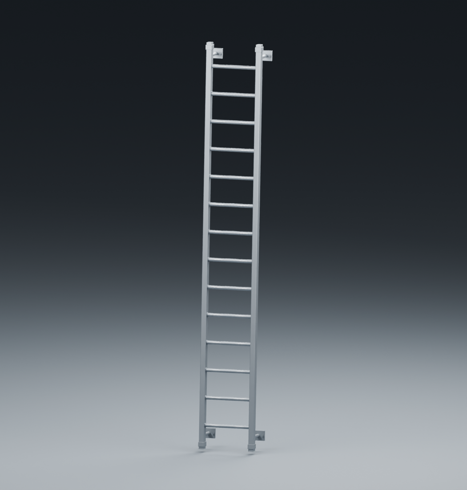

# Escaleras — 1/1

Pruebas visuales históricas de escaleras y agarres.

[Página 1](page-1.md)

[Todas las familias](../README.md)

### Jerico Ladder 01 Wood Vertical

Fuente: `Evidence/2026-10-09-ladders/Delivery/Jerico-Ladder-01-Wood-Vertical.png`.

### Jerico Ladder 02 Wood Hooks Inclined

Fuente: `Evidence/2026-10-09-ladders/Delivery/Jerico-Ladder-02-Wood-Hooks-Inclined.png`.

### Jerico Ladder 03 Metal Tall Inclined

Fuente: `Evidence/2026-10-09-ladders/Delivery/Jerico-Ladder-03-Metal-Tall-Inclined.png`.

### Jerico Ladder 04 Metal 68deg

Fuente: `Evidence/2026-10-09-ladders/Delivery/Jerico-Ladder-04-Metal-68deg.png`.

### Jerico Ladder 05 Grip Frames 68deg

Fuente: `Evidence/2026-10-09-ladders/Delivery/Jerico-Ladder-05-Grip-Frames-68deg.png`.

### Jerico Ladder 06 Wood Detail

Fuente: `Evidence/2026-10-09-ladders/Delivery/Jerico-Ladder-06-Wood-Detail.png`.

### Jerico Ladder 07 Metal Detail

Fuente: `Evidence/2026-10-09-ladders/Delivery/Jerico-Ladder-07-Metal-Detail.png`.

### case 1 detail

Fuente: `Evidence/2026-10-09-ladders/case-1-detail.png`.

### case 1

Fuente: `Evidence/2026-10-09-ladders/case-1.png`.

### case 2

Fuente: `Evidence/2026-10-09-ladders/case-2.png`.

### case 3 detail

Fuente: `Evidence/2026-10-09-ladders/case-3-detail.png`.

### case 3

Fuente: `Evidence/2026-10-09-ladders/case-3.png`.

### case 4 grips

Fuente: `Evidence/2026-10-09-ladders/case-4-grips.png`.

### case 4

Fuente: `Evidence/2026-10-09-ladders/case-4.png`.

### case 5

Fuente: `Evidence/2026-10-09-ladders/case-5.png`.
