# Estructuras y assemblies — 1/1

Estructuras construidas sobre los sistemas compartidos. Las capturas conservan el estado de esa tanda, sin cerrar el goal completo.

[Página 1](page-1.md)

[Todas las familias](../README.md)

### broken railing

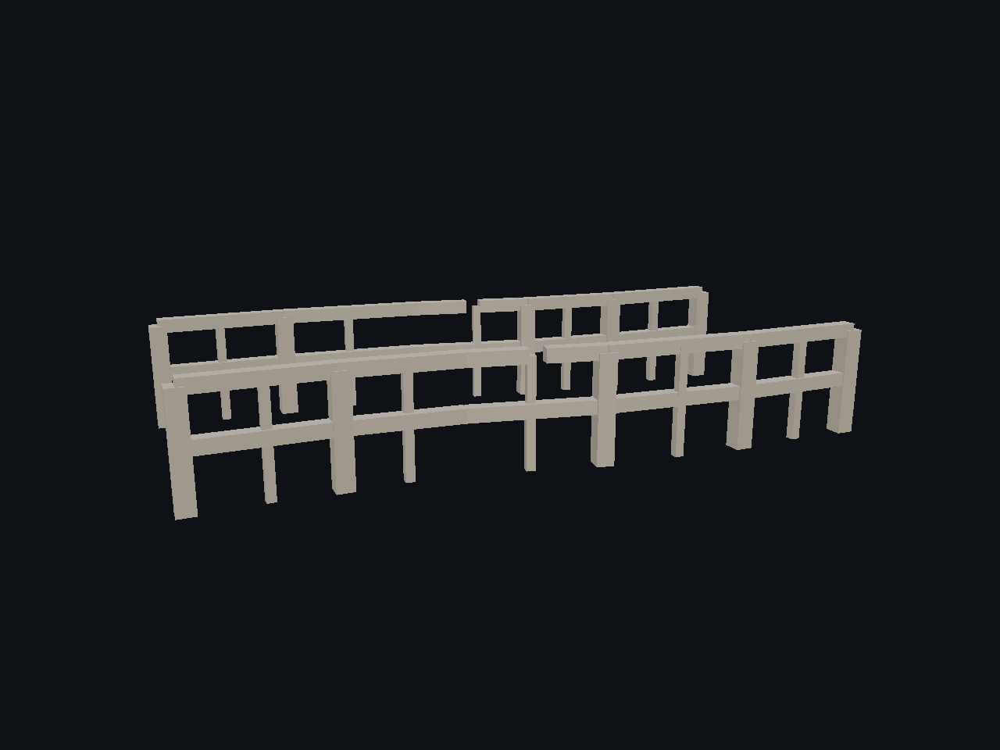

Fuente: `Evidence/assembly-quality-final-2026-09-27/broken-railing.png`.

### broken railway

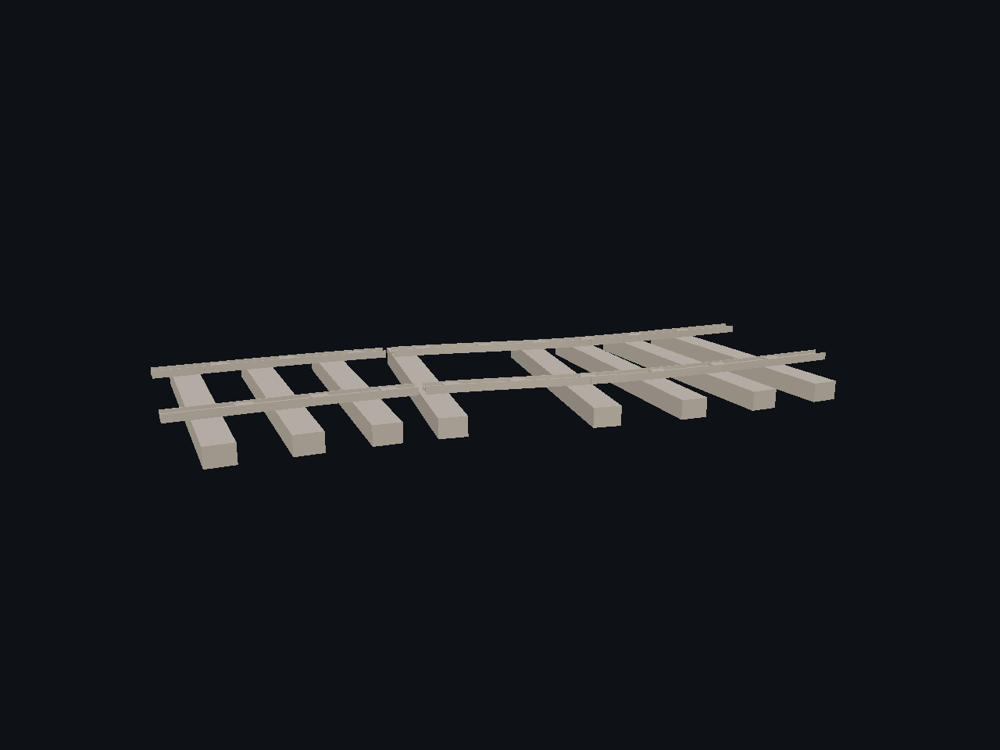

Fuente: `Evidence/assembly-quality-final-2026-09-27/broken-railway.png`.

### catwalk

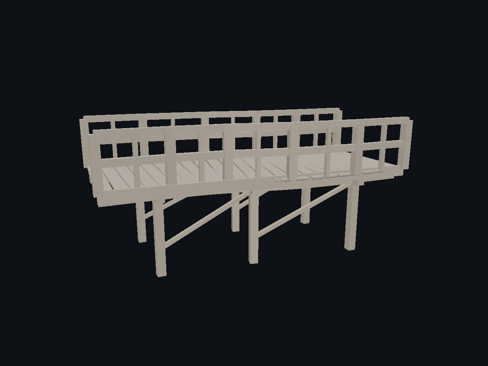

Fuente: `Evidence/assembly-quality-final-2026-09-27/catwalk.png`.

### pier manual damage

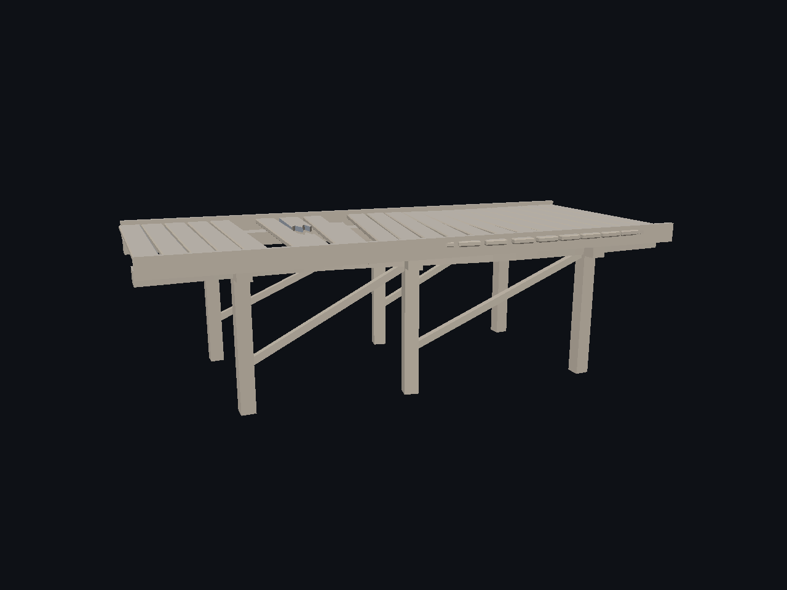

Fuente: `Evidence/assembly-quality-final-2026-09-27/pier-manual-damage.png`.

### pipe couplings

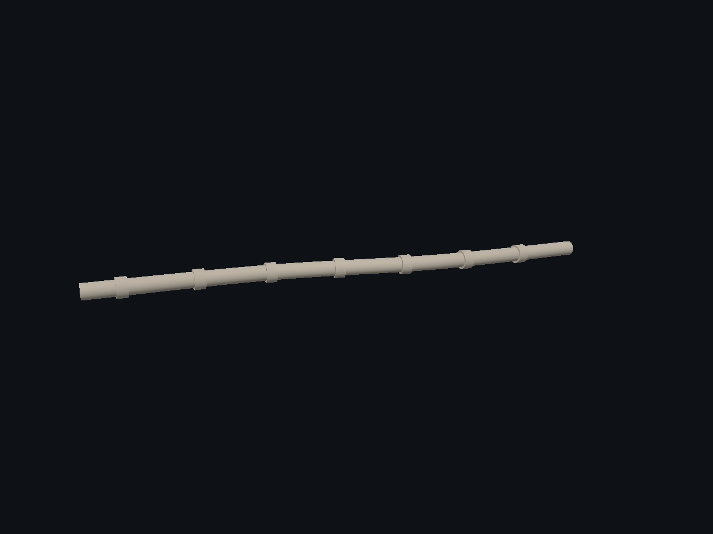

Fuente: `Evidence/assembly-quality-final-2026-09-27/pipe-couplings.png`.

### pipe high curvature rmf

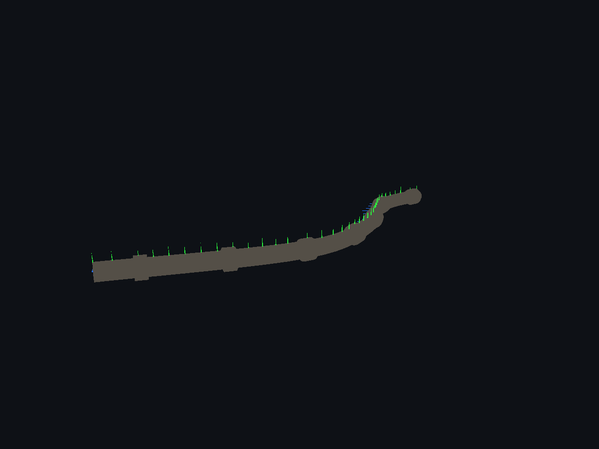

Fuente: `Evidence/assembly-quality-final-2026-09-27/pipe-high-curvature-rmf.png`.

### pipe uv

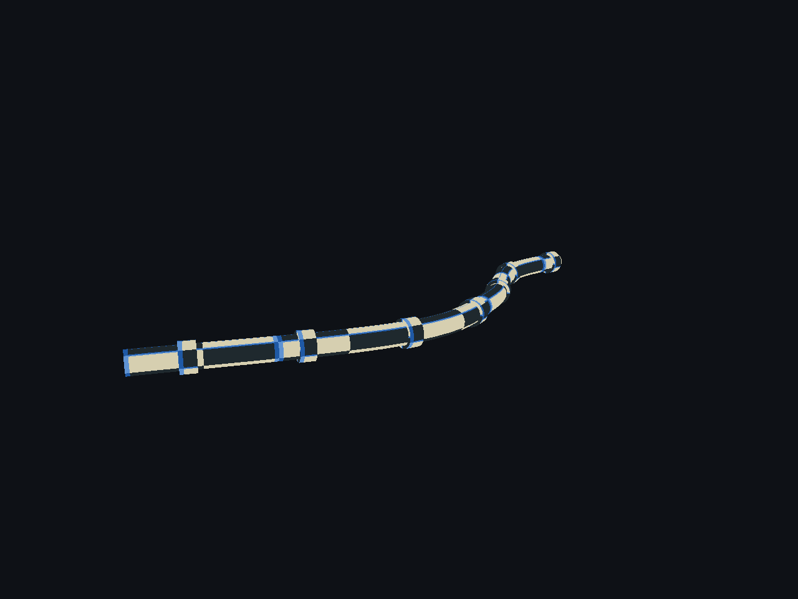

Fuente: `Evidence/assembly-quality-final-2026-09-27/pipe-uv.png`.

### railing

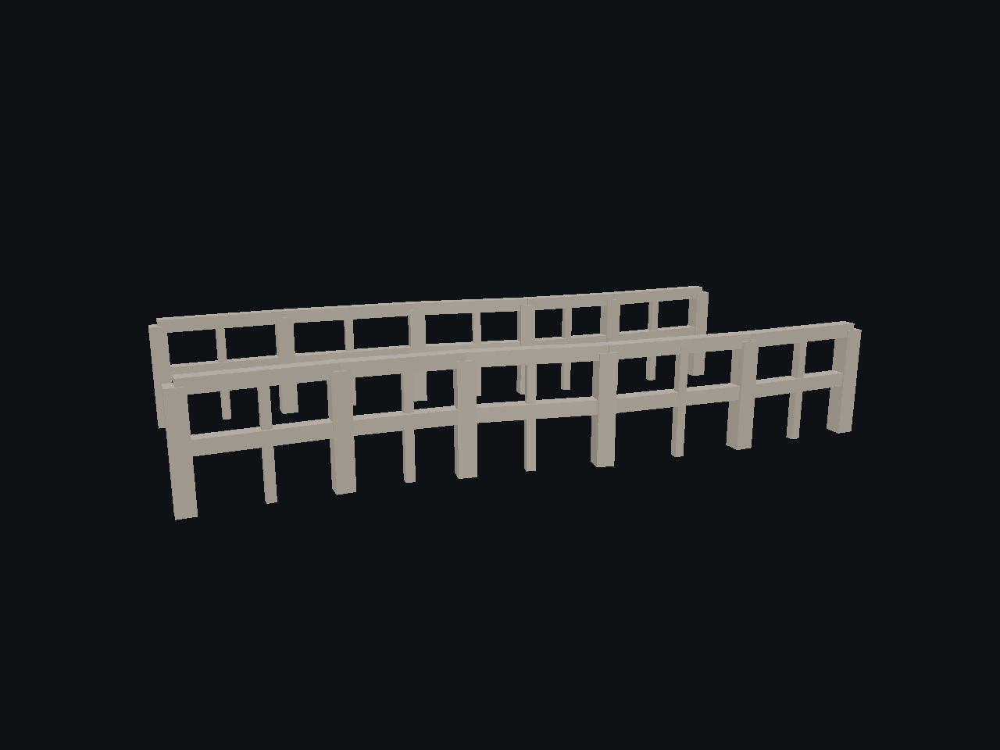

Fuente: `Evidence/assembly-quality-final-2026-09-27/railing.png`.

### railway

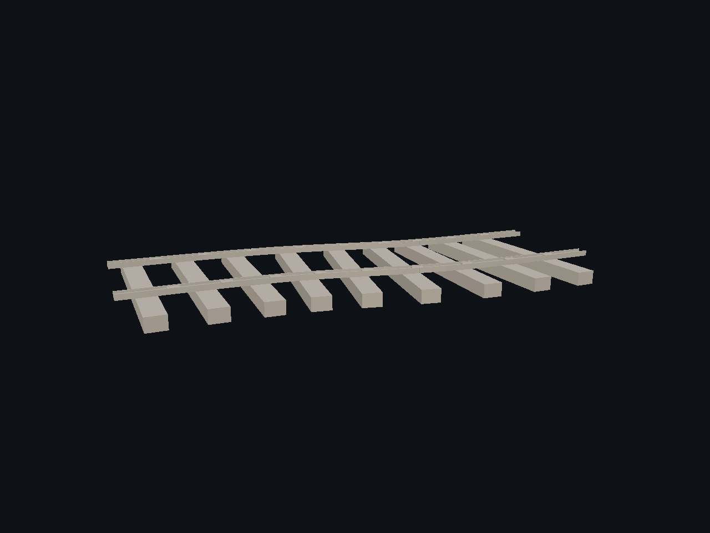

Fuente: `Evidence/assembly-quality-final-2026-09-27/railway.png`.

### rope manual damage

Fuente: `Evidence/assembly-quality-final-2026-09-27/rope-manual-damage.png`.

### rope plank bridge

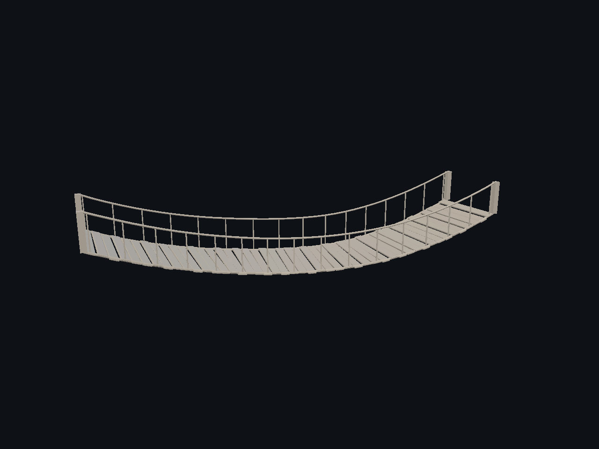

Fuente: `Evidence/assembly-quality-final-2026-09-27/rope-plank-bridge.png`.

### suspension bridge

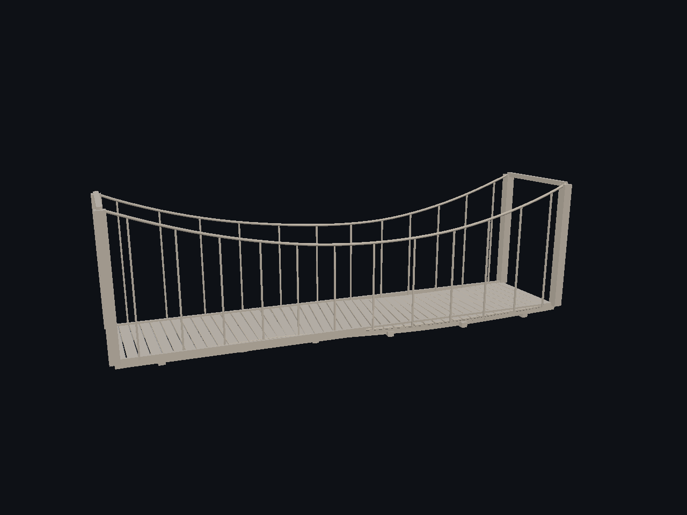

Fuente: `Evidence/assembly-quality-final-2026-09-27/suspension-bridge.png`.

### suspension hanger debug

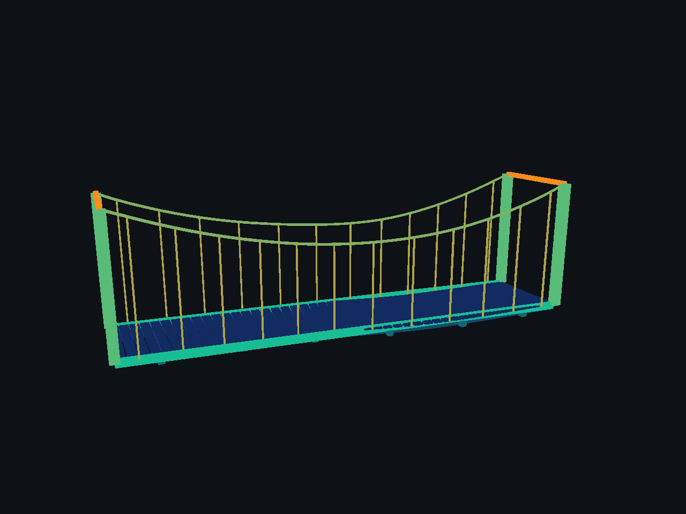

Fuente: `Evidence/assembly-quality-final-2026-09-27/suspension-hanger-debug.png`.

### truss howe

Fuente: `Evidence/assembly-quality-final-2026-09-27/truss-howe.png`.

### truss pratt

Fuente: `Evidence/assembly-quality-final-2026-09-27/truss-pratt.png`.

### truss warren

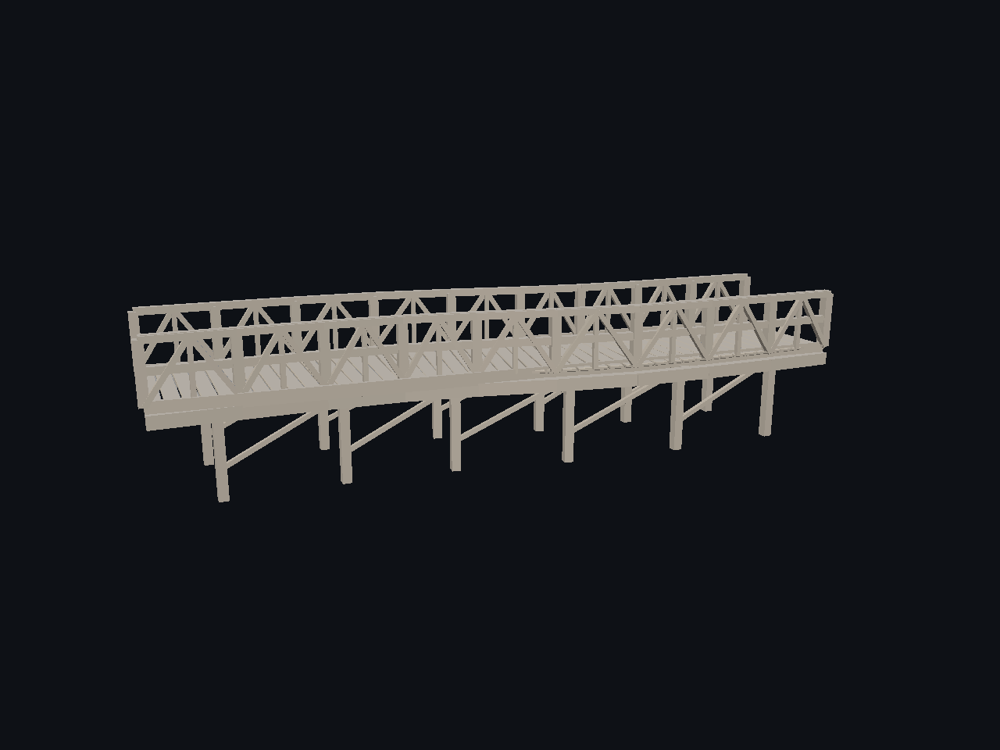

Fuente: `Evidence/assembly-quality-final-2026-09-27/truss-warren.png`.

### wooden pier

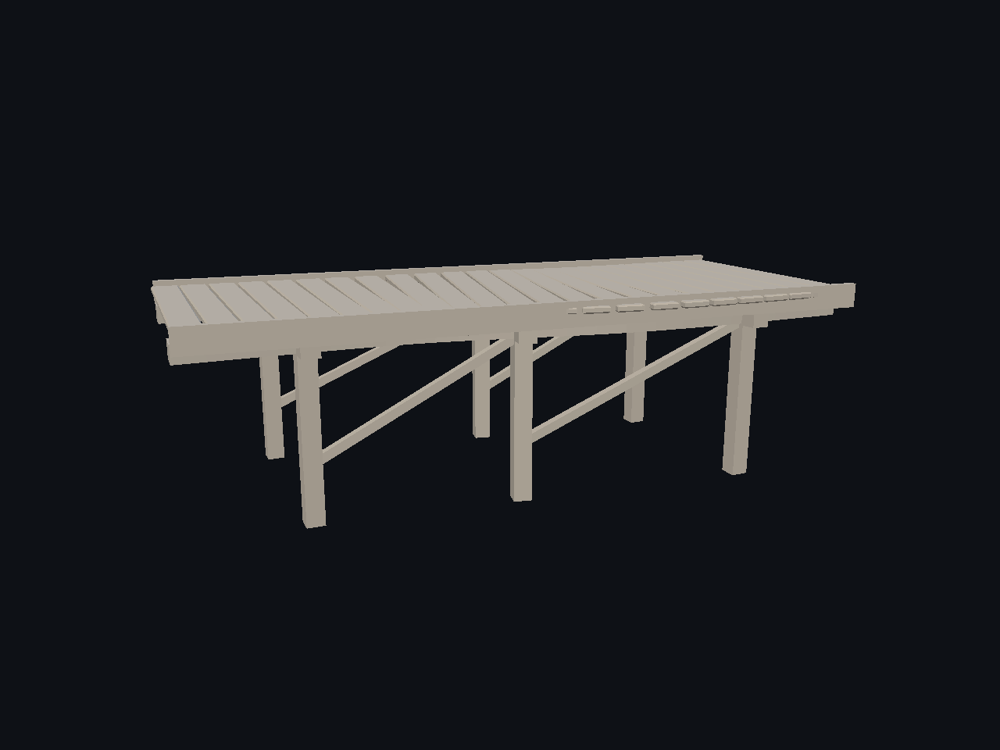

Fuente: `Evidence/assembly-quality-final-2026-09-27/wooden-pier.png`.
