# Muelles y ramas de spline — 1/2

Capturas del sistema de muelles procedurales, sus vistas y edición. Se conserva la evidencia histórica de esta familia.

[Página 1](page-1.md) · [Página 2](page-2.md)

[Todas las familias](../README.md)

### stage 0 ui

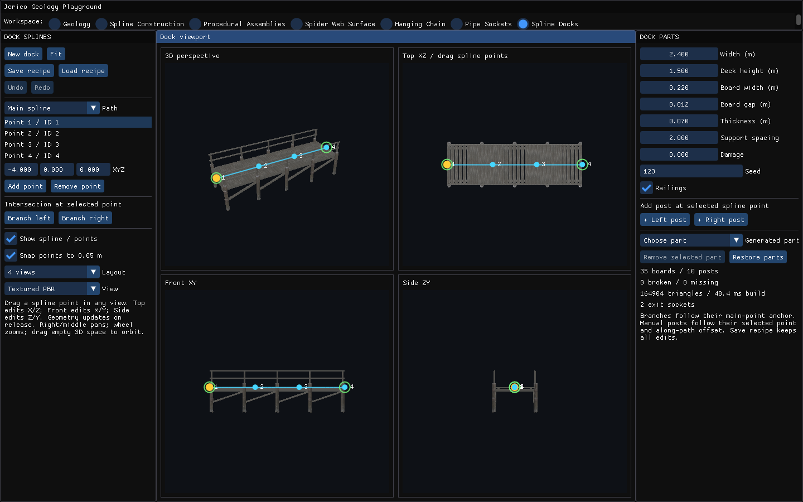

Fuente: `Evidence/dock-spline/final-runtime/stage-0-ui.png`.

### stage 0 viewport

Fuente: `Evidence/dock-spline/final-runtime/stage-0-viewport.png`.

### stage 1 ui

Fuente: `Evidence/dock-spline/final-runtime/stage-1-ui.png`.

### stage 1 viewport

Fuente: `Evidence/dock-spline/final-runtime/stage-1-viewport.png`.

### stage 2 ui

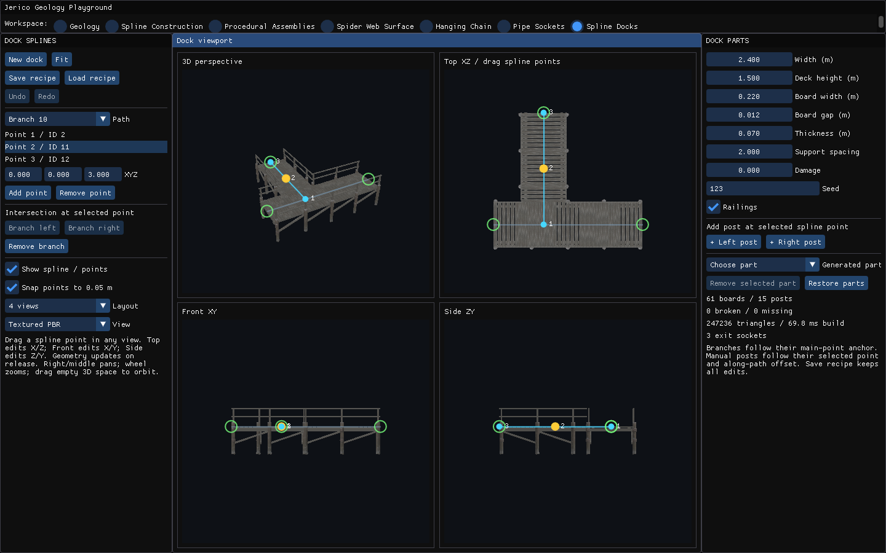

Fuente: `Evidence/dock-spline/final-runtime/stage-2-ui.png`.

### stage 2 viewport

Fuente: `Evidence/dock-spline/final-runtime/stage-2-viewport.png`.

### stage 3 ui

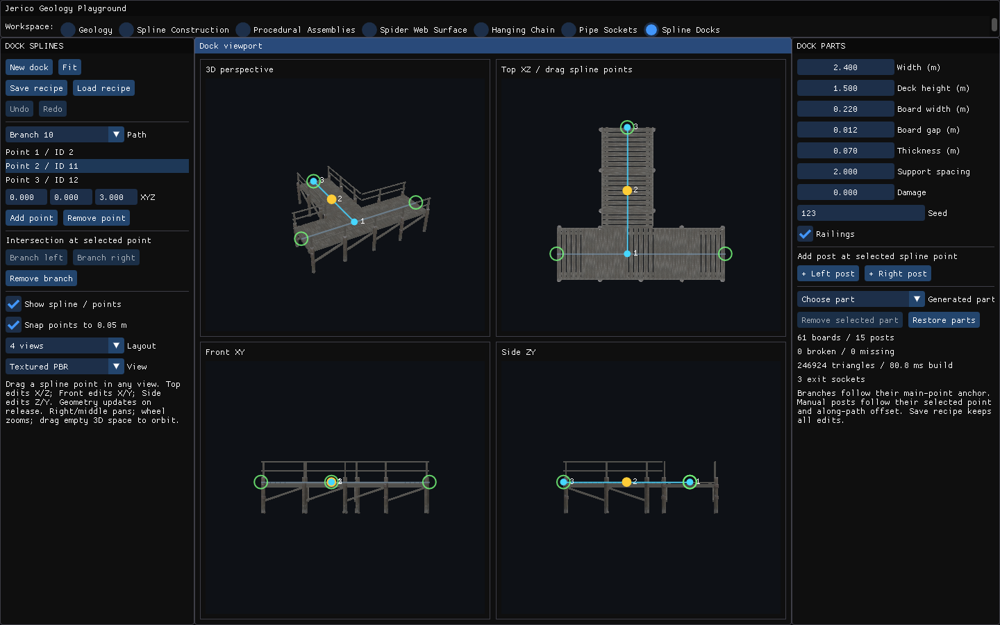

Fuente: `Evidence/dock-spline/final-runtime/stage-3-ui.png`.

### stage 3 viewport

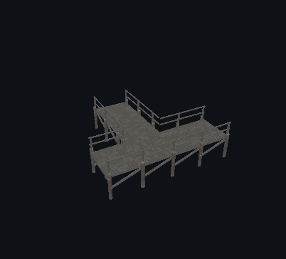

Fuente: `Evidence/dock-spline/final-runtime/stage-3-viewport.png`.

### stage 4 ui

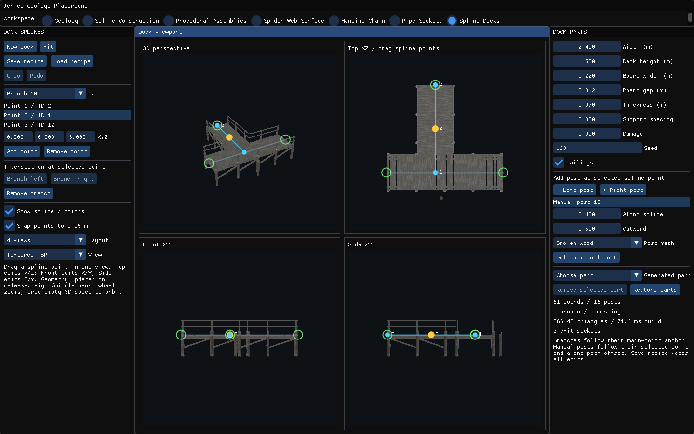

Fuente: `Evidence/dock-spline/final-runtime/stage-4-ui.png`.

### stage 4 viewport

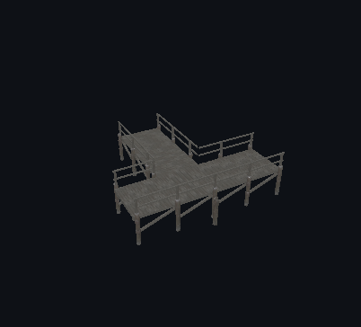

Fuente: `Evidence/dock-spline/final-runtime/stage-4-viewport.png`.

### stage 5 ui

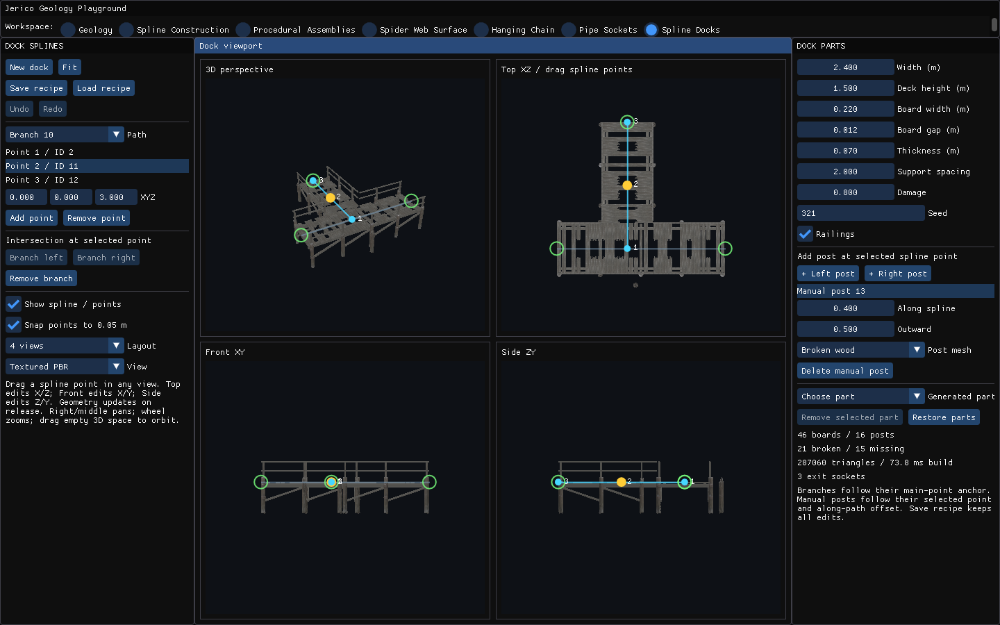

Fuente: `Evidence/dock-spline/final-runtime/stage-5-ui.png`.

### stage 5 viewport

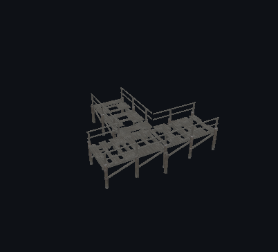

Fuente: `Evidence/dock-spline/final-runtime/stage-5-viewport.png`.

### stage 6 ui

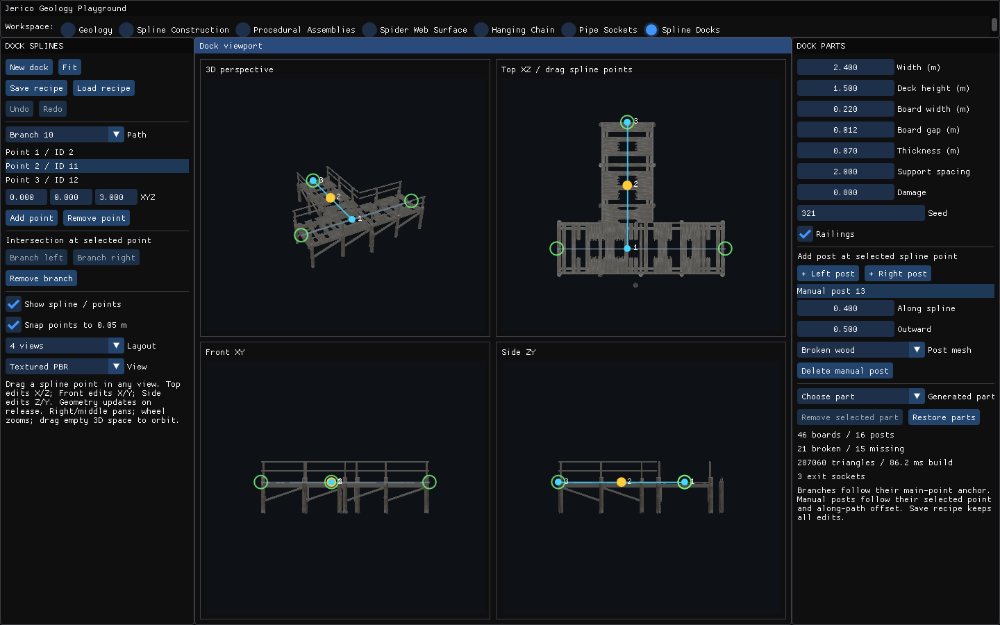

Fuente: `Evidence/dock-spline/final-runtime/stage-6-ui.png`.

### stage 6 viewport

Fuente: `Evidence/dock-spline/final-runtime/stage-6-viewport.png`.

### stage 7 ui

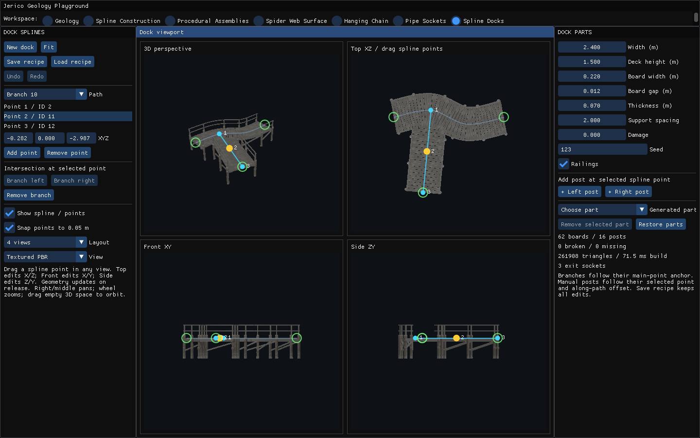

Fuente: `Evidence/dock-spline/final-runtime/stage-7-ui.png`.

### stage 7 viewport

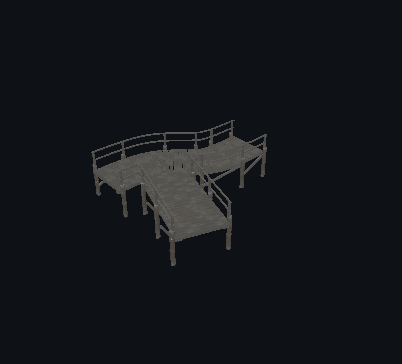

Fuente: `Evidence/dock-spline/final-runtime/stage-7-viewport.png`.

### stage 8 ui

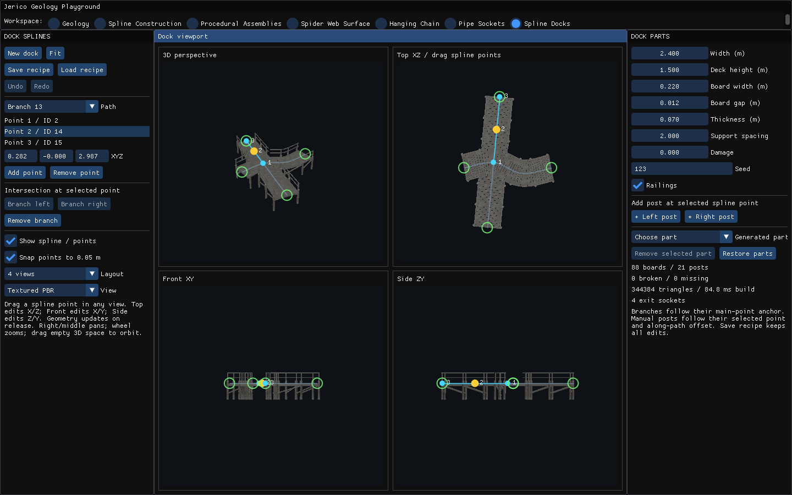

Fuente: `Evidence/dock-spline/final-runtime/stage-8-ui.png`.

### stage 8 viewport

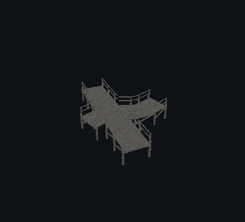

Fuente: `Evidence/dock-spline/final-runtime/stage-8-viewport.png`.

### stage 0 ui

Fuente: `Evidence/dock-spline/runtime/stage-0-ui.png`.

### stage 0 viewport

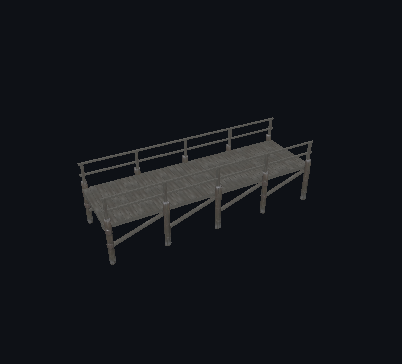

Fuente: `Evidence/dock-spline/runtime/stage-0-viewport.png`.

### stage 1 ui

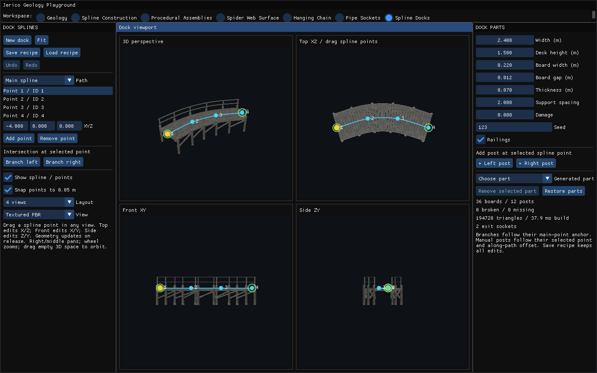

Fuente: `Evidence/dock-spline/runtime/stage-1-ui.png`.

### stage 1 viewport

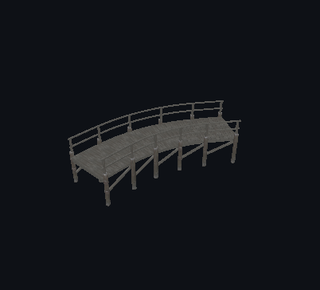

Fuente: `Evidence/dock-spline/runtime/stage-1-viewport.png`.

### stage 2 ui

Fuente: `Evidence/dock-spline/runtime/stage-2-ui.png`.

### stage 2 viewport

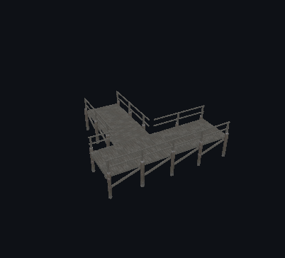

Fuente: `Evidence/dock-spline/runtime/stage-2-viewport.png`.
