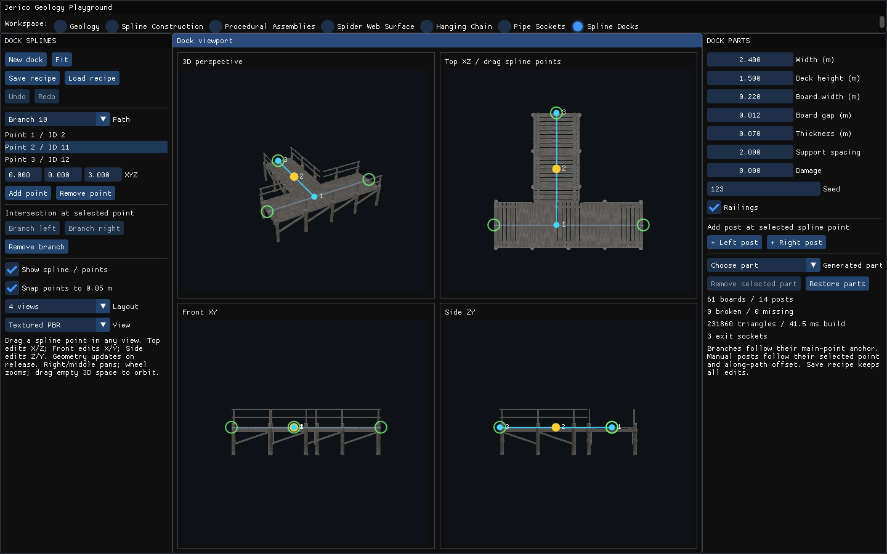
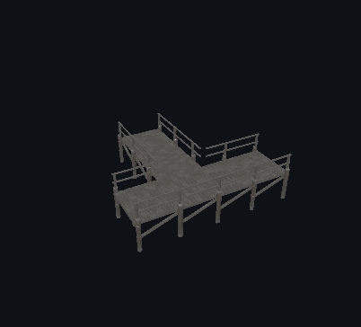
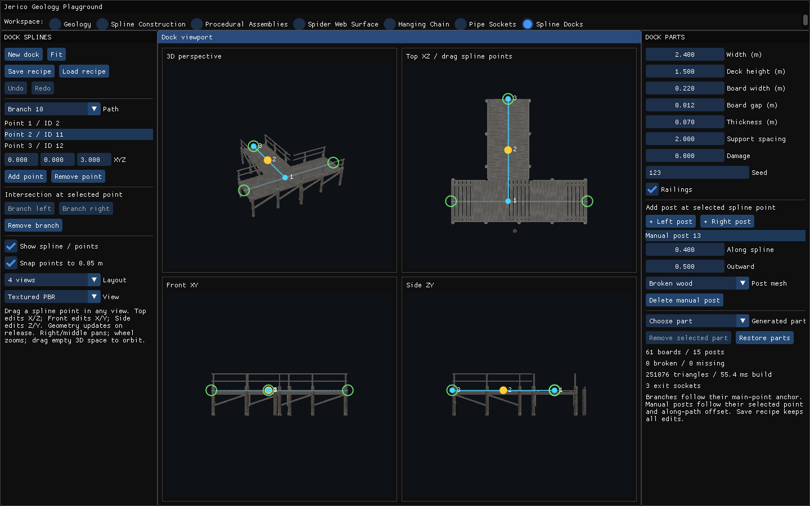
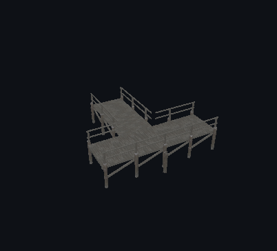
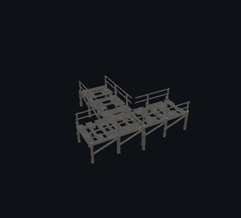
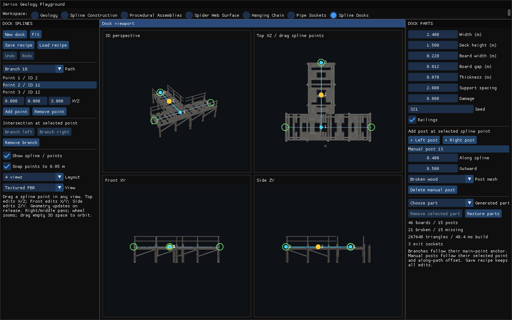

# Muelles y ramas de spline — 2/2

Capturas del sistema de muelles procedurales, sus vistas y edición. Se conserva la evidencia histórica de esta familia.

[Página 1](page-1.md) · [Página 2](page-2.md)

[Todas las familias](../README.md)

### stage 3 ui

Fuente: `Evidence/dock-spline/runtime/stage-3-ui.png`.

### stage 3 viewport

Fuente: `Evidence/dock-spline/runtime/stage-3-viewport.png`.

### stage 4 ui

Fuente: `Evidence/dock-spline/runtime/stage-4-ui.png`.

### stage 4 viewport

Fuente: `Evidence/dock-spline/runtime/stage-4-viewport.png`.

### stage 5 ui

Fuente: `Evidence/dock-spline/runtime/stage-5-ui.png`.

### stage 5 viewport

Fuente: `Evidence/dock-spline/runtime/stage-5-viewport.png`.

### stage 6 ui

Fuente: `Evidence/dock-spline/runtime/stage-6-ui.png`.

### stage 6 viewport

Fuente: `Evidence/dock-spline/runtime/stage-6-viewport.png`.
