# Physics — 1/1

Primera solapa Physics Lab: lattice volumétrico Jolt de 3 o 6 nodos por eje, esfera rígida, receptor elástico fijado en +X y gravedad cero. Las etapas muestran reposo, impacto, recuperación y variaciones de masa/velocidad/rigidez. Es un modelo elástico genérico: cajas huecas, metal macizo, chapa y gel requieren modelos propios todavía pendientes. Plasticidad y fatiga no están implementadas. Los contactos nodales y los casos descentrados/radios necesitan comprobación adicional.

[Página 1](page-1.md)

[Todas las familias](../README.md)

[Registro de ejecución](elastic-2026-11-04/execution.json).

### stage 0 ui

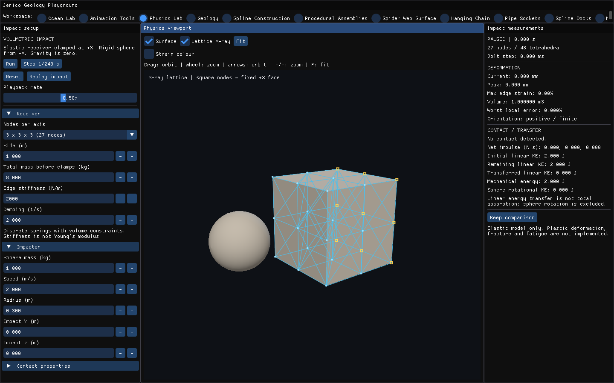

Fuente: `Evidence/physics-lab-2026-11-04/native-1/captures/stage-0-ui.png`.

### stage 0 viewport

Fuente: `Evidence/physics-lab-2026-11-04/native-1/captures/stage-0-viewport.png`.

### stage 1 ui

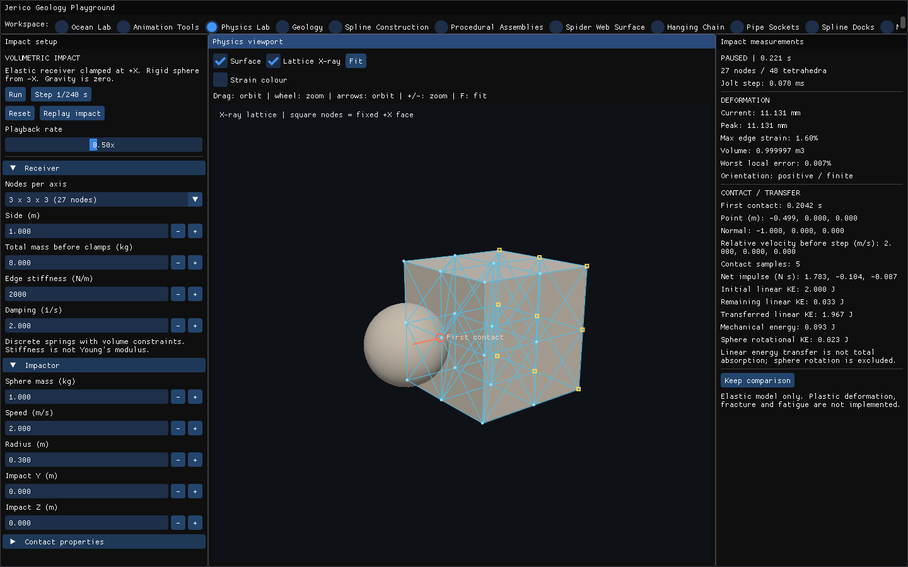

Fuente: `Evidence/physics-lab-2026-11-04/native-1/captures/stage-1-ui.png`.

### stage 1 viewport

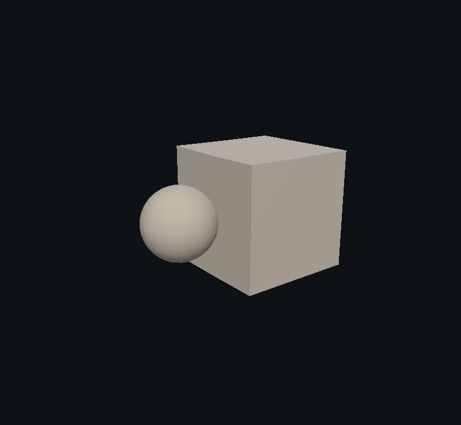

Fuente: `Evidence/physics-lab-2026-11-04/native-1/captures/stage-1-viewport.png`.

### stage 2 ui

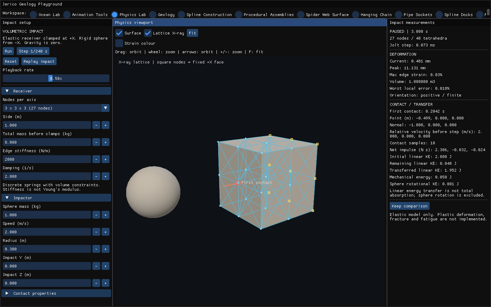

Fuente: `Evidence/physics-lab-2026-11-04/native-1/captures/stage-2-ui.png`.

### stage 2 viewport

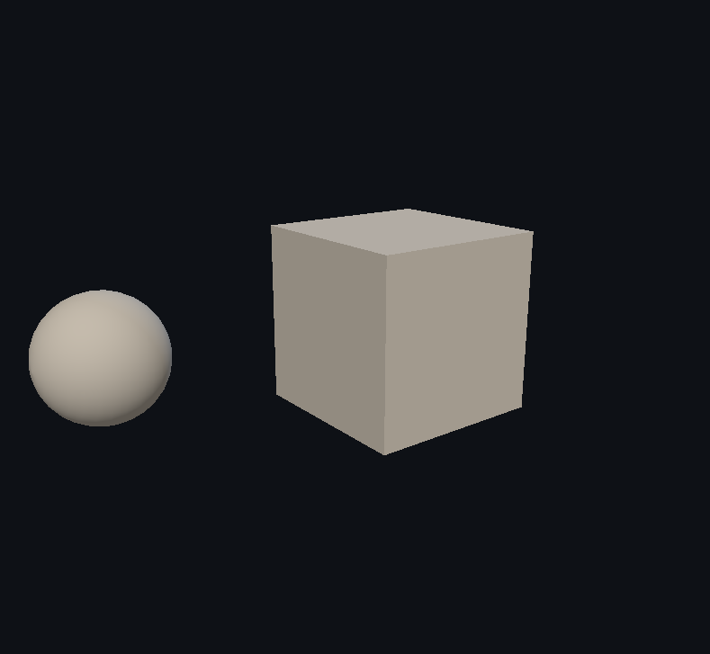

Fuente: `Evidence/physics-lab-2026-11-04/native-1/captures/stage-2-viewport.png`.

### stage 3 ui

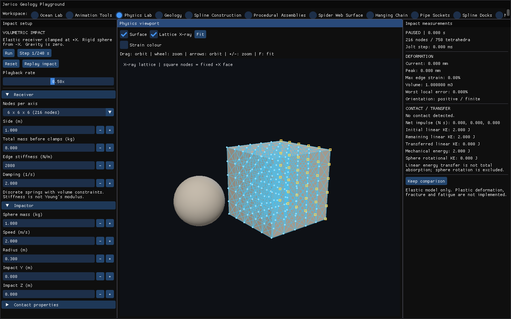

Fuente: `Evidence/physics-lab-2026-11-04/native-1/captures/stage-3-ui.png`.

### stage 3 viewport

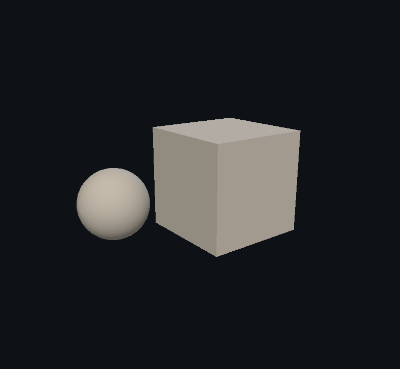

Fuente: `Evidence/physics-lab-2026-11-04/native-1/captures/stage-3-viewport.png`.

### stage 4 ui

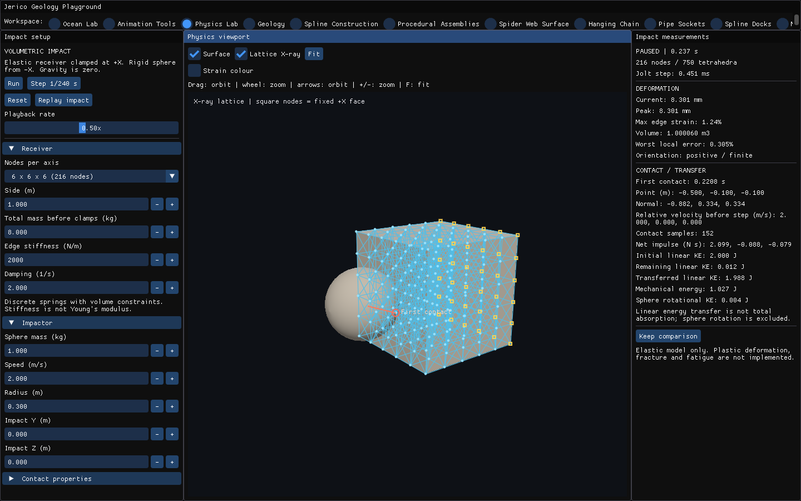

Fuente: `Evidence/physics-lab-2026-11-04/native-1/captures/stage-4-ui.png`.

### stage 4 viewport

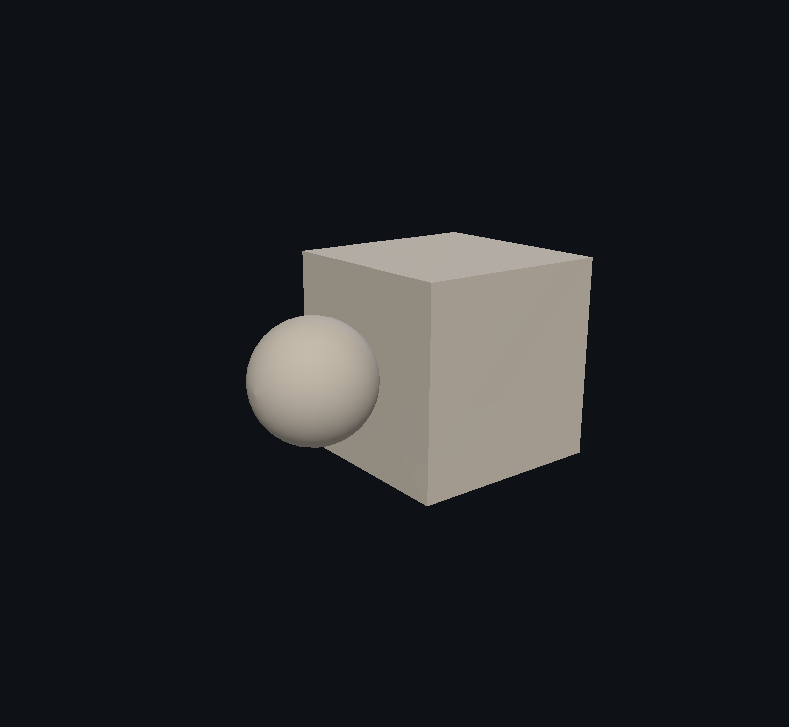

Fuente: `Evidence/physics-lab-2026-11-04/native-1/captures/stage-4-viewport.png`.

### stage 5 ui

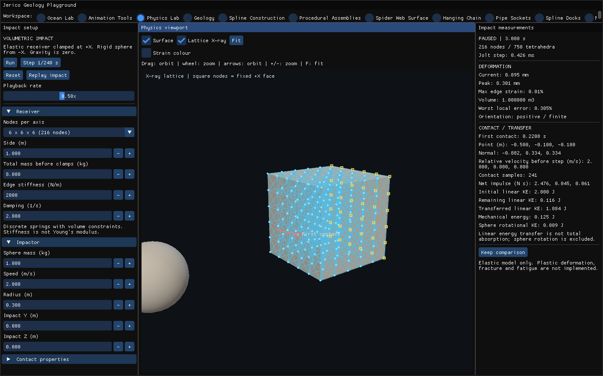

Fuente: `Evidence/physics-lab-2026-11-04/native-1/captures/stage-5-ui.png`.

### stage 5 viewport

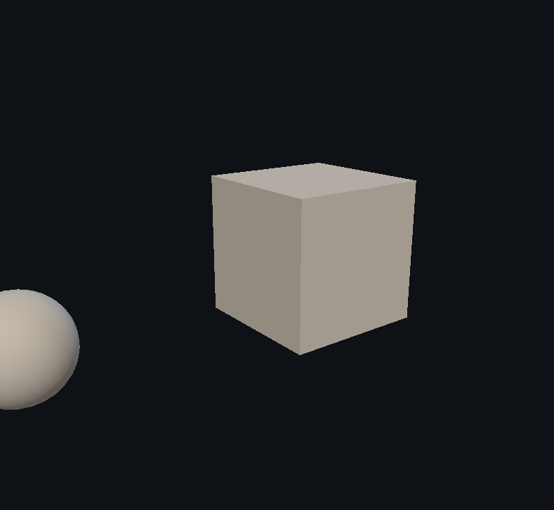

Fuente: `Evidence/physics-lab-2026-11-04/native-1/captures/stage-5-viewport.png`.

### stage 6 ui

Fuente: `Evidence/physics-lab-2026-11-04/native-1/captures/stage-6-ui.png`.

### stage 6 viewport

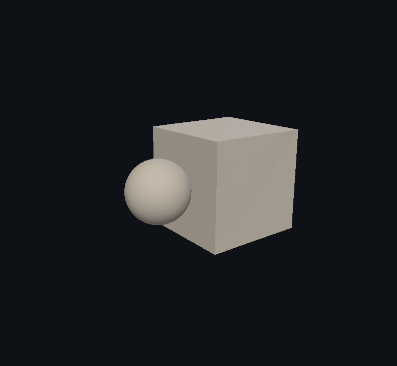

Fuente: `Evidence/physics-lab-2026-11-04/native-1/captures/stage-6-viewport.png`.

### stage 7 ui

Fuente: `Evidence/physics-lab-2026-11-04/native-1/captures/stage-7-ui.png`.

### stage 7 viewport

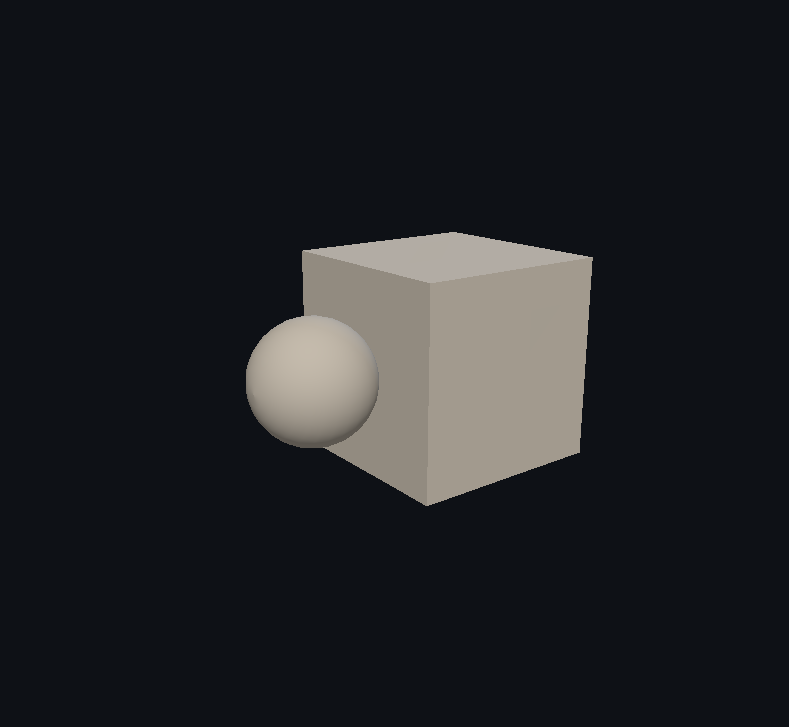

Fuente: `Evidence/physics-lab-2026-11-04/native-1/captures/stage-7-viewport.png`.

### stage 8 ui

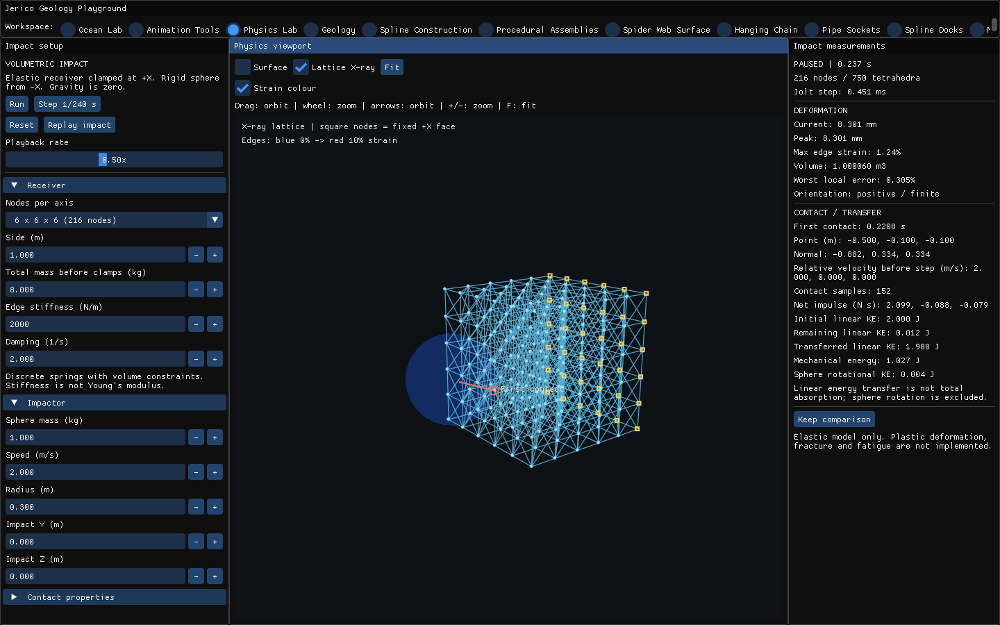

Fuente: `Evidence/physics-lab-2026-11-04/native-1/captures/stage-8-ui.png`.

### stage 8 viewport

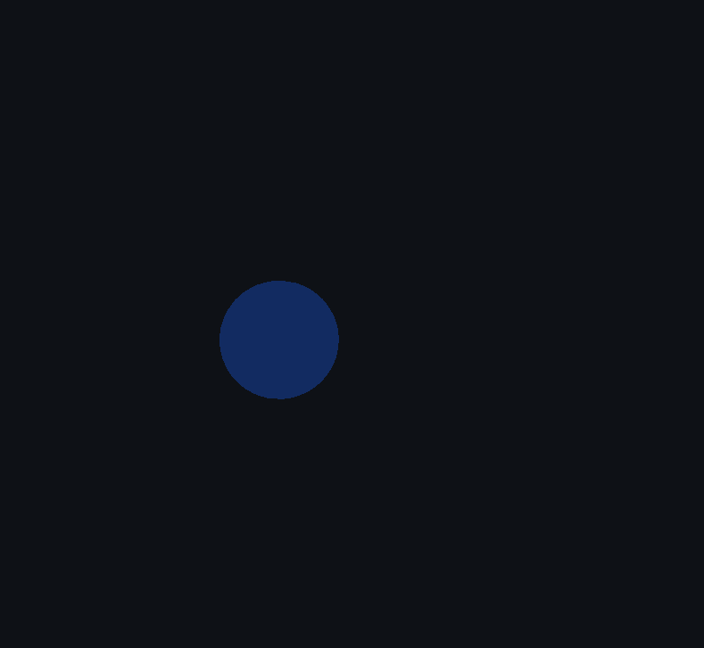

Fuente: `Evidence/physics-lab-2026-11-04/native-1/captures/stage-8-viewport.png`.

### stage 9 ui

Fuente: `Evidence/physics-lab-2026-11-04/native-1/captures/stage-9-ui.png`.

### stage 9 viewport

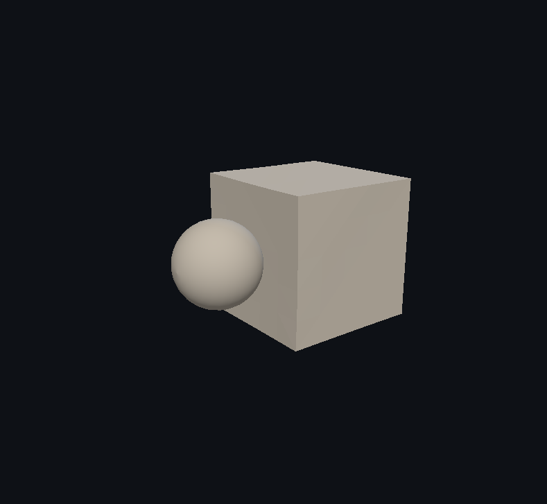

Fuente: `Evidence/physics-lab-2026-11-04/native-1/captures/stage-9-viewport.png`.
