# Caños, sockets y edición de meshes — 1/2

Capturas del editor de caños y conexiones, incluidos meshes importados y gizmos.

[Página 1](page-1.md) · [Página 2](page-2.md)

[Todas las familias](../README.md)

### interactive connected

Fuente: `Evidence/pipe-editor/interactive-connected.png`.

### interactive external mesh

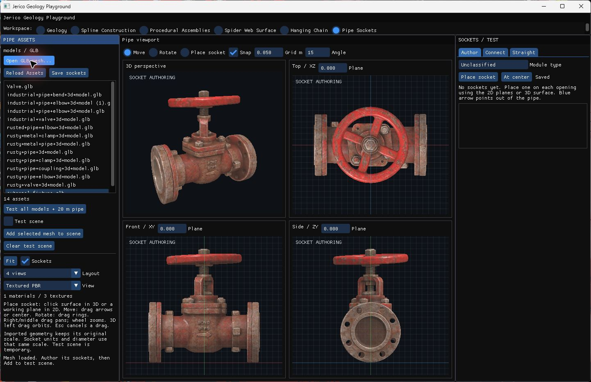

Fuente: `Evidence/pipe-editor/interactive-external-mesh.png`.

### interactive gizmos

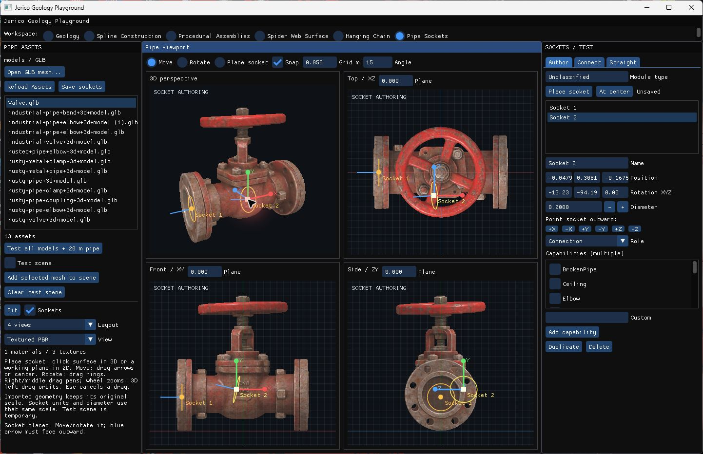

Fuente: `Evidence/pipe-editor/interactive-gizmos.png`.

### interactive picked connected

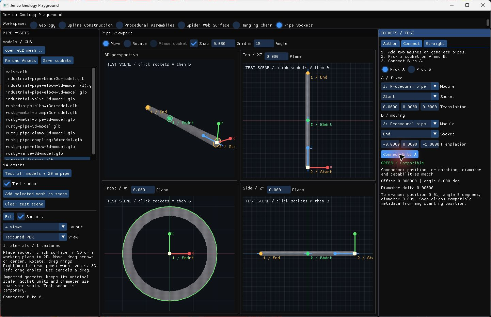

Fuente: `Evidence/pipe-editor/interactive-picked-connected.png`.

### interactive reloaded

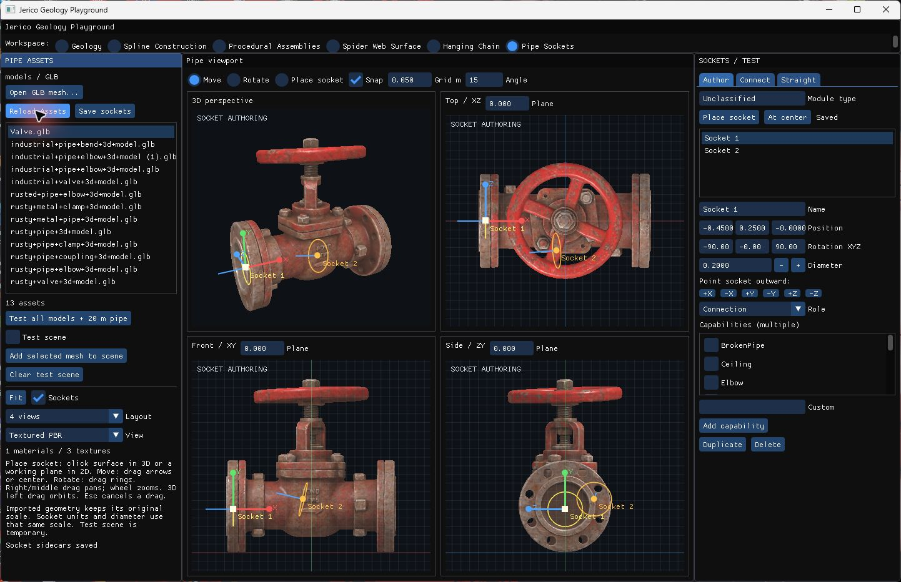

Fuente: `Evidence/pipe-editor/interactive-reloaded.png`.

### stage 0 ui

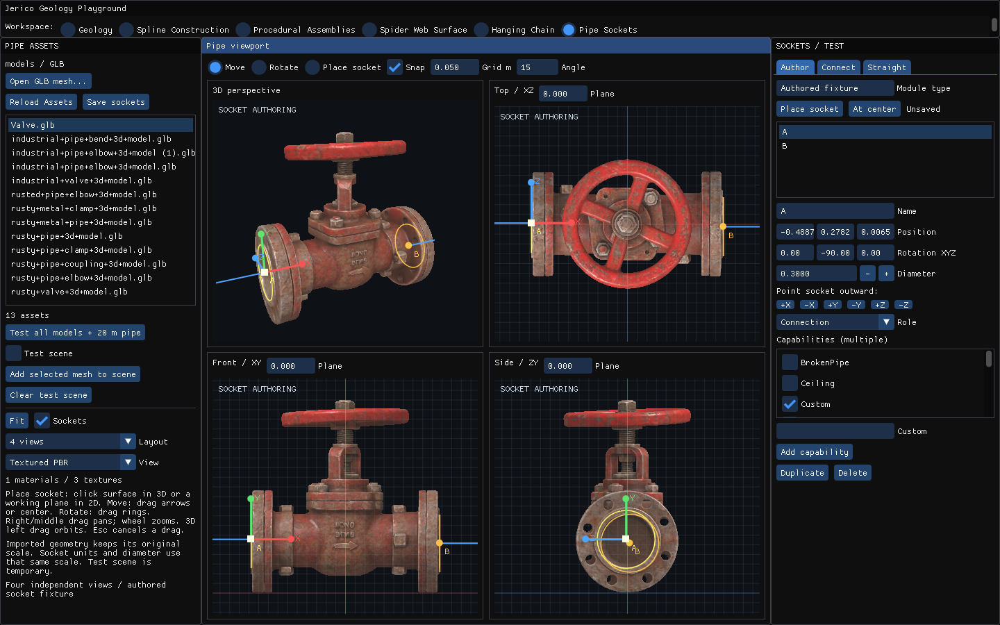

Fuente: `Evidence/pipe-editor/final-runtime/stage-0-ui.png`.

### stage 0 viewport

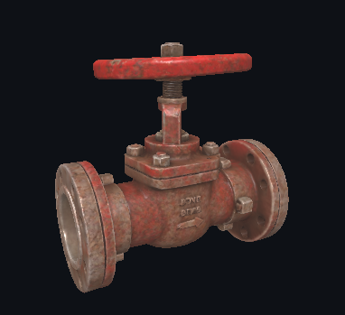

Fuente: `Evidence/pipe-editor/final-runtime/stage-0-viewport.png`.

### stage 1 ui

Fuente: `Evidence/pipe-editor/final-runtime/stage-1-ui.png`.

### stage 1 viewport

Fuente: `Evidence/pipe-editor/final-runtime/stage-1-viewport.png`.

### stage 2 ui

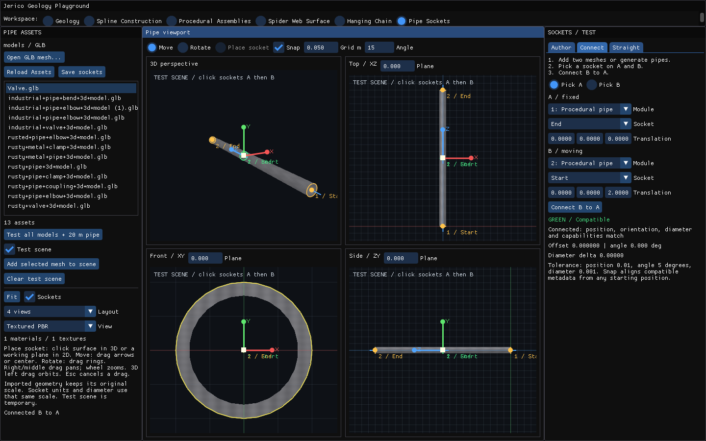

Fuente: `Evidence/pipe-editor/final-runtime/stage-2-ui.png`.

### stage 2 viewport

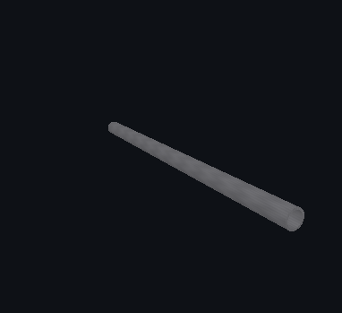

Fuente: `Evidence/pipe-editor/final-runtime/stage-2-viewport.png`.

### stage 3 ui

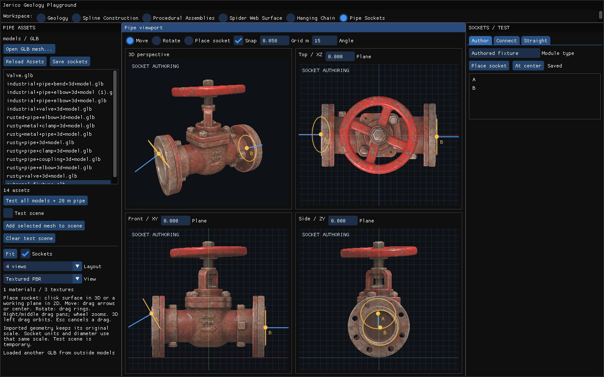

Fuente: `Evidence/pipe-editor/final-runtime/stage-3-ui.png`.

### stage 3 viewport

Fuente: `Evidence/pipe-editor/final-runtime/stage-3-viewport.png`.

### stage 4 ui

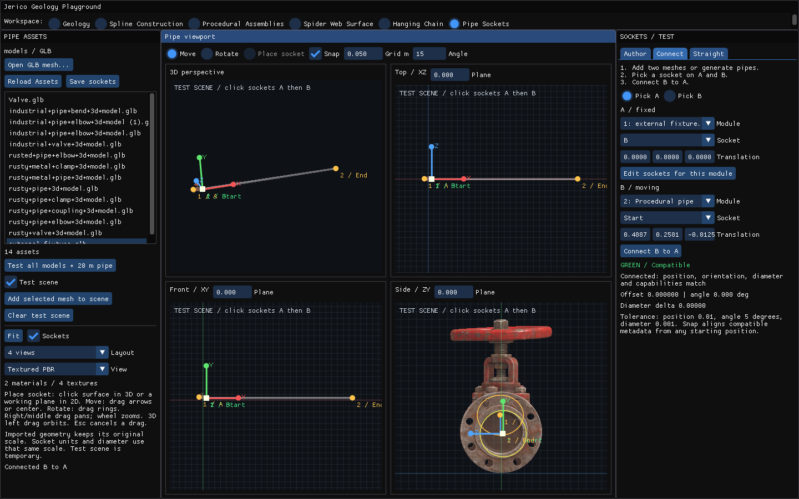

Fuente: `Evidence/pipe-editor/final-runtime/stage-4-ui.png`.

### stage 4 viewport

Fuente: `Evidence/pipe-editor/final-runtime/stage-4-viewport.png`.

### stage 5 ui

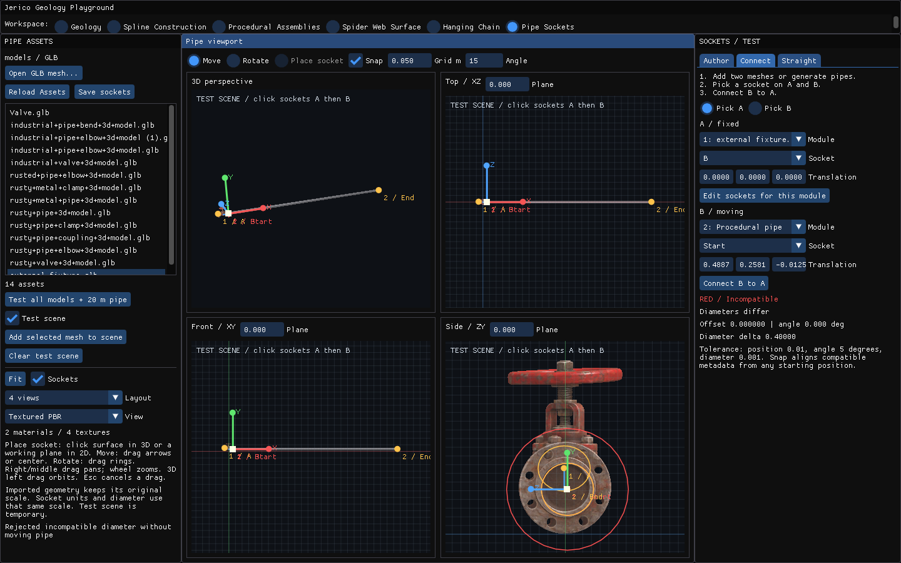

Fuente: `Evidence/pipe-editor/final-runtime/stage-5-ui.png`.

### stage 5 viewport

Fuente: `Evidence/pipe-editor/final-runtime/stage-5-viewport.png`.

### stage 6 ui

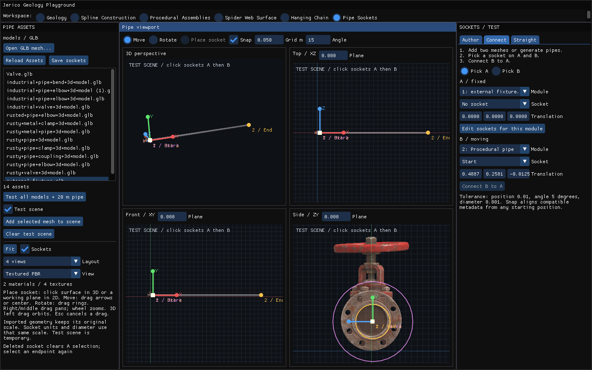

Fuente: `Evidence/pipe-editor/final-runtime/stage-6-ui.png`.

### stage 6 viewport

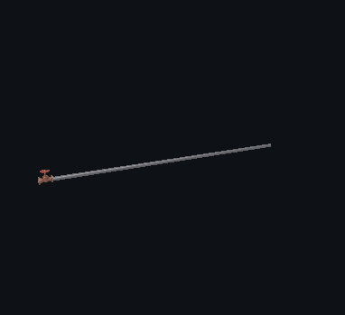

Fuente: `Evidence/pipe-editor/final-runtime/stage-6-viewport.png`.

### stage 0 ui

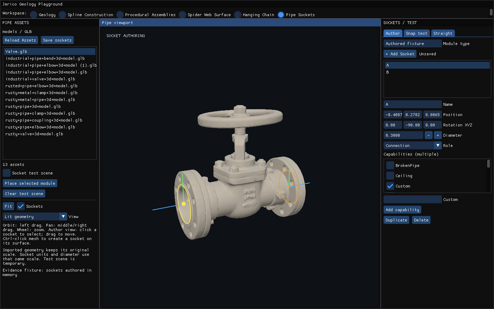

Fuente: `Evidence/pipe-sockets/runtime/stage-0-ui.png`.

### stage 0 viewport

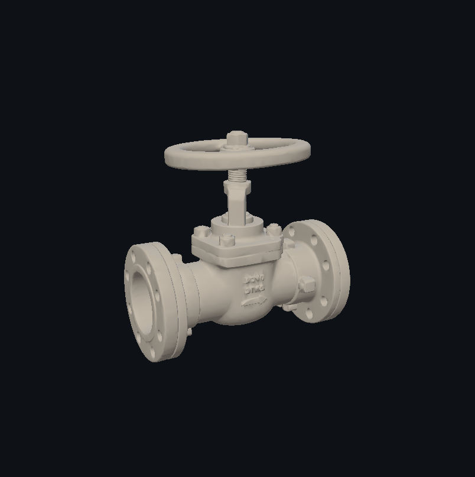

Fuente: `Evidence/pipe-sockets/runtime/stage-0-viewport.png`.

### stage 1 ui

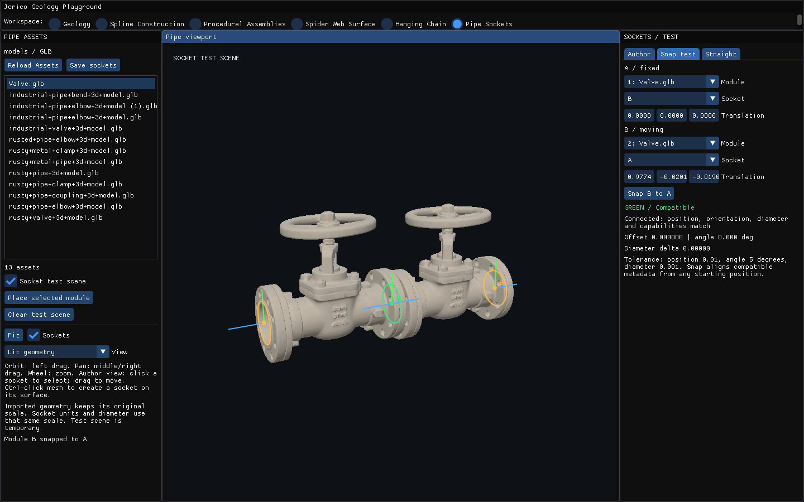

Fuente: `Evidence/pipe-sockets/runtime/stage-1-ui.png`.

### stage 1 viewport

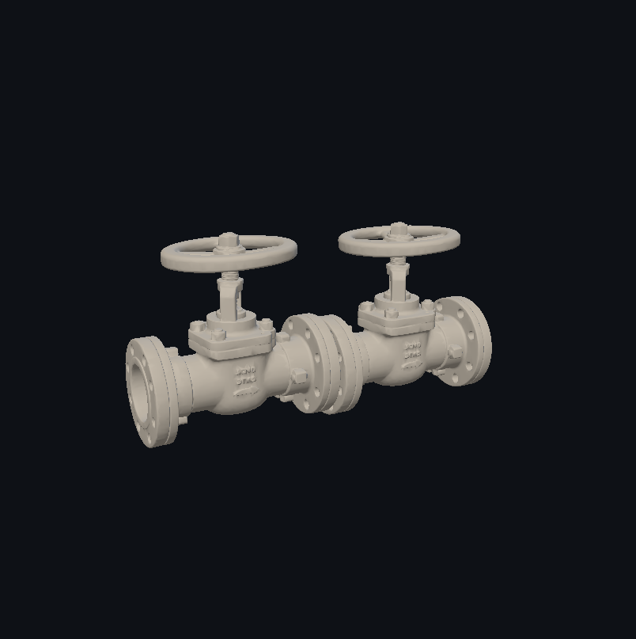

Fuente: `Evidence/pipe-sockets/runtime/stage-1-viewport.png`.

### stage 2 ui

Fuente: `Evidence/pipe-sockets/runtime/stage-2-ui.png`.
