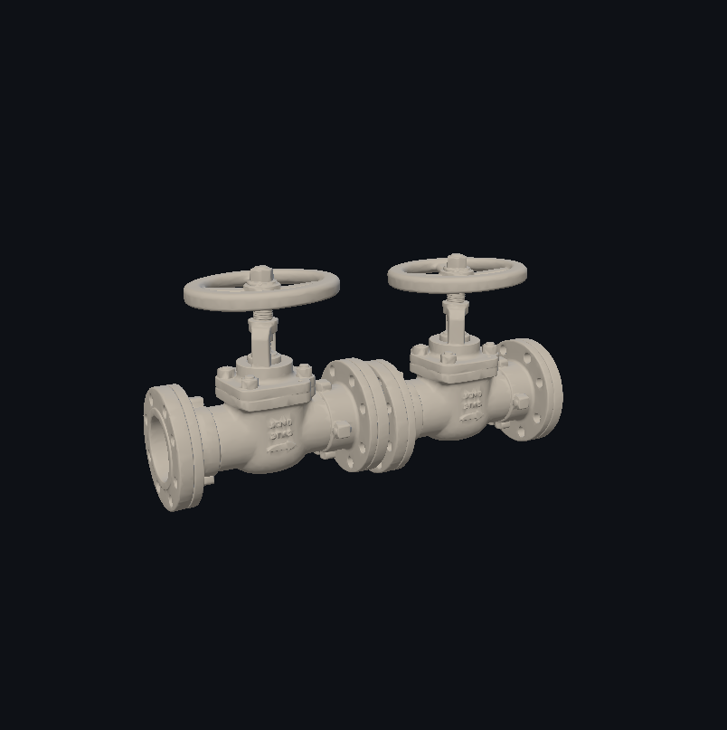
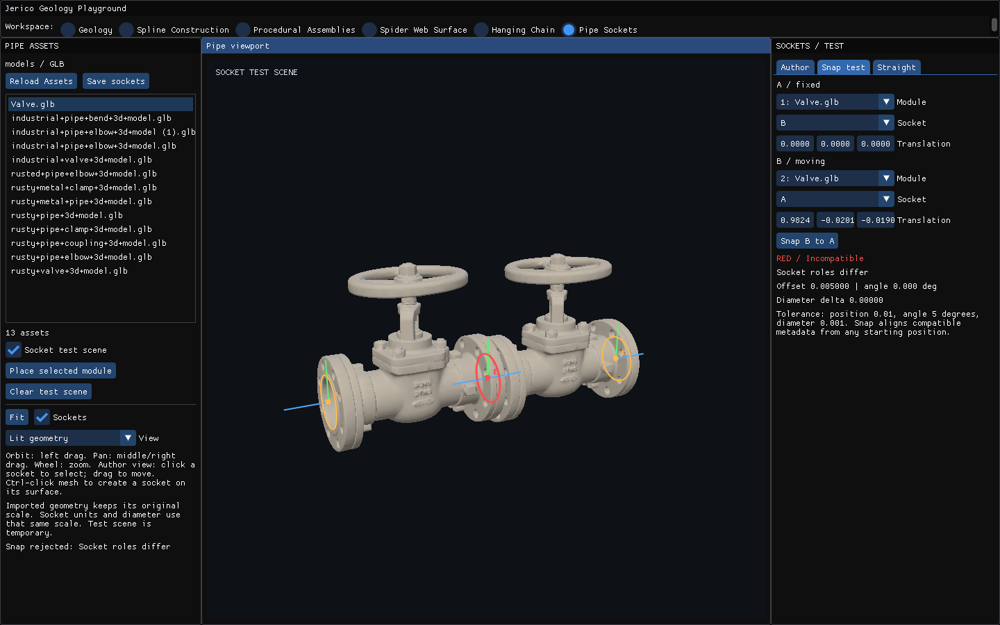
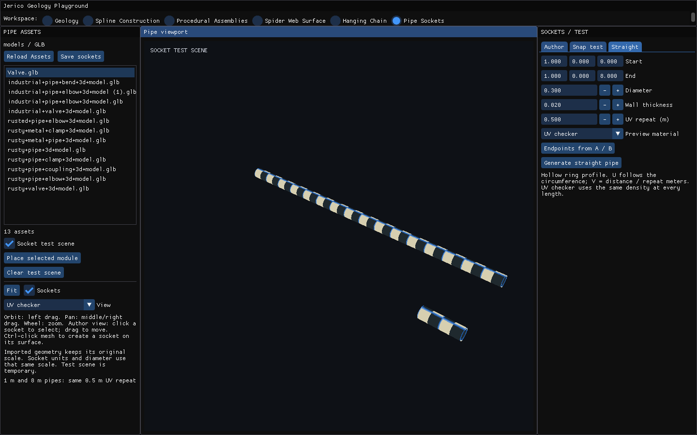
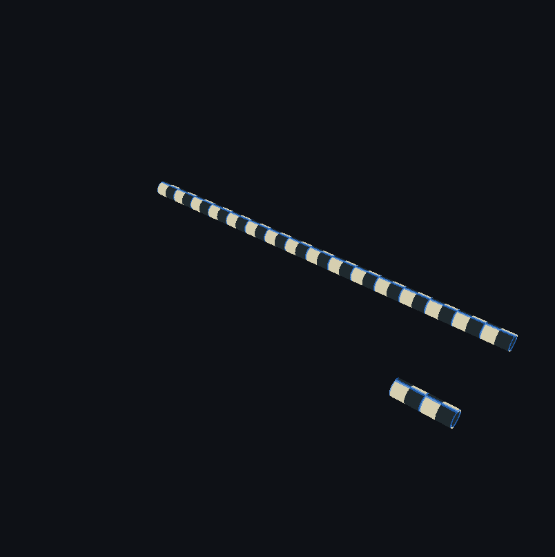

# Caños, sockets y edición de meshes — 2/2

Capturas del editor de caños y conexiones, incluidos meshes importados y gizmos.

[Página 1](page-1.md) · [Página 2](page-2.md)

[Todas las familias](../README.md)

### stage 2 viewport

Fuente: `Evidence/pipe-sockets/runtime/stage-2-viewport.png`.

### stage 3 ui

Fuente: `Evidence/pipe-sockets/runtime/stage-3-ui.png`.

### stage 3 viewport

Fuente: `Evidence/pipe-sockets/runtime/stage-3-viewport.png`.

### stage 4 ui

Fuente: `Evidence/pipe-sockets/runtime/stage-4-ui.png`.

### stage 4 viewport

Fuente: `Evidence/pipe-sockets/runtime/stage-4-viewport.png`.
