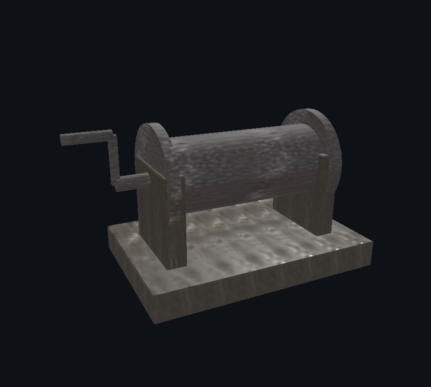
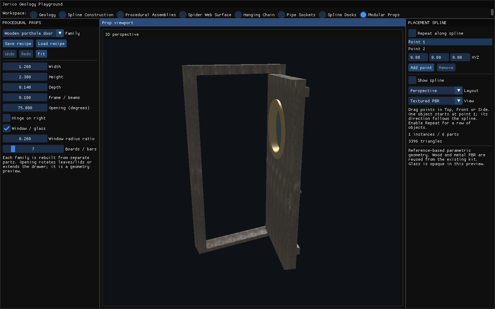
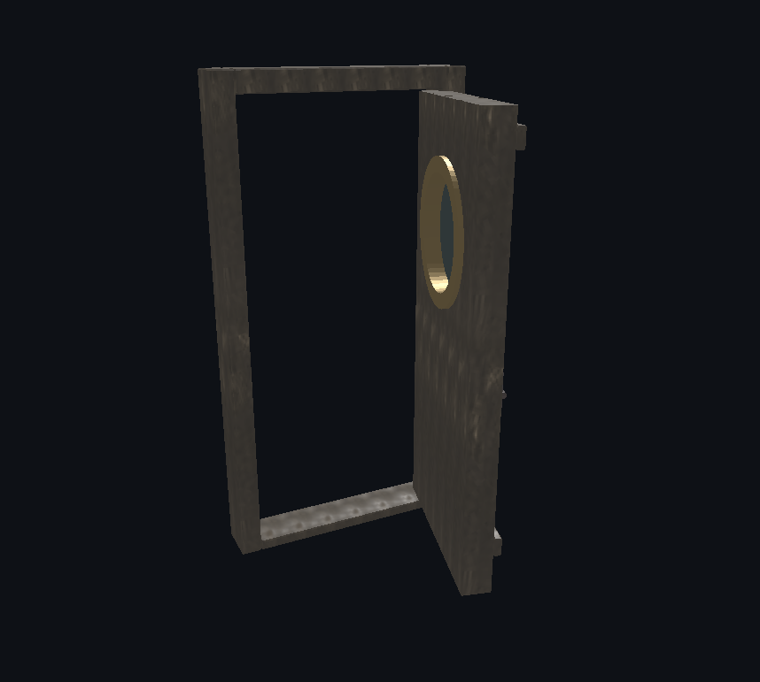
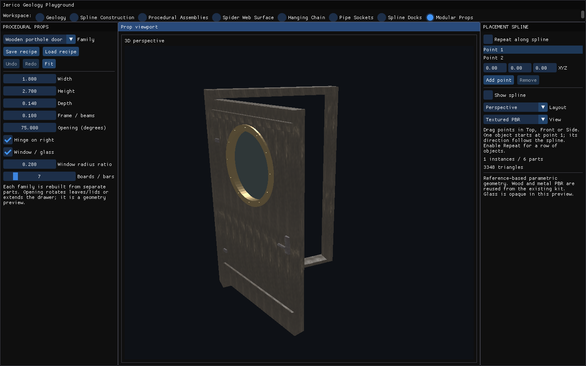
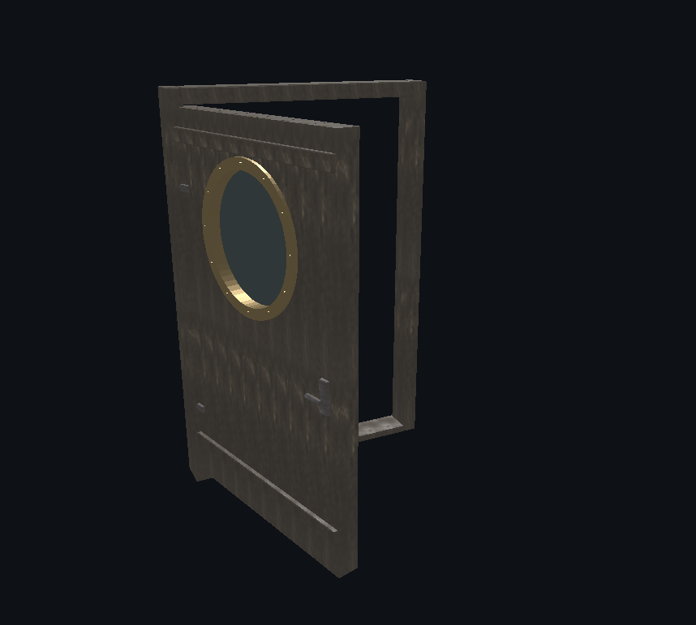
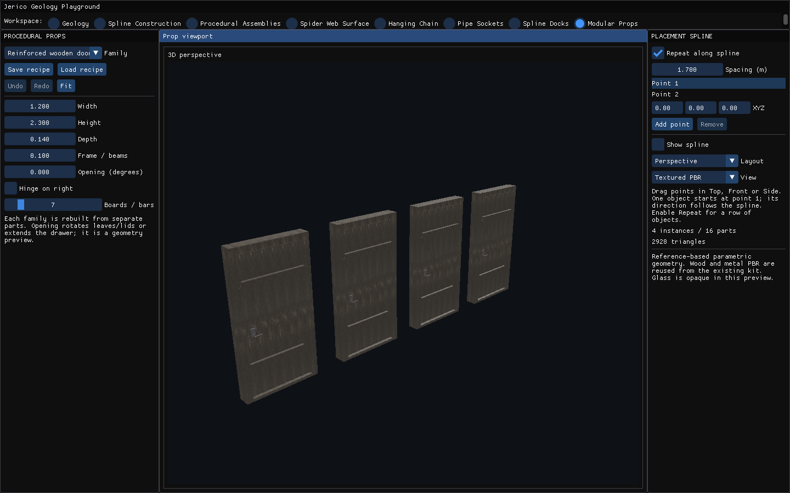
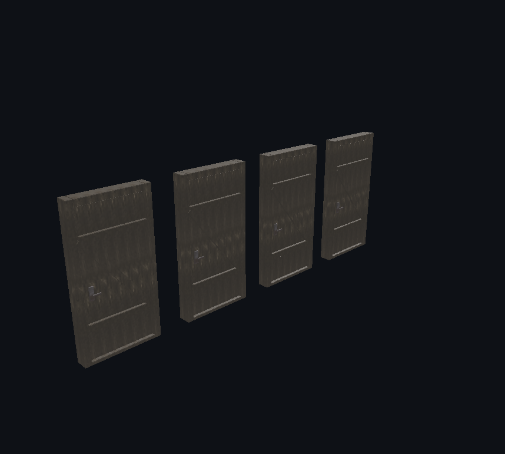

# Props y mecanismos — 3/3

Escenarios del generador paramétrico y vistas de la interfaz. Las imágenes no implican una simulación física de todos los mecanismos.

[Página 1](page-1.md) · [Página 2](page-2.md) · [Página 3](page-3.md)

[Todas las familias](../README.md)

### stage 22 viewport

Fuente: `Evidence/prop-system/final/stage-22-viewport.png`.

### stage 23 ui

Fuente: `Evidence/prop-system/final/stage-23-ui.png`.

### stage 23 viewport

Fuente: `Evidence/prop-system/final/stage-23-viewport.png`.

### stage 24 ui

Fuente: `Evidence/prop-system/final/stage-24-ui.png`.

### stage 24 viewport

Fuente: `Evidence/prop-system/final/stage-24-viewport.png`.

### stage 25 ui

Fuente: `Evidence/prop-system/final/stage-25-ui.png`.

### stage 25 viewport

Fuente: `Evidence/prop-system/final/stage-25-viewport.png`.

### stage 26 ui

Fuente: `Evidence/prop-system/final/stage-26-ui.png`.

### stage 26 viewport

Fuente: `Evidence/prop-system/final/stage-26-viewport.png`.
