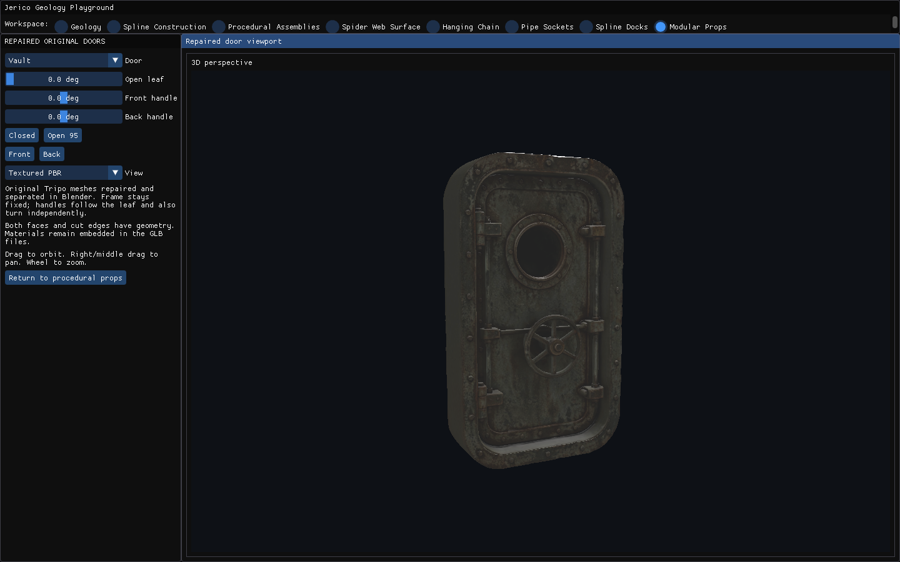
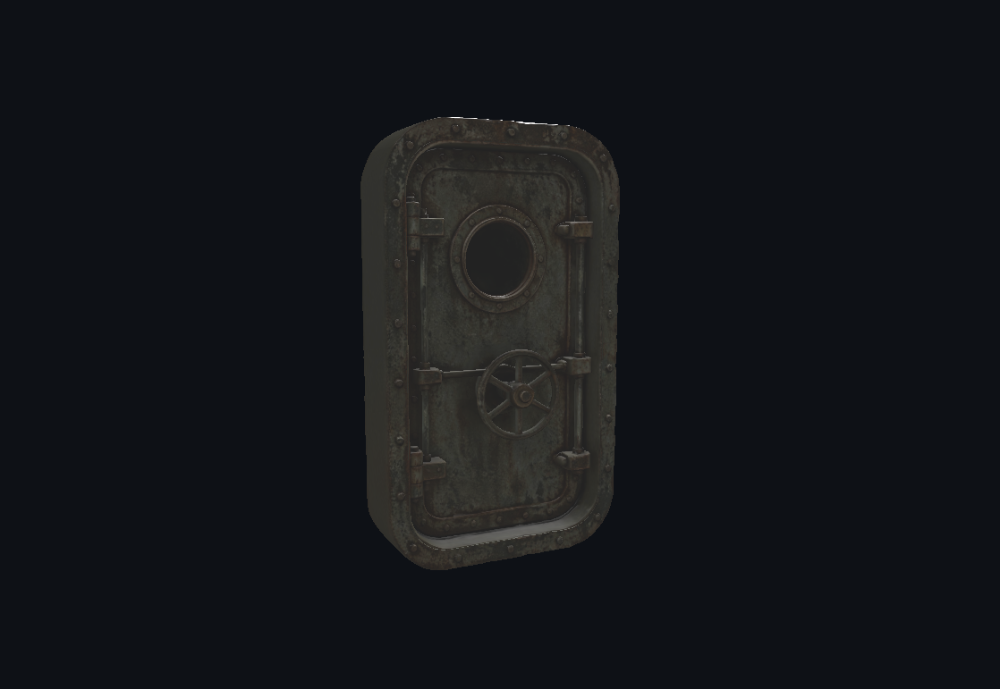
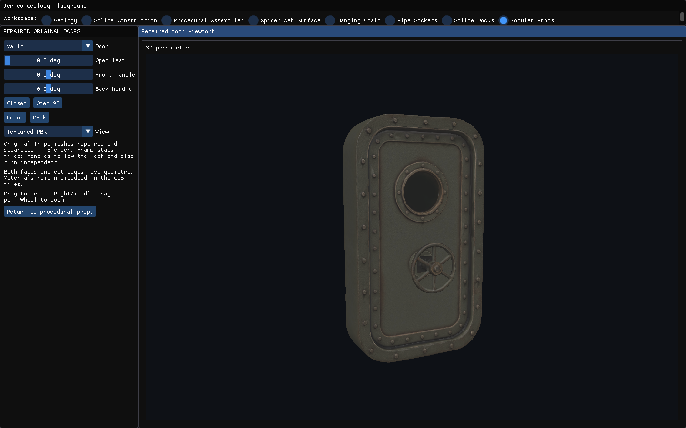
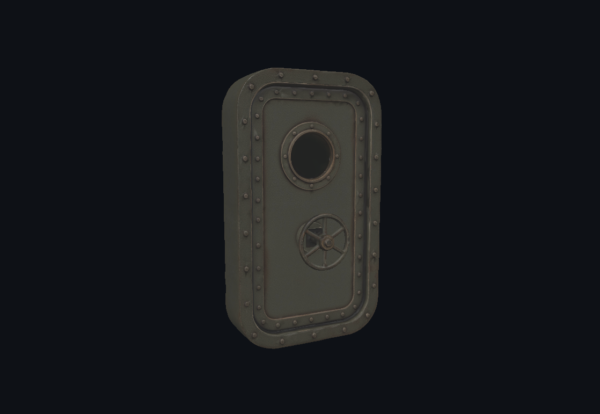
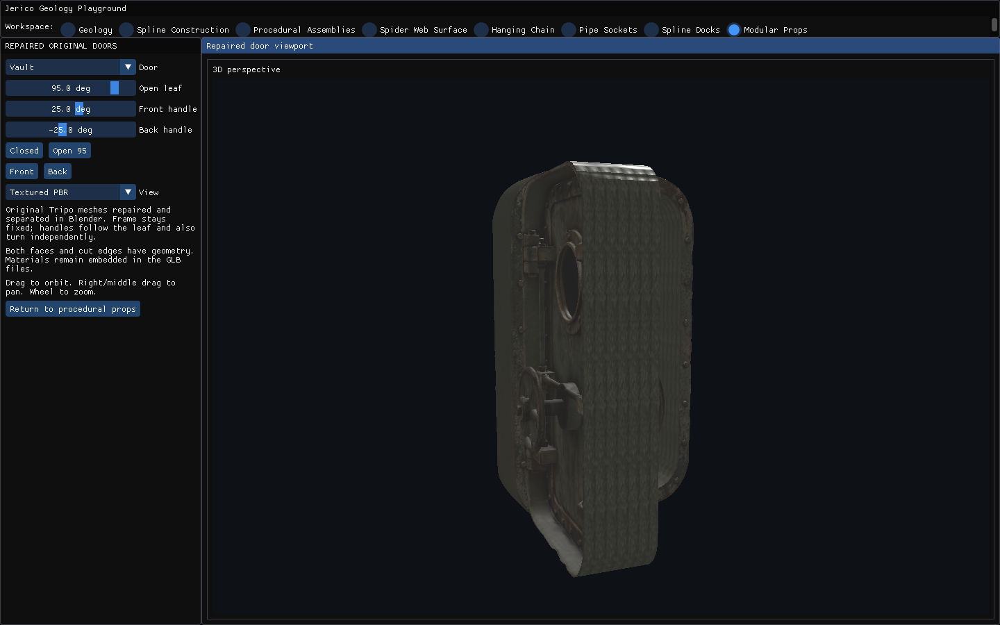
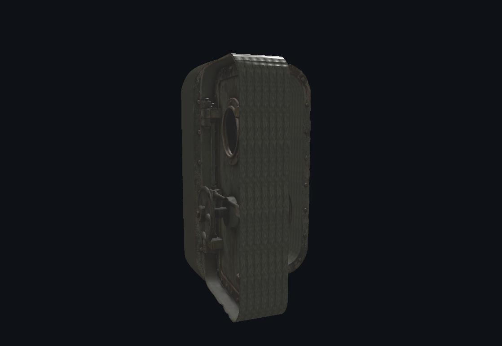
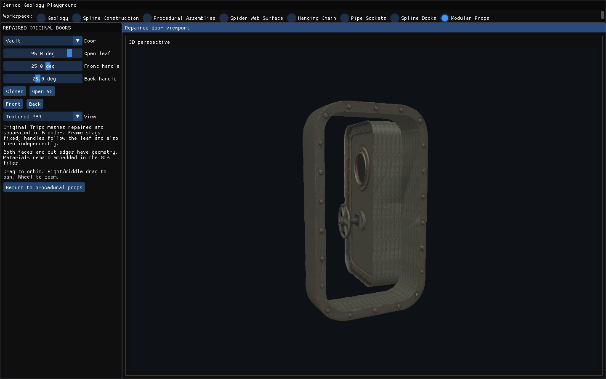
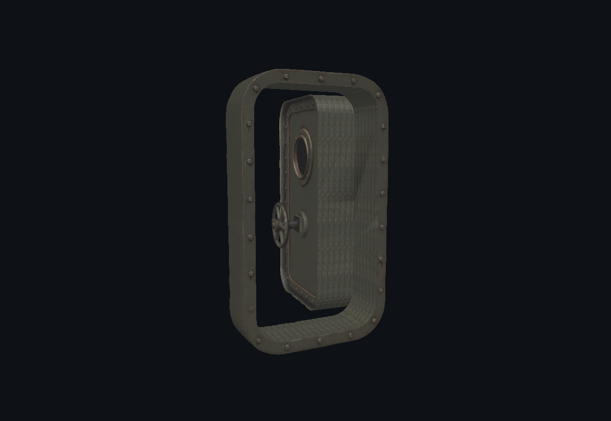

# Puertas articuladas — 2/2

Capturas de las cuatro puertas reparadas y sus piezas móviles. No representan una retopología integral ni una simulación de cerraduras.

[Página 1](page-1.md) · [Página 2](page-2.md)

[Todas las familias](../README.md)

### stage 12 ui

Fuente: `Evidence/doors-repair/native/stage-12-ui.png`.

### stage 12 viewport

Fuente: `Evidence/doors-repair/native/stage-12-viewport.png`.

### stage 13 ui

Fuente: `Evidence/doors-repair/native/stage-13-ui.png`.

### stage 13 viewport

Fuente: `Evidence/doors-repair/native/stage-13-viewport.png`.

### stage 14 ui

Fuente: `Evidence/doors-repair/native/stage-14-ui.png`.

### stage 14 viewport

Fuente: `Evidence/doors-repair/native/stage-14-viewport.png`.

### stage 15 ui

Fuente: `Evidence/doors-repair/native/stage-15-ui.png`.

### stage 15 viewport

Fuente: `Evidence/doors-repair/native/stage-15-viewport.png`.
