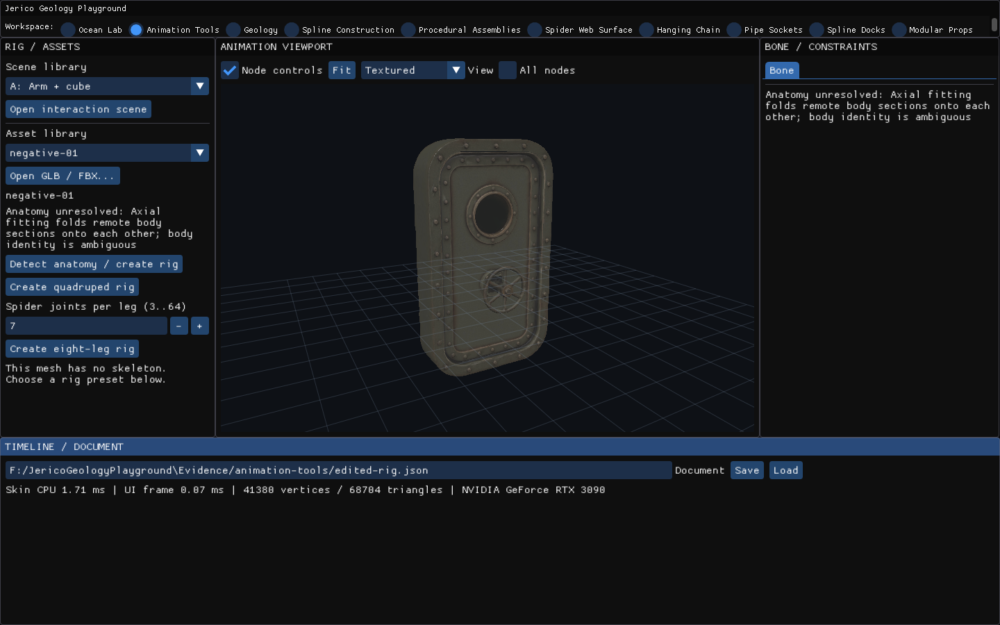
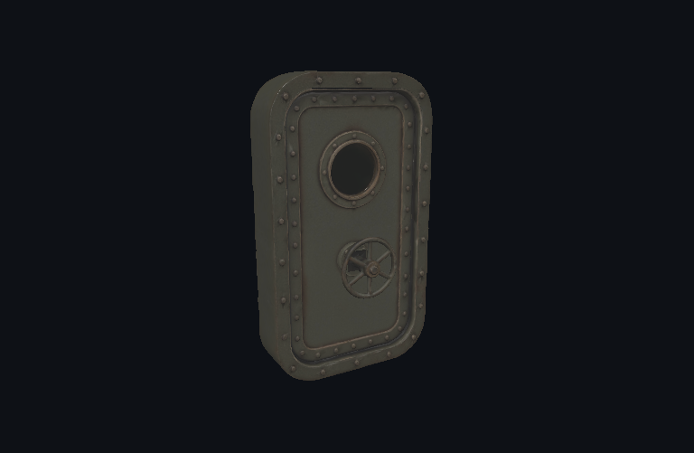
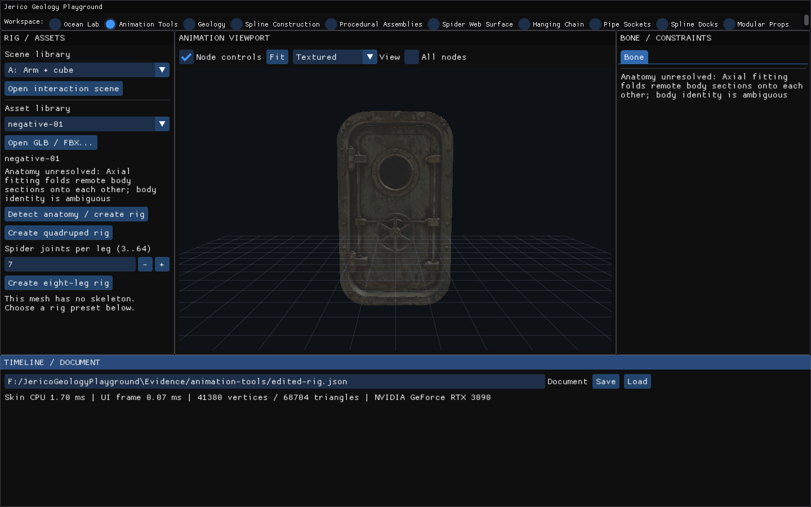
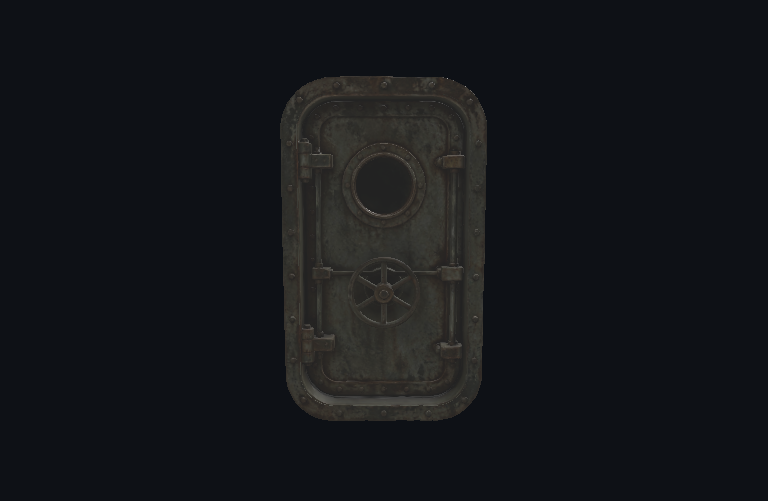
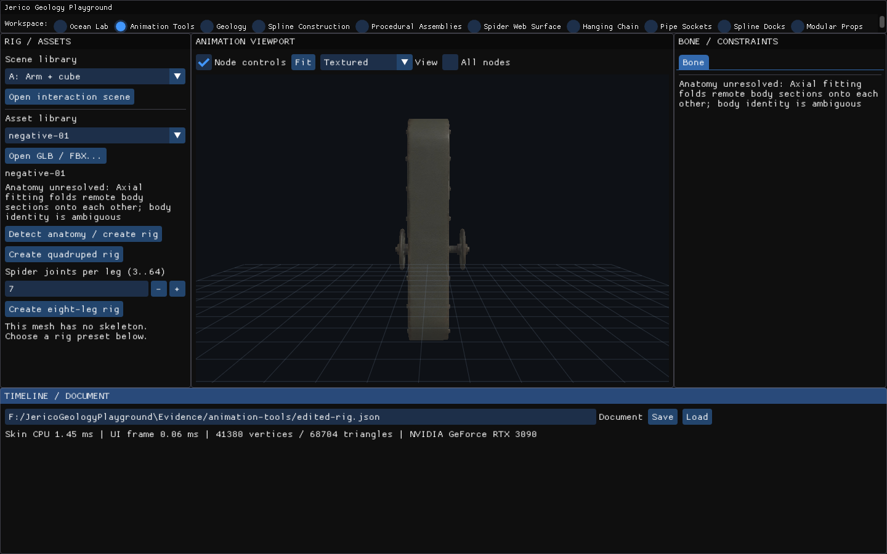
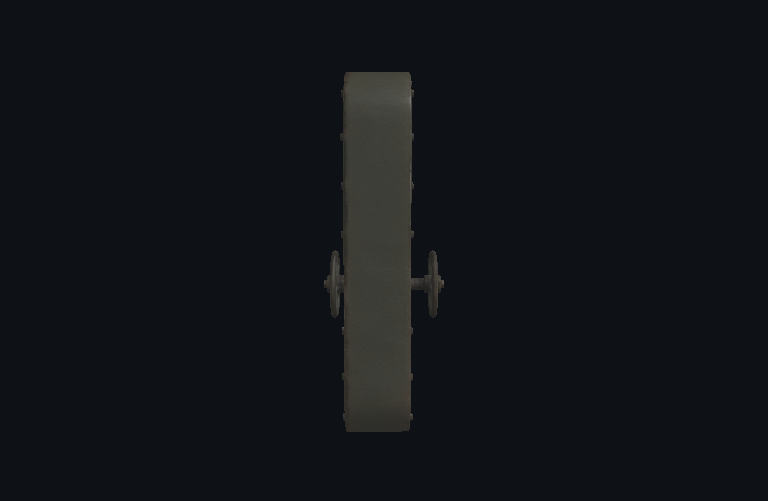
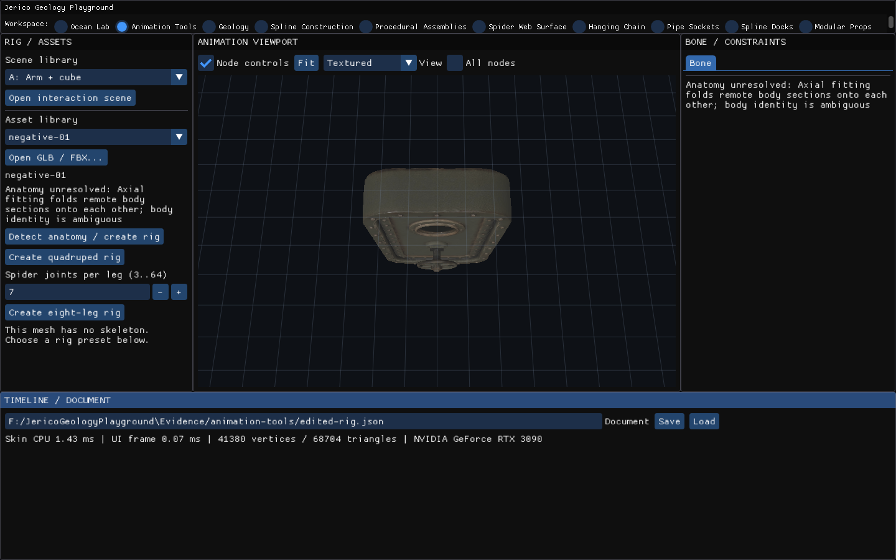
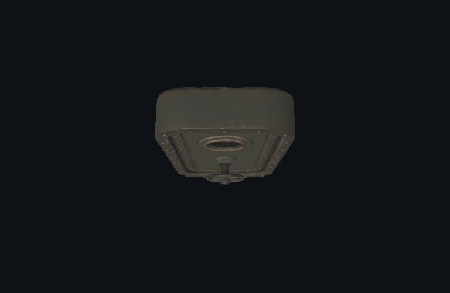

# Huesos, rigs e IK/FK — 3/3

Rigs propuestos y deformación de seis modelos, más un control mecánico negativo. La anatomía detallada y el reconocimiento general siguen pendientes.

[Página 1](page-1.md) · [Página 2](page-2.md) · [Página 3](page-3.md)

[Todas las familias](../README.md)

### stage 24 ui

Fuente: `Evidence/animation-tools/resume-2026-11-03/anatomy-region-native/stage-24-ui.png`.

### stage 24 viewport

Fuente: `Evidence/animation-tools/resume-2026-11-03/anatomy-region-native/stage-24-viewport.png`.

### stage 25 ui

Fuente: `Evidence/animation-tools/resume-2026-11-03/anatomy-region-native/stage-25-ui.png`.

### stage 25 viewport

Fuente: `Evidence/animation-tools/resume-2026-11-03/anatomy-region-native/stage-25-viewport.png`.

### stage 26 ui

Fuente: `Evidence/animation-tools/resume-2026-11-03/anatomy-region-native/stage-26-ui.png`.

### stage 26 viewport

Fuente: `Evidence/animation-tools/resume-2026-11-03/anatomy-region-native/stage-26-viewport.png`.

### stage 27 ui

Fuente: `Evidence/animation-tools/resume-2026-11-03/anatomy-region-native/stage-27-ui.png`.

### stage 27 viewport

Fuente: `Evidence/animation-tools/resume-2026-11-03/anatomy-region-native/stage-27-viewport.png`.
