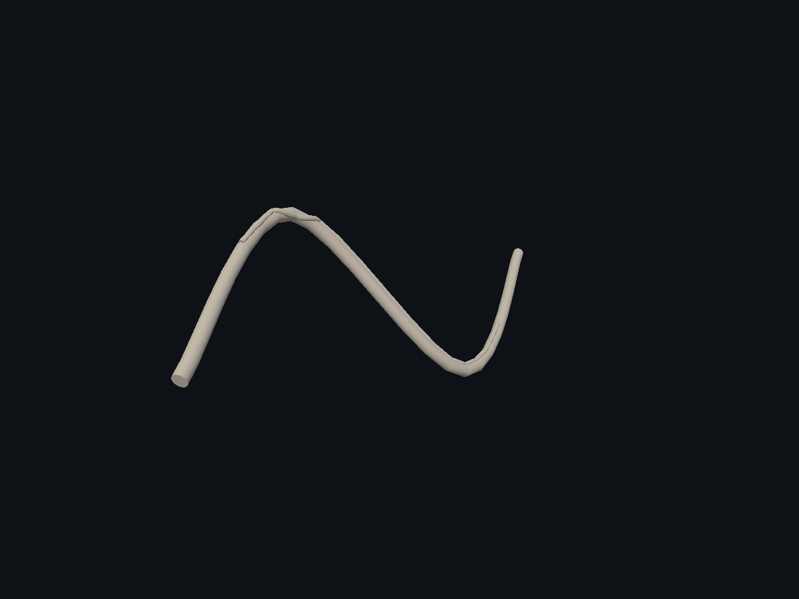
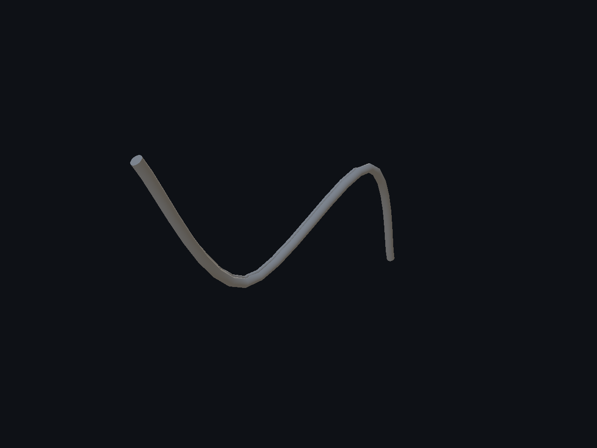
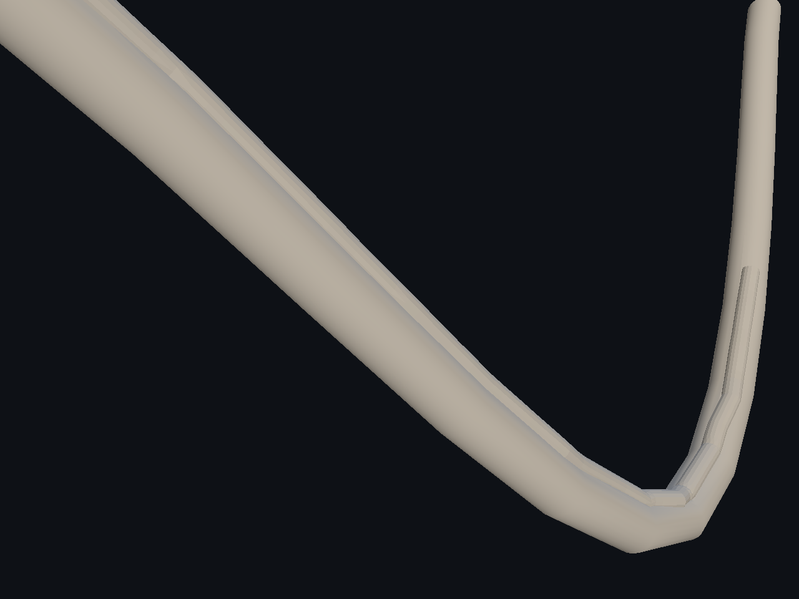
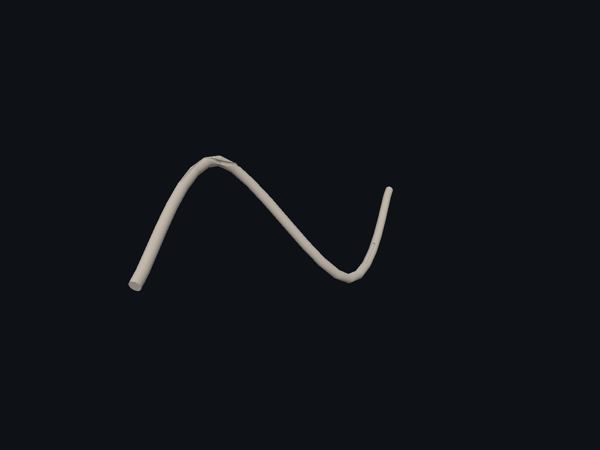
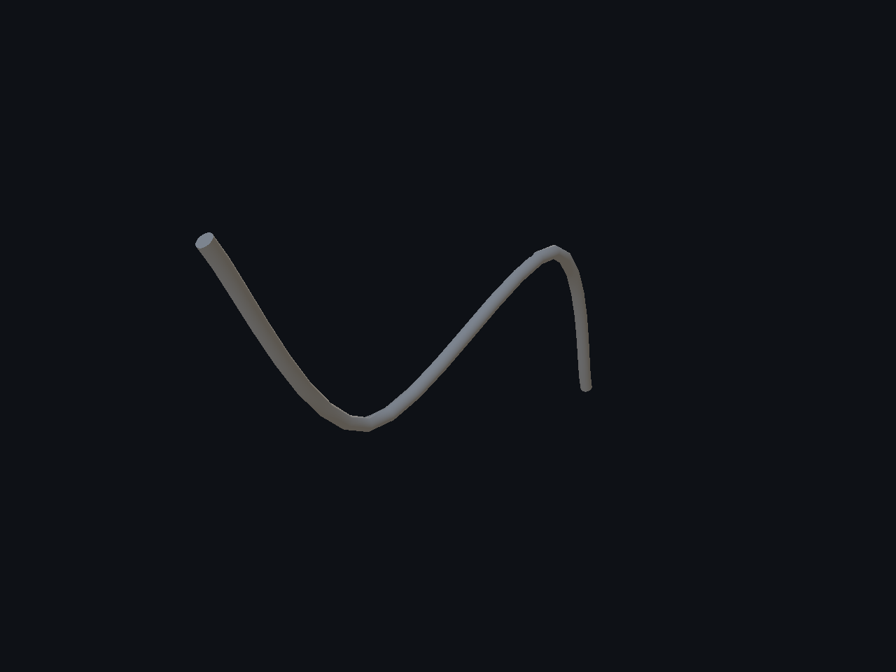
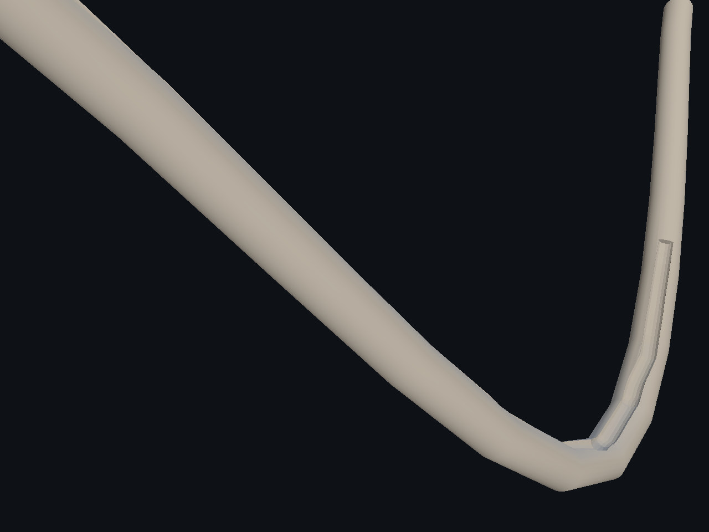
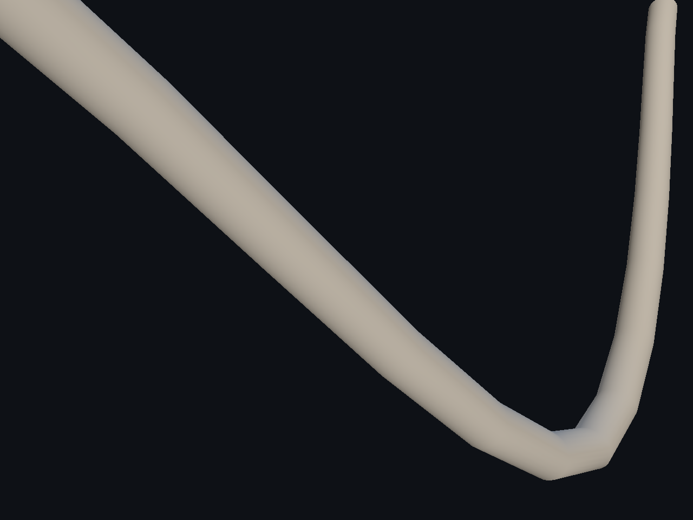

# Splines — 10/10

Follow surface adapta la guía al receptor y orienta el perfil, con distancia máxima explícita y refinamiento de los tramos. Ocho suites Release, cuatro AddressSanitizer y recorrido UI comprobados; la regresión posterior de anillo ajustado también pasa. Comparaciones con cámaras idénticas, replay/off y modo libre. El error indicado es muestreado en cuartos/punto medio, no una cota global. Anchura/profundidad siguen autoradas. Persisten facetas, acabado poco natural y pendientes de UX/Undo/Redo y del goal.

[Página 1](page-1.md) · [Página 2](page-2.md) · [Página 3](page-3.md) · [Página 4](page-4.md) · [Página 5](page-5.md) · [Página 6](page-6.md) · [Página 7](page-7.md) · [Página 8](page-8.md) · [Página 9](page-9.md) · [Página 10](page-10.md)

[Todas las familias](../README.md)

[Mediciones](surface-follow-2026-11-04/spatial-damage-proof.json) · [Ejecución](surface-follow-2026-11-04/execution.json) · [ASan](surface-follow-2026-11-04/asan-summary.json) · [Controles](surface-follow-2026-11-04/ui-result.json).

### curved pipe decal surface off 0

### curved pipe decal surface off 1

### curved pipe decal surface off 2

### curved pipe decal surface replay 0

### curved pipe decal surface replay 1

### curved pipe decal surface replay 2

### curved pipe off 0

### curved pipe off 1

### curved pipe off 2

### curved pipe replay 0

### curved pipe replay 1

### curved pipe replay 2

### curved pipe surface after 0

### curved pipe surface after 1

### curved pipe surface after 2

### curved pipe surface before 0

### curved pipe surface before 1

### curved pipe surface before 2

### curved pipe surface off 0

### curved pipe surface off 1

### curved pipe surface off 2

### curved pipe surface replay 0

### curved pipe surface replay 1

### curved pipe surface replay 2

