# Splines — 2/4

Capturas nativas actuales antes/después en siete perfiles y condiciones, más las pruebas existentes del generador. El ajuste crea cortes visibles y conserva el sólido en las pruebas ejercitadas. **Beauty parcial:** las ranuras siguen siendo mecánicas y la vista de detalle de torsión queda de canto. Decals 3D siguiendo spline siguen pendientes.

[Página 1](page-1.md) · [Página 2](page-2.md) · [Página 3](page-3.md) · [Página 4](page-4.md)

[Todas las familias](../README.md)

[Registro de ejecución](surface-fit-2026-11-04/result.json).

### cable tray crossbars

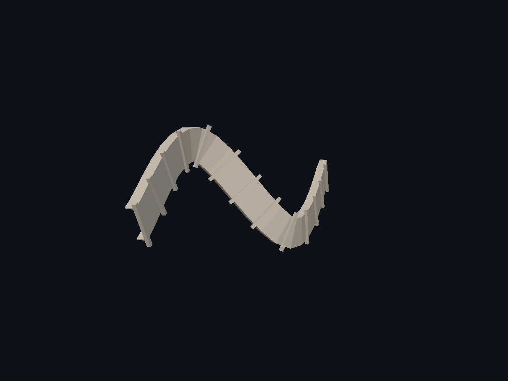

Fuente: `Evidence/spline-authoring-2026-11-04/native-1/cable-tray-crossbars.png`.

### cable

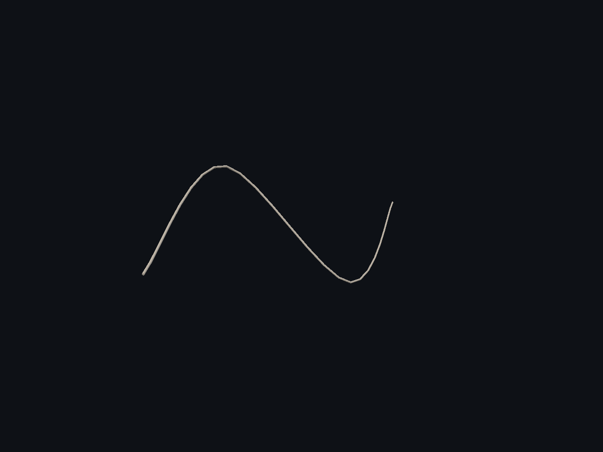

Fuente: `Evidence/spline-authoring-2026-11-04/native-1/cable.png`.

### corrugated hose

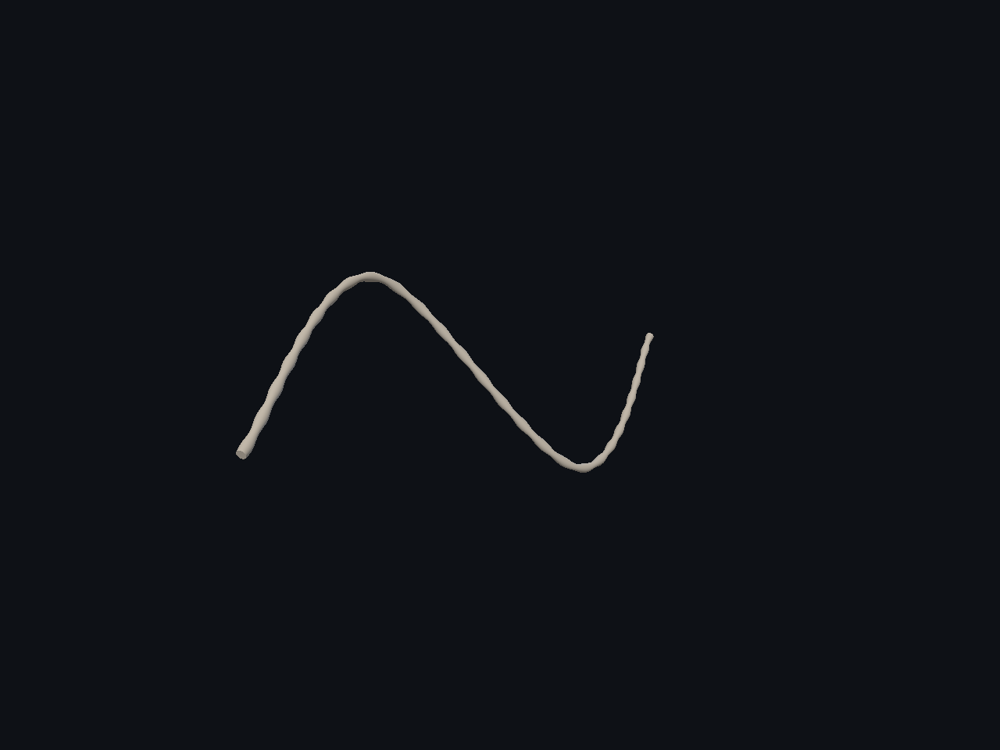

Fuente: `Evidence/spline-authoring-2026-11-04/native-1/corrugated-hose.png`.

### fitted beam after detail

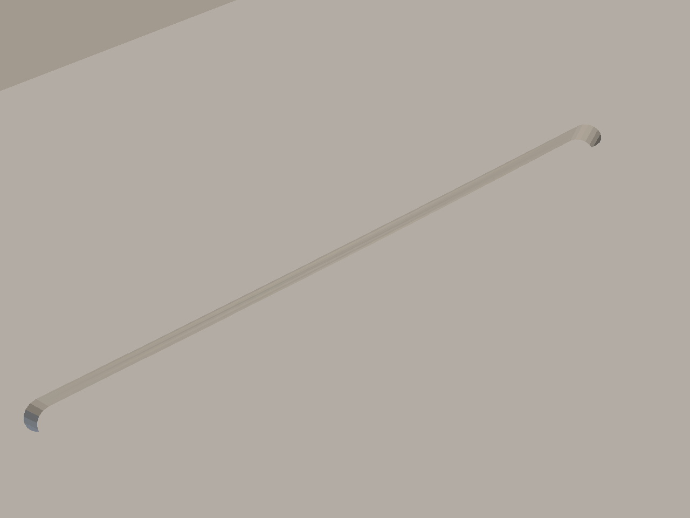

Fuente: `Evidence/spline-authoring-2026-11-04/native-1/fitted-beam-after-detail.png`.

### fitted beam after

Fuente: `Evidence/spline-authoring-2026-11-04/native-1/fitted-beam-after.png`.

### fitted beam before detail

Fuente: `Evidence/spline-authoring-2026-11-04/native-1/fitted-beam-before-detail.png`.

### fitted beam before

Fuente: `Evidence/spline-authoring-2026-11-04/native-1/fitted-beam-before.png`.

### fitted curve after detail

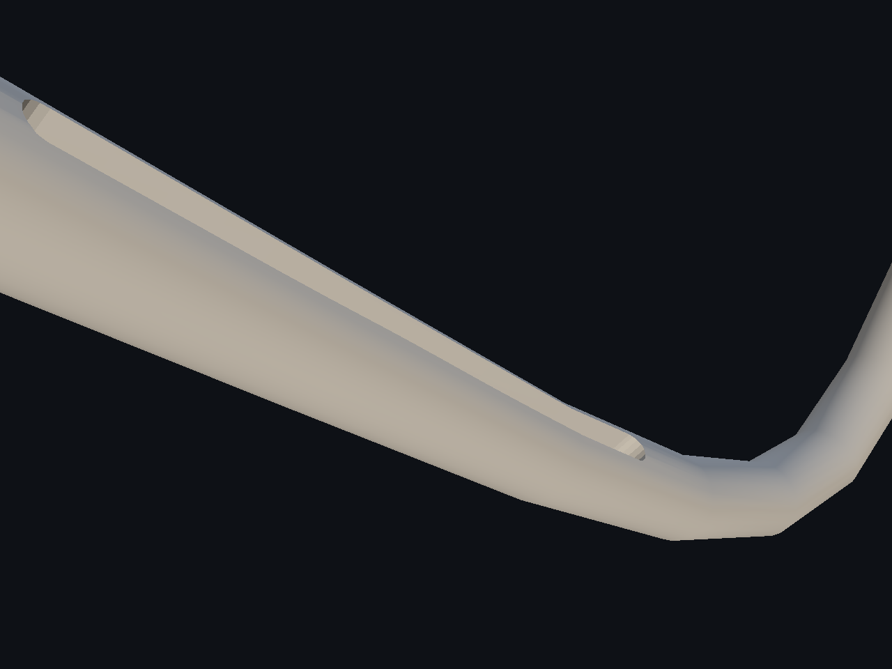

Fuente: `Evidence/spline-authoring-2026-11-04/native-1/fitted-curve-after-detail.png`.

### fitted curve after

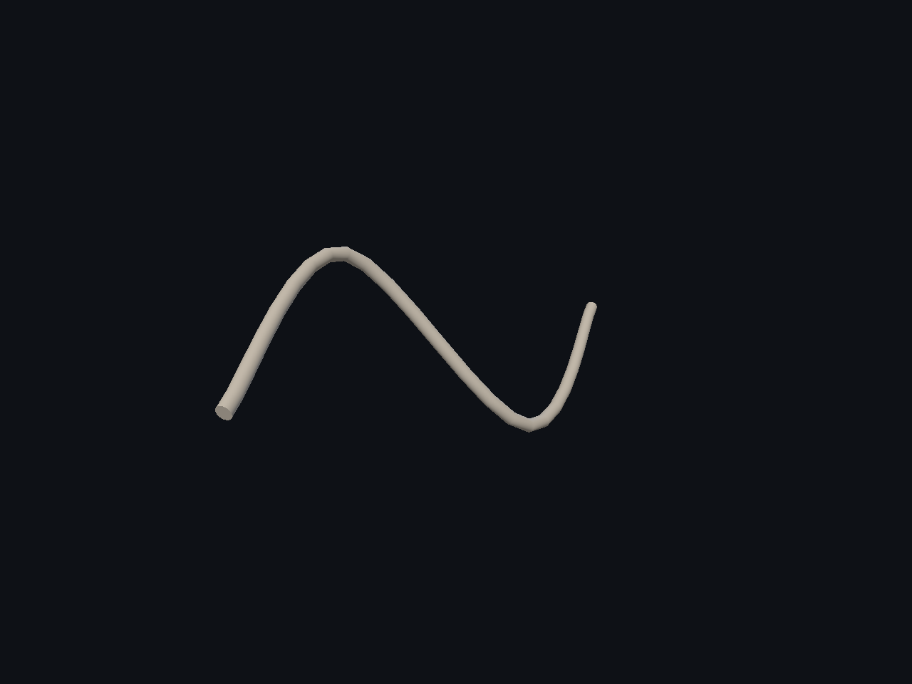

Fuente: `Evidence/spline-authoring-2026-11-04/native-1/fitted-curve-after.png`.

### fitted curve before detail

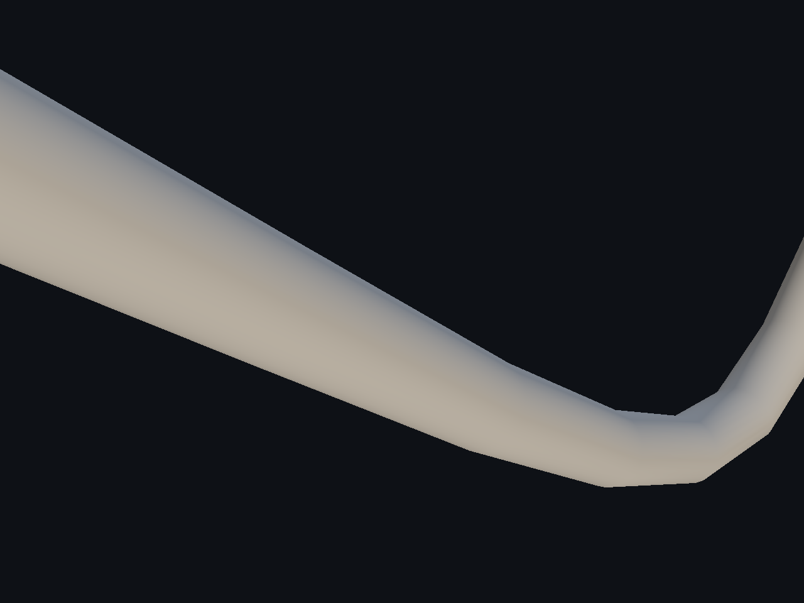

Fuente: `Evidence/spline-authoring-2026-11-04/native-1/fitted-curve-before-detail.png`.

### fitted curve before

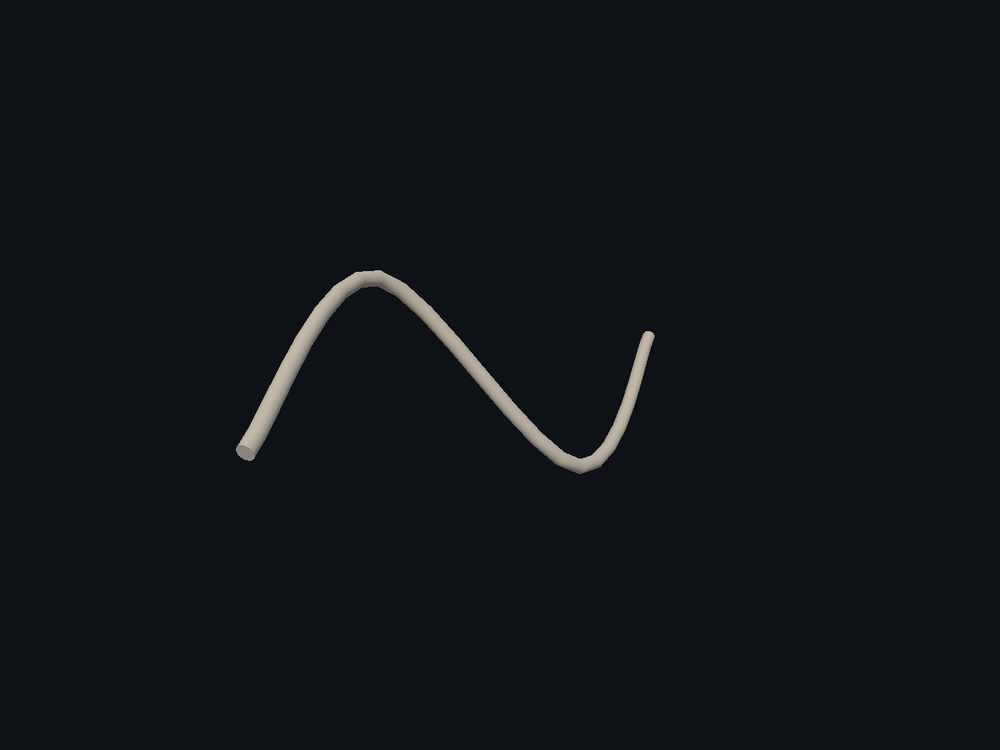

Fuente: `Evidence/spline-authoring-2026-11-04/native-1/fitted-curve-before.png`.

### fitted hollow after detail

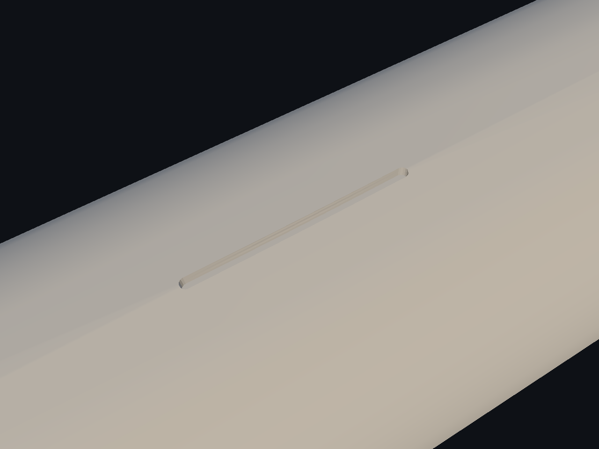

Fuente: `Evidence/spline-authoring-2026-11-04/native-1/fitted-hollow-after-detail.png`.

### fitted hollow after

Fuente: `Evidence/spline-authoring-2026-11-04/native-1/fitted-hollow-after.png`.

### fitted hollow before detail

Fuente: `Evidence/spline-authoring-2026-11-04/native-1/fitted-hollow-before-detail.png`.

### fitted hollow before

Fuente: `Evidence/spline-authoring-2026-11-04/native-1/fitted-hollow-before.png`.

### fitted large after detail

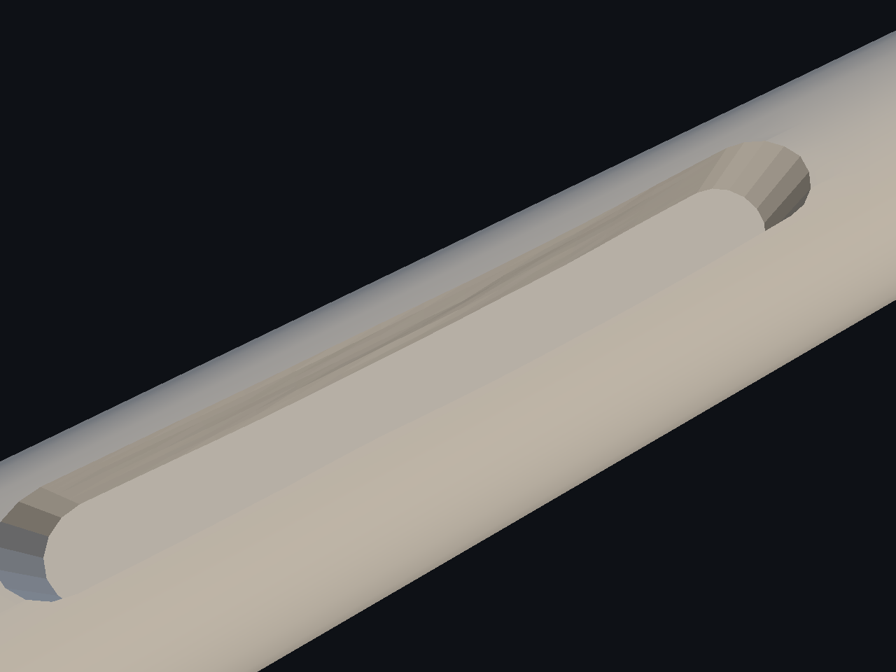

Fuente: `Evidence/spline-authoring-2026-11-04/native-1/fitted-large-after-detail.png`.

### fitted large after

Fuente: `Evidence/spline-authoring-2026-11-04/native-1/fitted-large-after.png`.

### fitted large before detail

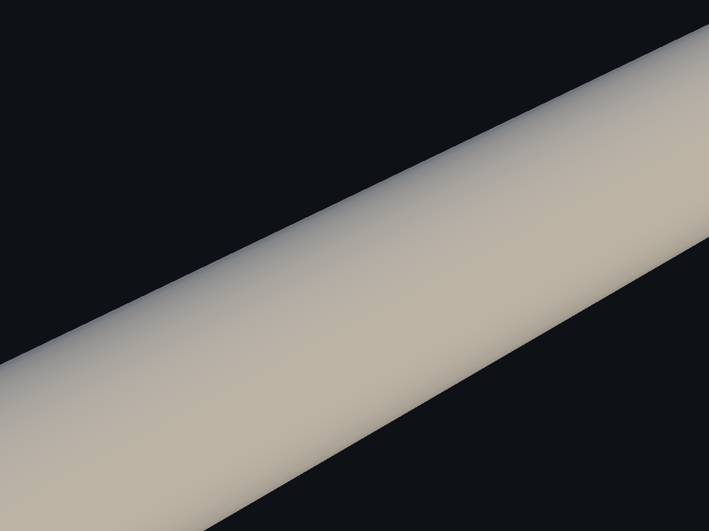

Fuente: `Evidence/spline-authoring-2026-11-04/native-1/fitted-large-before-detail.png`.

### fitted large before

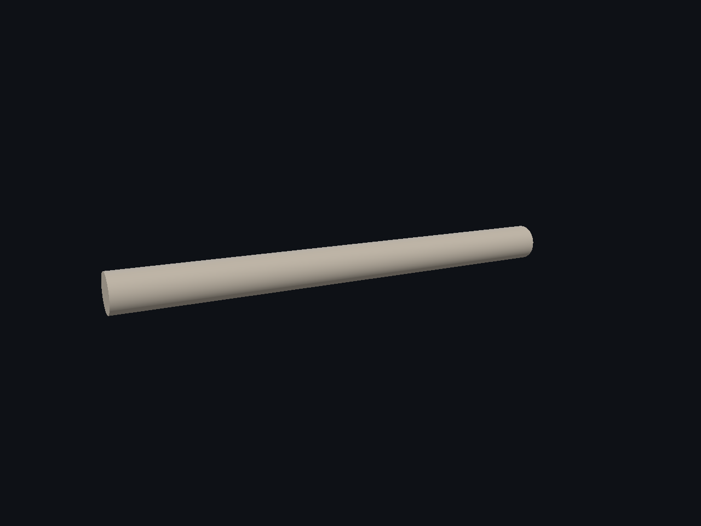

Fuente: `Evidence/spline-authoring-2026-11-04/native-1/fitted-large-before.png`.

### fitted ribs after detail

Fuente: `Evidence/spline-authoring-2026-11-04/native-1/fitted-ribs-after-detail.png`.

### fitted ribs after

Fuente: `Evidence/spline-authoring-2026-11-04/native-1/fitted-ribs-after.png`.

### fitted ribs before detail

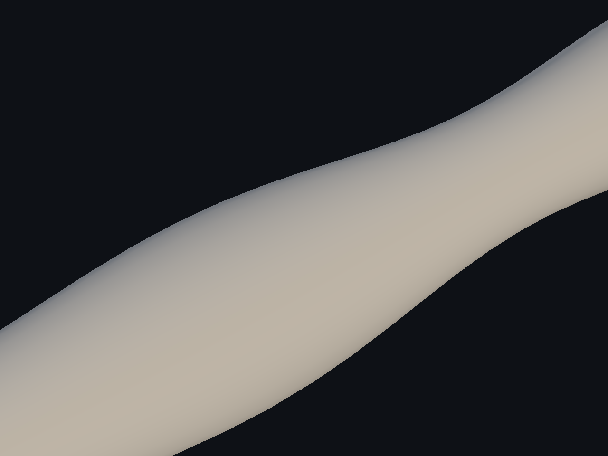

Fuente: `Evidence/spline-authoring-2026-11-04/native-1/fitted-ribs-before-detail.png`.

### fitted ribs before

Fuente: `Evidence/spline-authoring-2026-11-04/native-1/fitted-ribs-before.png`.

### fitted small after detail

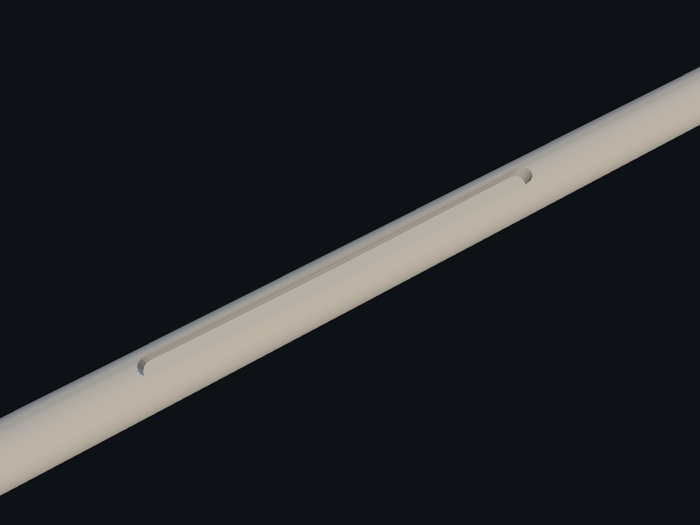

Fuente: `Evidence/spline-authoring-2026-11-04/native-1/fitted-small-after-detail.png`.
