# Splines — 3/10

Capturas nativas actuales antes/después en siete perfiles y condiciones, más las pruebas existentes del generador. El ajuste crea cortes visibles y conserva el sólido en las pruebas ejercitadas. **Beauty parcial:** las ranuras siguen siendo mecánicas y la vista de detalle de torsión queda de canto. Decals 3D siguiendo spline siguen pendientes.

[Página 1](page-1.md) · [Página 2](page-2.md) · [Página 3](page-3.md) · [Página 4](page-4.md) · [Página 5](page-5.md) · [Página 6](page-6.md) · [Página 7](page-7.md) · [Página 8](page-8.md) · [Página 9](page-9.md) · [Página 10](page-10.md)

[Todas las familias](../README.md)

[Registro de ejecución](surface-fit-2026-11-04/result.json).

### fitted small after

Fuente: `Evidence/spline-authoring-2026-11-04/native-1/fitted-small-after.png`.

### fitted small before detail

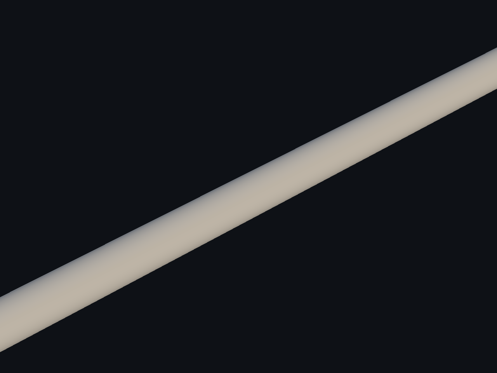

Fuente: `Evidence/spline-authoring-2026-11-04/native-1/fitted-small-before-detail.png`.

### fitted small before

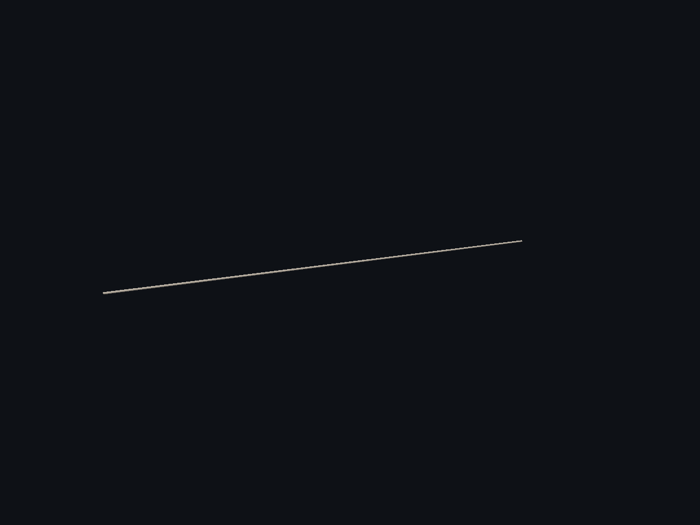

Fuente: `Evidence/spline-authoring-2026-11-04/native-1/fitted-small-before.png`.

### fitted twist after detail

Fuente: `Evidence/spline-authoring-2026-11-04/native-1/fitted-twist-after-detail.png`.

### fitted twist after

Fuente: `Evidence/spline-authoring-2026-11-04/native-1/fitted-twist-after.png`.

### fitted twist before detail

Fuente: `Evidence/spline-authoring-2026-11-04/native-1/fitted-twist-before-detail.png`.

### fitted twist before

Fuente: `Evidence/spline-authoring-2026-11-04/native-1/fitted-twist-before.png`.

### fractured pipe

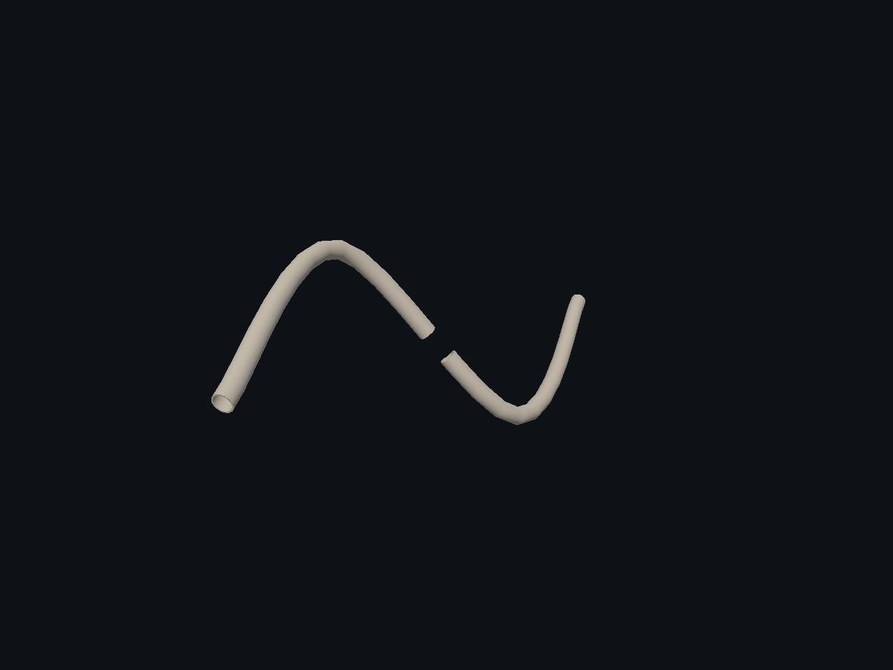

Fuente: `Evidence/spline-authoring-2026-11-04/native-1/fractured-pipe.png`.

### high curvature bend

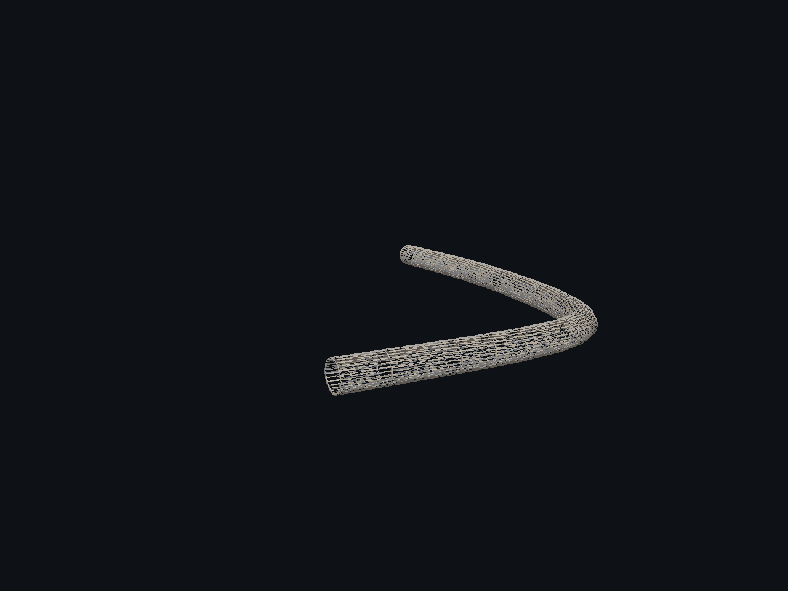

Fuente: `Evidence/spline-authoring-2026-11-04/native-1/high-curvature-bend.png`.

### i beam run

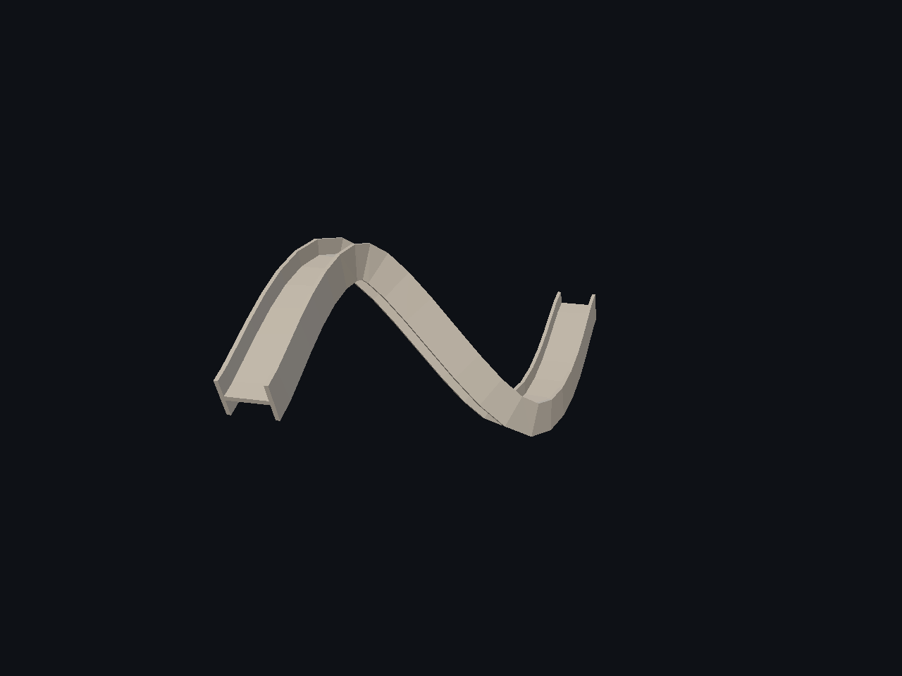

Fuente: `Evidence/spline-authoring-2026-11-04/native-1/i-beam-run.png`.

### pipe s curve

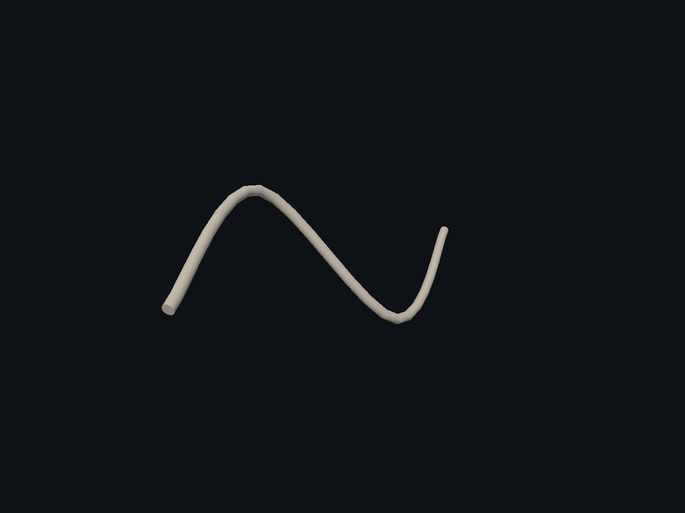

Fuente: `Evidence/spline-authoring-2026-11-04/native-1/pipe-s-curve.png`.

### pipe seam

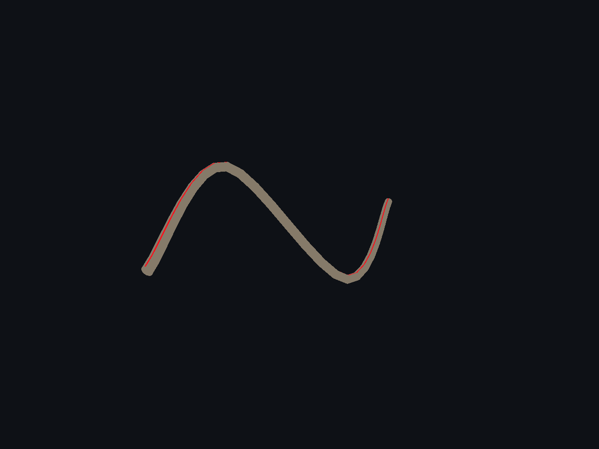

Fuente: `Evidence/spline-authoring-2026-11-04/native-1/pipe-seam.png`.

### pipe straight

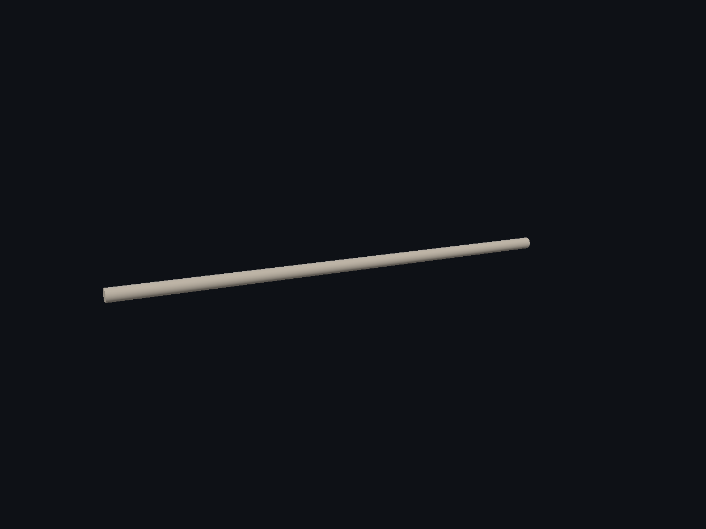

Fuente: `Evidence/spline-authoring-2026-11-04/native-1/pipe-straight.png`.

### pipe uv checker

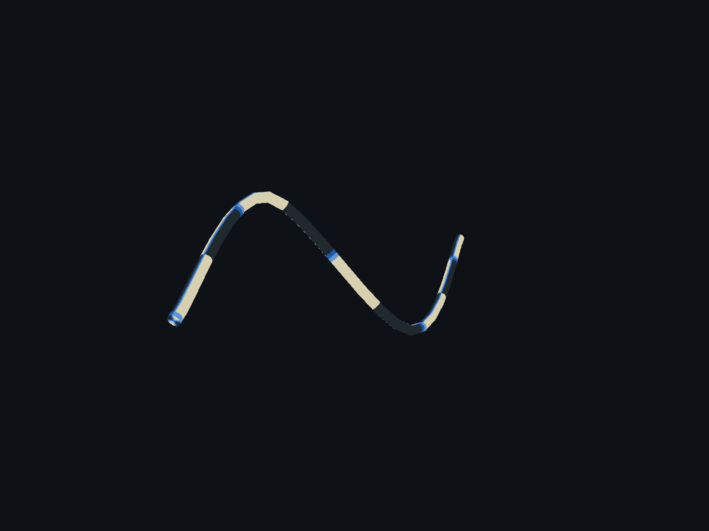

Fuente: `Evidence/spline-authoring-2026-11-04/native-1/pipe-uv-checker.png`.

### pipe vertical rmf

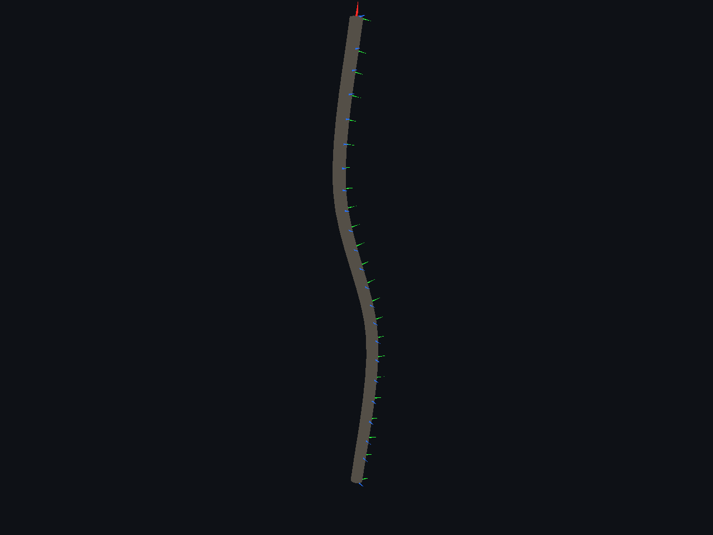

Fuente: `Evidence/spline-authoring-2026-11-04/native-1/pipe-vertical-rmf.png`.

### rectangular duct

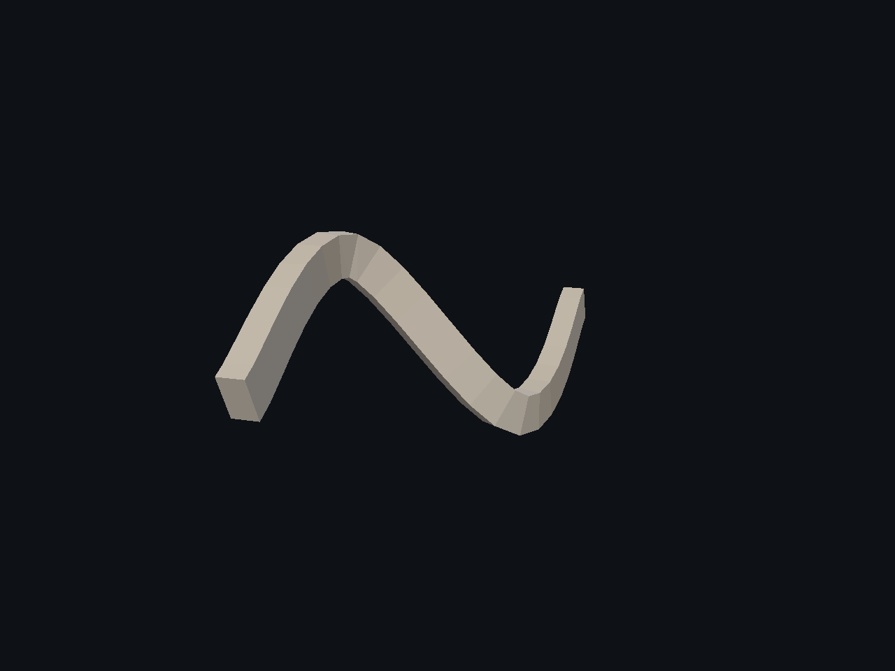

Fuente: `Evidence/spline-authoring-2026-11-04/native-1/rectangular-duct.png`.

### shared crack bake uv

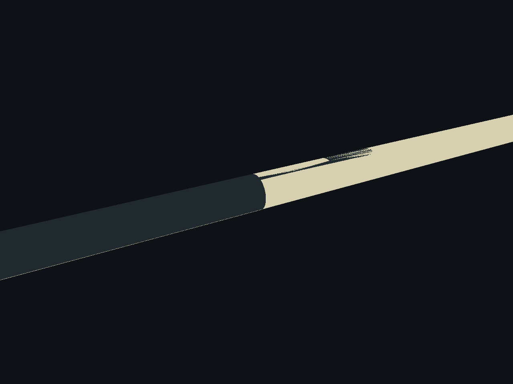

Fuente: `Evidence/spline-authoring-2026-11-04/native-1/shared-crack-bake-uv.png`.

### shared crack lit

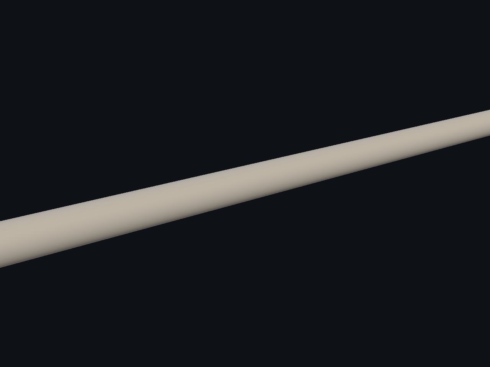

Fuente: `Evidence/spline-authoring-2026-11-04/native-1/shared-crack-lit.png`.

### shared crack wire

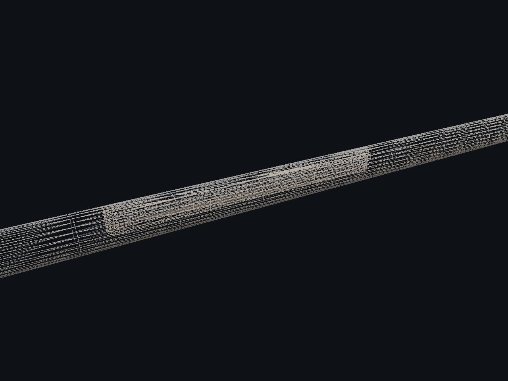

Fuente: `Evidence/spline-authoring-2026-11-04/native-1/shared-crack-wire.png`.

### twisted duct

Fuente: `Evidence/spline-authoring-2026-11-04/native-1/twisted-duct.png`.
