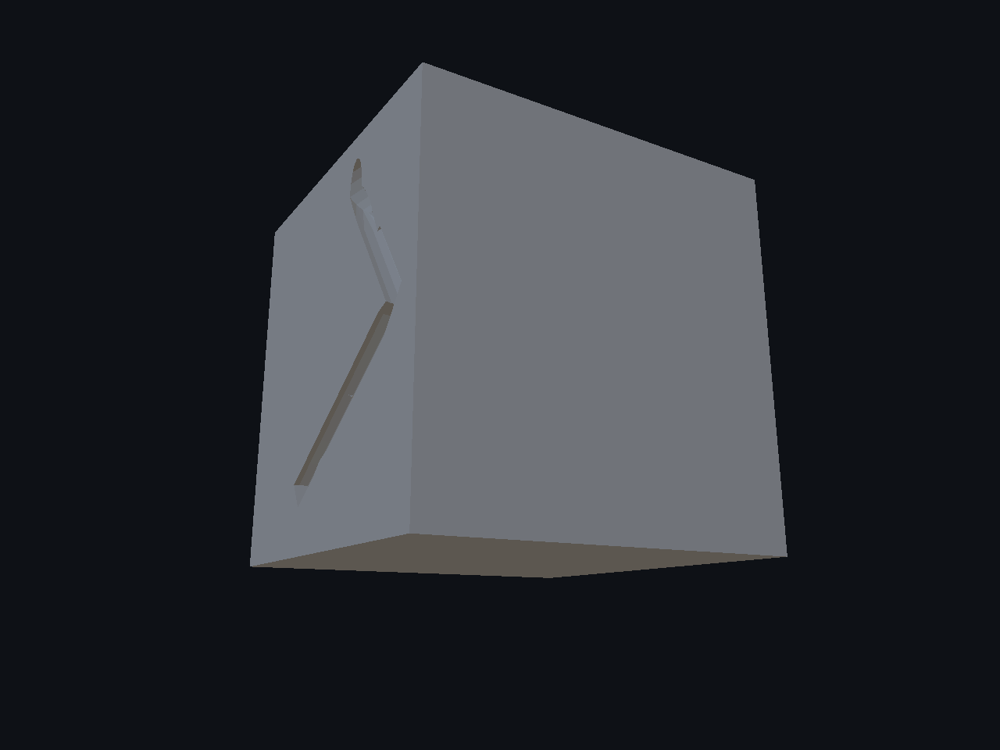
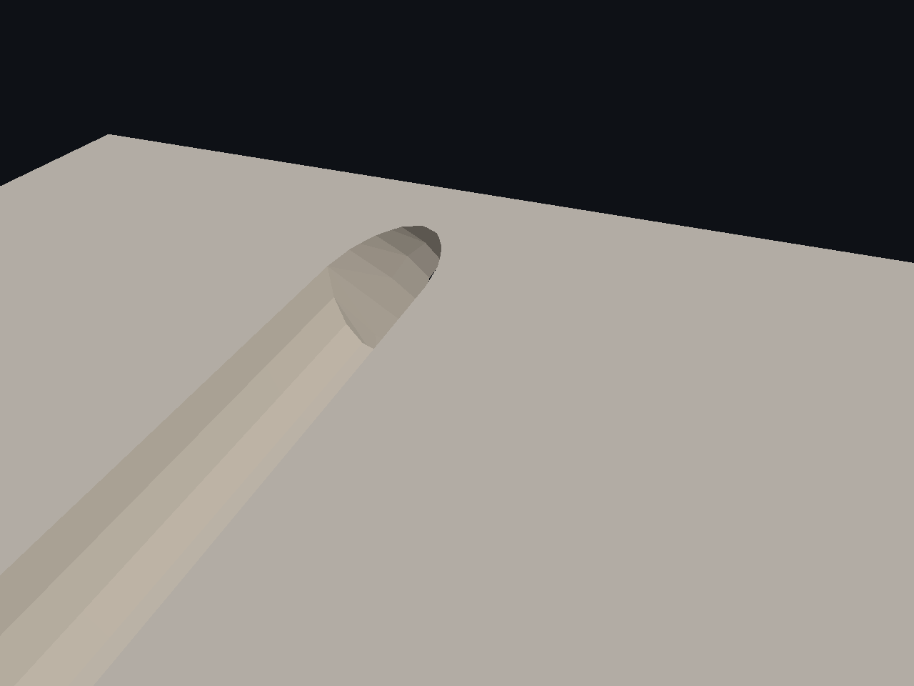
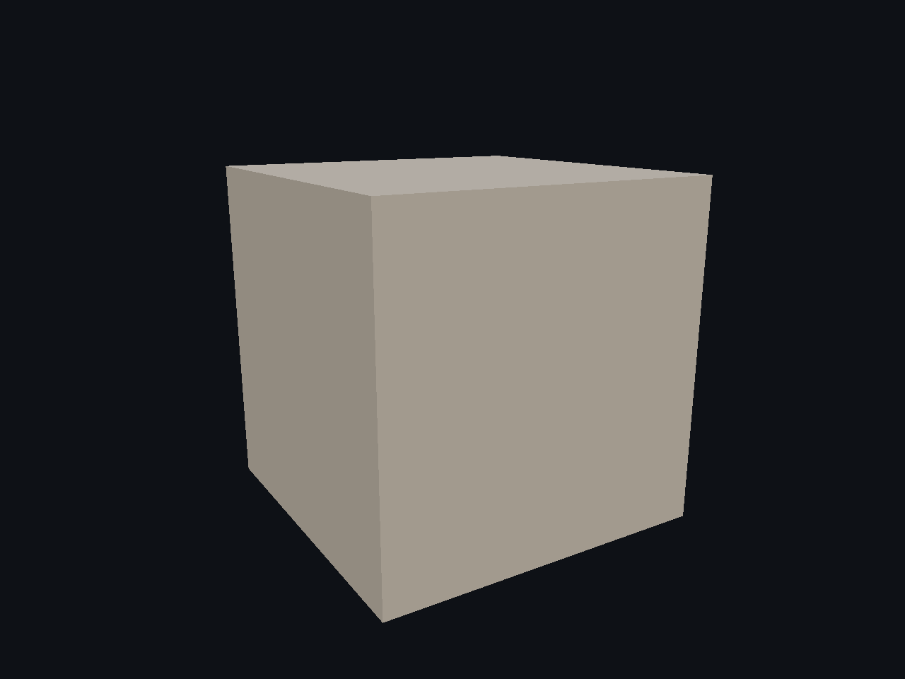
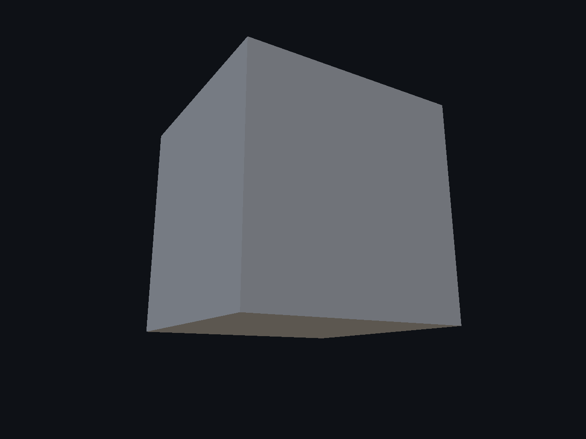
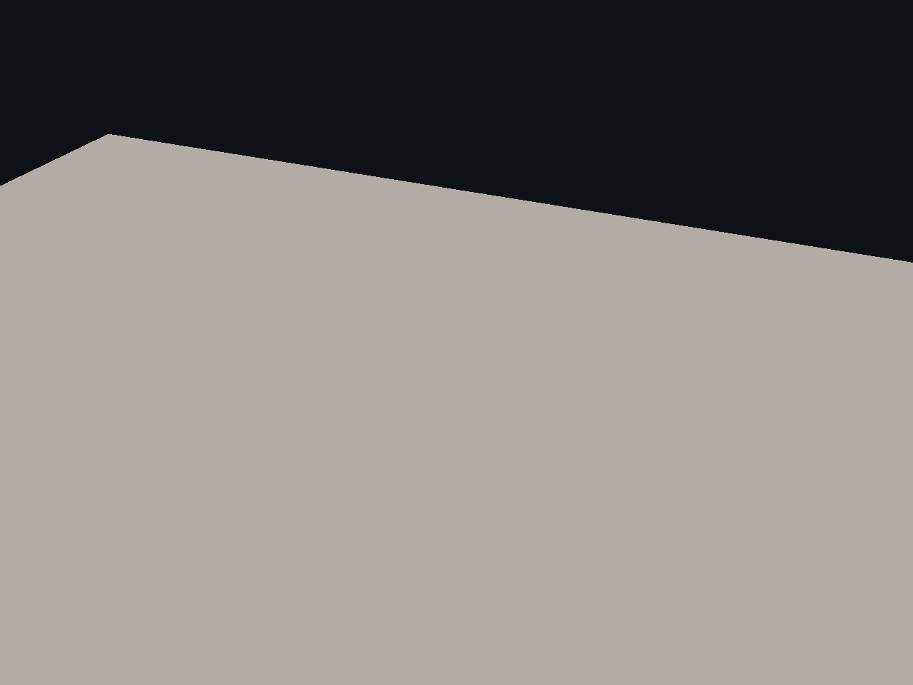
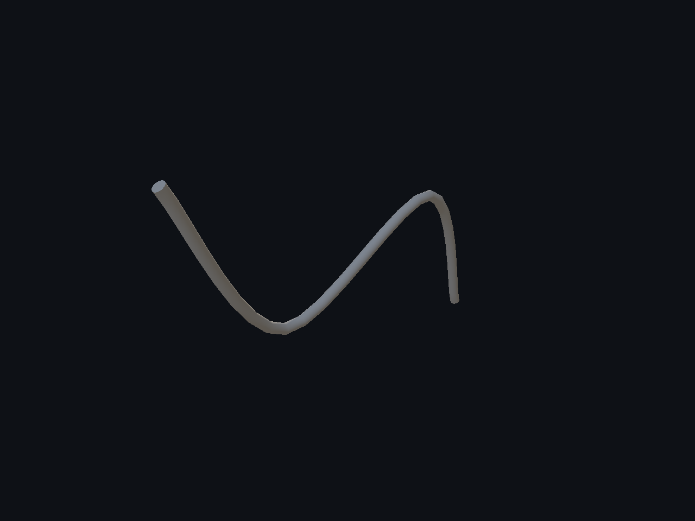
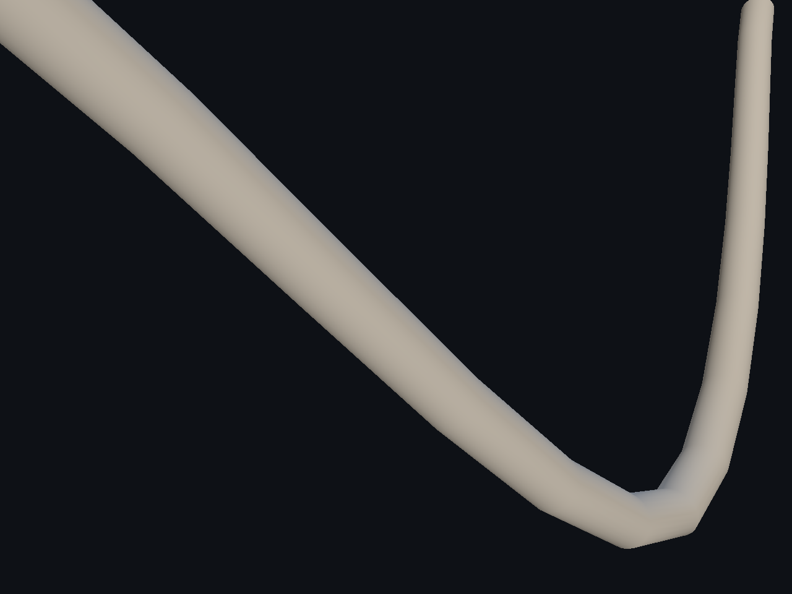
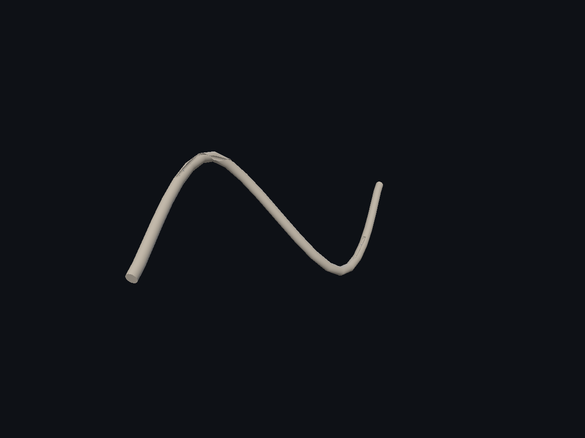

# Splines — 4/4

Primer recorrido espacial real de damage: una spline 3D genera un volumen continuo que retira material del cubo y del tubo curvo. Guardado/carga, IDs, UVs y desactivación comprobados; tres suites PASS y 24 capturas nativas con fuentes/binario sin deriva. La ventana también permitió convertir, añadir un punto, editar Z y guardar/recargar. **Calidad visual parcial:** aspecto de ranura y ajuste continuo a superficies curvadas por mejorar. Decals 3D, ASan actualizado y la aceptación completa de UI siguen pendientes.

[Página 1](page-1.md) · [Página 2](page-2.md) · [Página 3](page-3.md) · [Página 4](page-4.md)

[Todas las familias](../README.md)

[Mediciones](spatial-damage-2026-11-04/spatial-damage-proof.json) · [Ejecución](spatial-damage-2026-11-04/execution.json) · [Recorrido de controles](spatial-damage-2026-11-04/ui-result.json).

### cube after 0

### cube after 1

### cube after 2

### cube before 0

### cube before 1

### cube before 2

### cube off 0

### cube off 1

### cube off 2

### cube replay 0

### cube replay 1

### cube replay 2

### curved pipe after 0

### curved pipe after 1

### curved pipe after 2

### curved pipe before 0

### curved pipe before 1

### curved pipe before 2

### curved pipe off 0

### curved pipe off 1

### curved pipe off 2

### curved pipe replay 0

### curved pipe replay 1

### curved pipe replay 2

