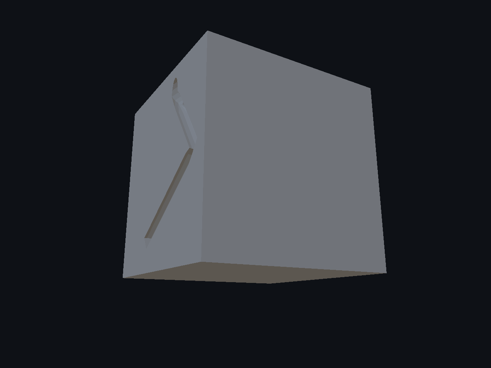
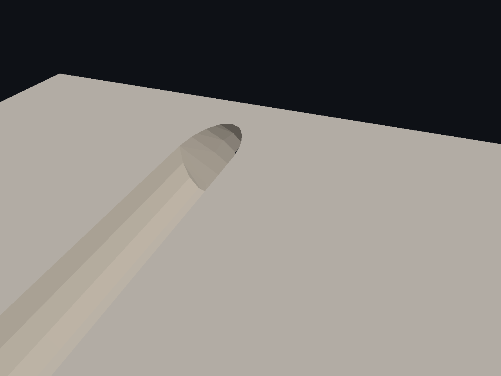
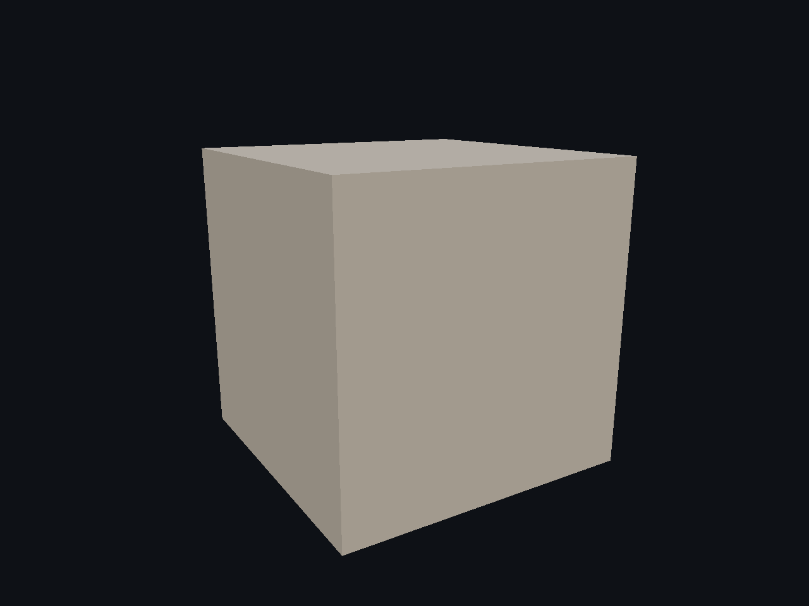
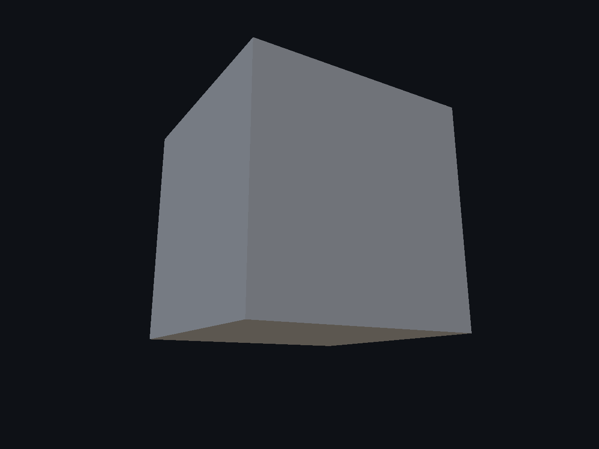
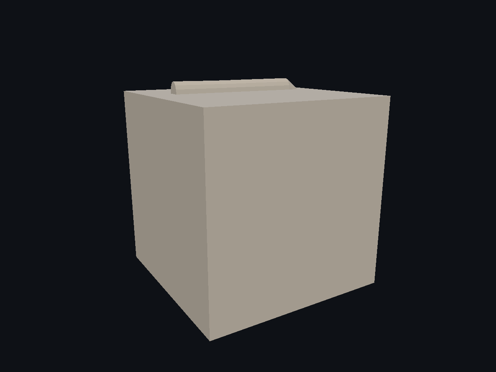
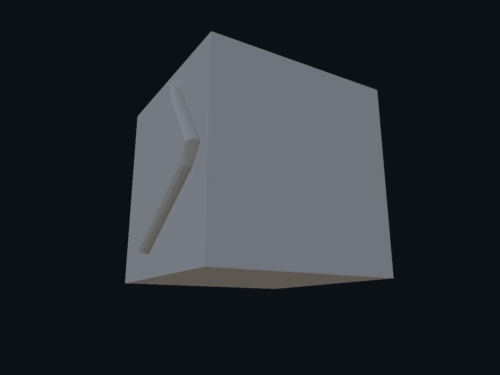
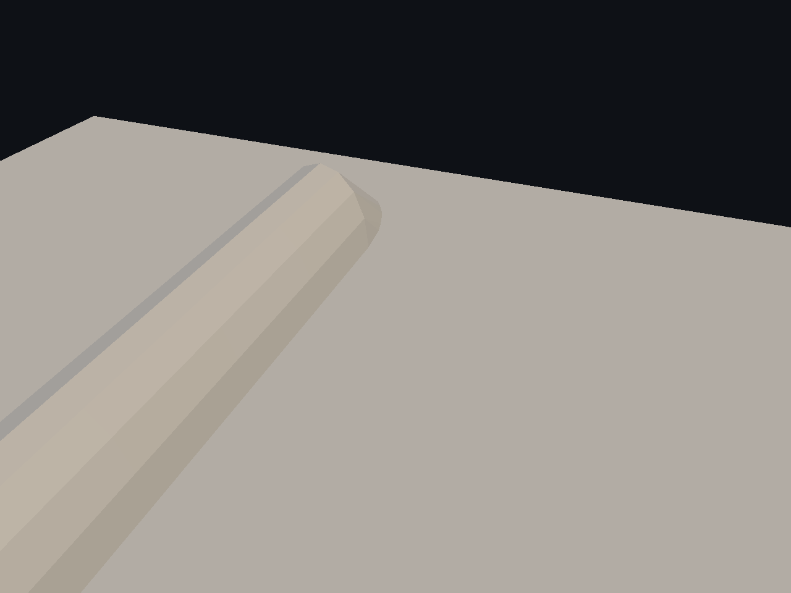

# Splines — 5/6

Cortes y relieves por la misma spline espacial. VolumeDifference retira material; VolumeUnion añade un decal unido al receptor, con identidad DecalSurface. Replay y off exactos, cuatro suites Release y cuatro AddressSanitizer PASS. La comprobación de conectividad elimina islas de volumen casi nulo en las uniones sin aumentar tolerancias. **Calidad visual parcial:** facetas y adaptación a la curva por mejorar. Otros modos de Decal3D, Undo/Redo y aceptación global siguen pendientes.

[Página 1](page-1.md) · [Página 2](page-2.md) · [Página 3](page-3.md) · [Página 4](page-4.md) · [Página 5](page-5.md) · [Página 6](page-6.md)

[Todas las familias](../README.md)

[Mediciones](spatial-decals-2026-11-04/spatial-damage-proof.json) · [Ejecución](spatial-decals-2026-11-04/execution.json) · [ASan](spatial-decals-2026-11-04/asan-summary.json) · [Controles](spatial-decals-2026-11-04/ui-result.json).

### cube after 0

### cube after 1

### cube after 2

### cube before 0

### cube before 1

### cube before 2

### cube decal after 0

### cube decal after 1

### cube decal after 2

### cube decal before 0

### cube decal before 1

### cube decal before 2

### cube decal off 0

### cube decal off 1

### cube decal off 2

### cube decal replay 0

### cube decal replay 1

### cube decal replay 2

### cube off 0

### cube off 1

### cube off 2

### cube replay 0

### cube replay 1

### cube replay 2

