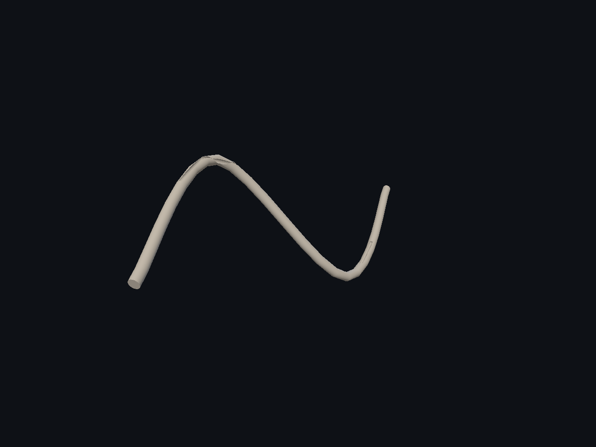
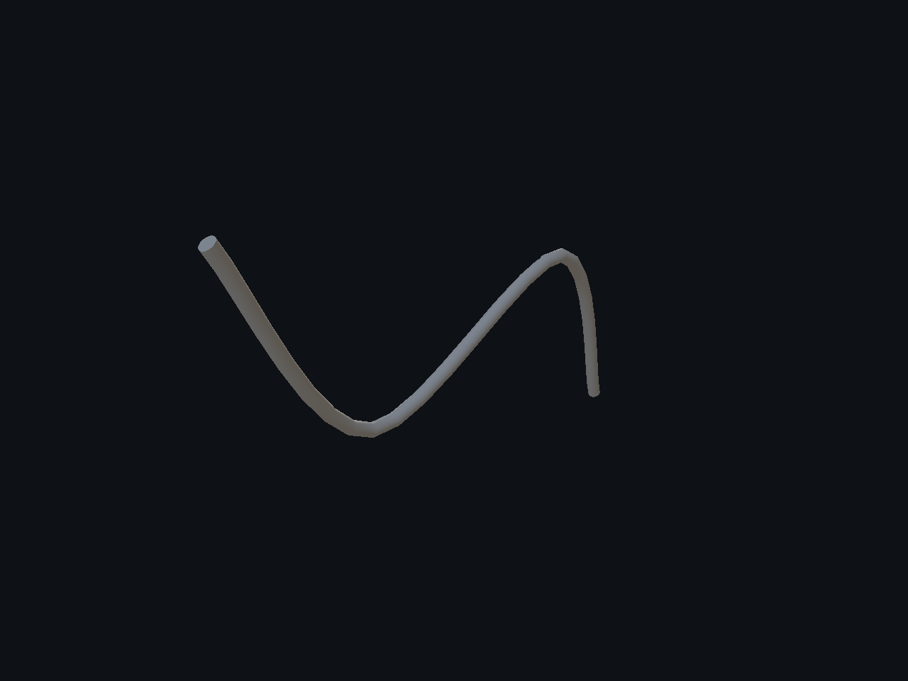
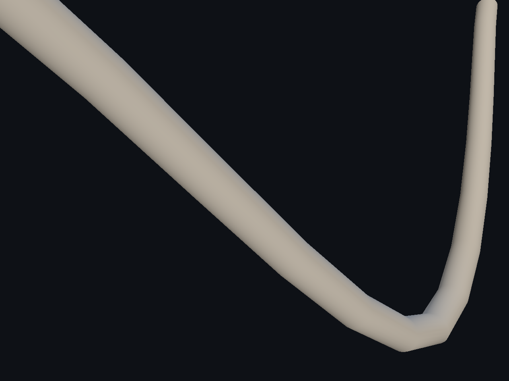
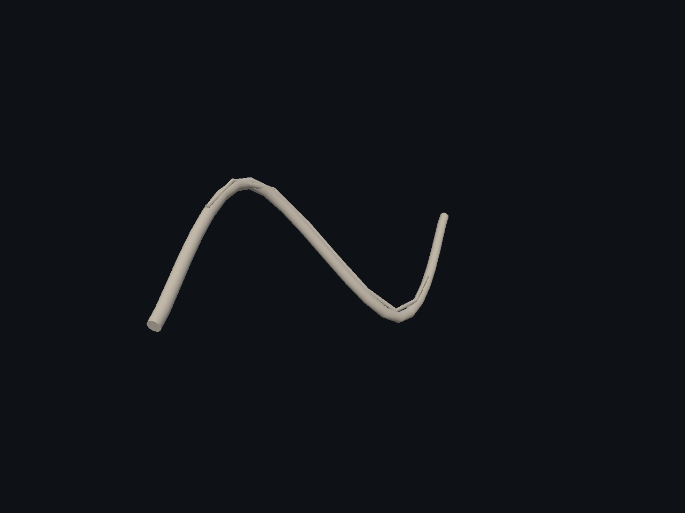
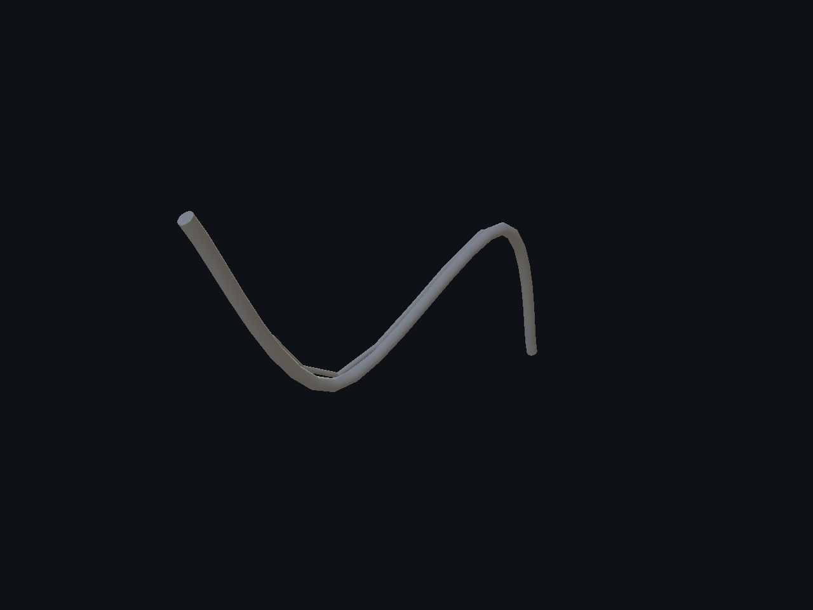
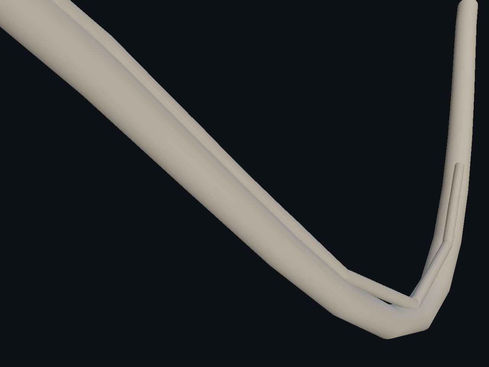

# Splines — 6/10

Cortes y relieves por la misma spline espacial. VolumeDifference retira material; VolumeUnion añade un decal unido al receptor, con identidad DecalSurface. Replay y off exactos, cuatro suites Release y cuatro AddressSanitizer PASS. La comprobación de conectividad elimina islas de volumen casi nulo en las uniones sin aumentar tolerancias. **Calidad visual parcial:** facetas y adaptación a la curva por mejorar. Otros modos de Decal3D, Undo/Redo y aceptación global siguen pendientes.

[Página 1](page-1.md) · [Página 2](page-2.md) · [Página 3](page-3.md) · [Página 4](page-4.md) · [Página 5](page-5.md) · [Página 6](page-6.md) · [Página 7](page-7.md) · [Página 8](page-8.md) · [Página 9](page-9.md) · [Página 10](page-10.md)

[Todas las familias](../README.md)

[Mediciones](spatial-decals-2026-11-04/spatial-damage-proof.json) · [Ejecución](spatial-decals-2026-11-04/execution.json) · [ASan](spatial-decals-2026-11-04/asan-summary.json) · [Controles](spatial-decals-2026-11-04/ui-result.json).

### curved pipe after 0

### curved pipe after 1

### curved pipe after 2

### curved pipe before 0

### curved pipe before 1

### curved pipe before 2

### curved pipe decal after 0

### curved pipe decal after 1

### curved pipe decal after 2

### curved pipe decal before 0

### curved pipe decal before 1

### curved pipe decal before 2

### curved pipe decal off 0

### curved pipe decal off 1

### curved pipe decal off 2

### curved pipe decal replay 0

### curved pipe decal replay 1

### curved pipe decal replay 2

### curved pipe off 0

### curved pipe off 1

### curved pipe off 2

### curved pipe replay 0

### curved pipe replay 1

### curved pipe replay 2

