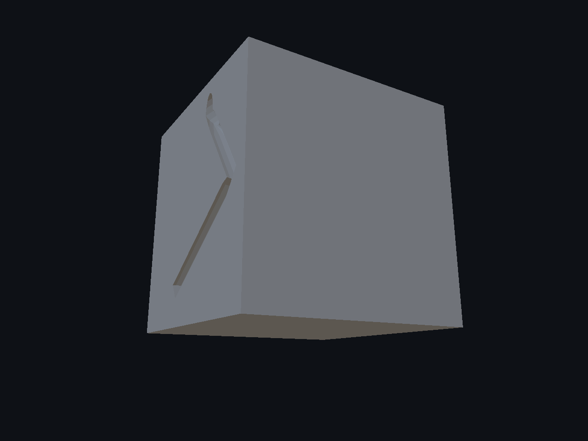
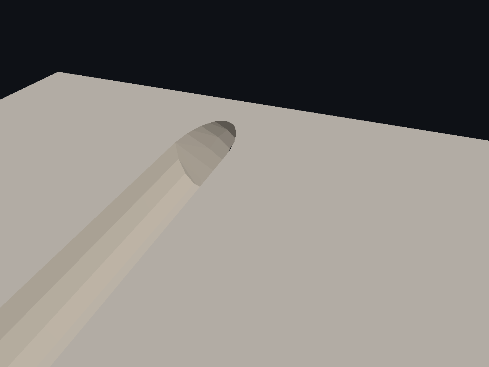
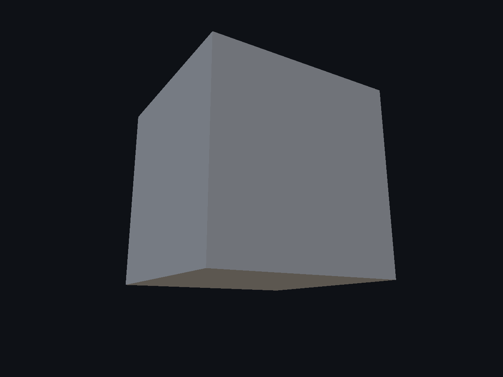
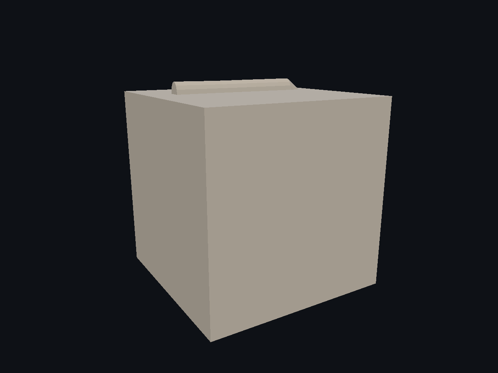
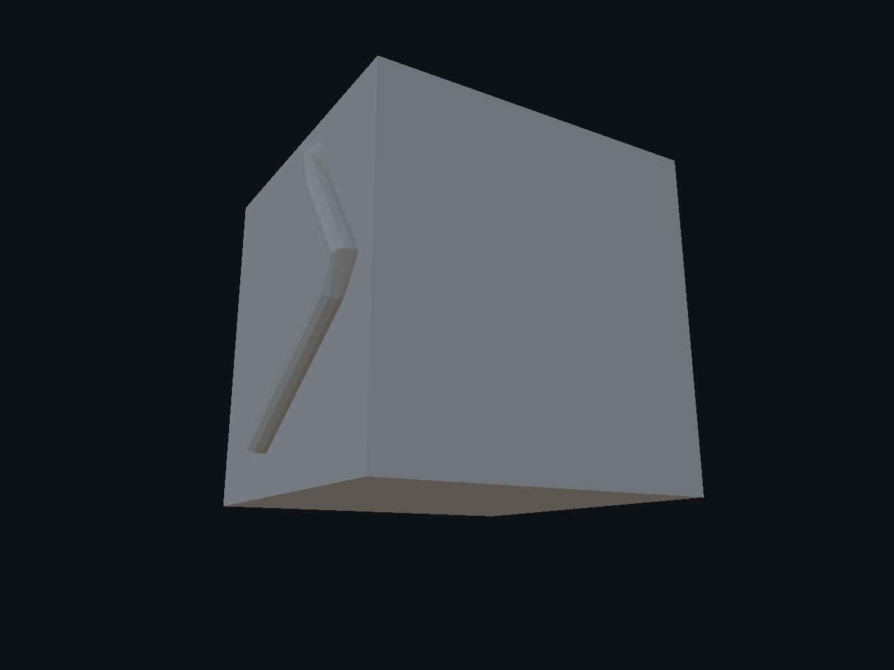
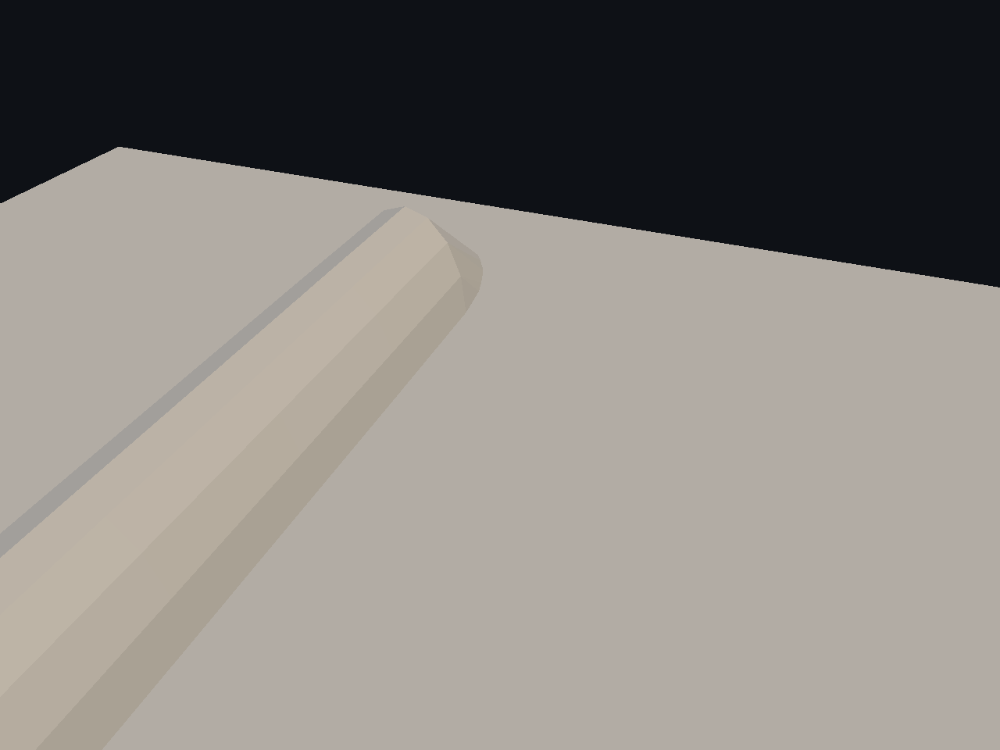
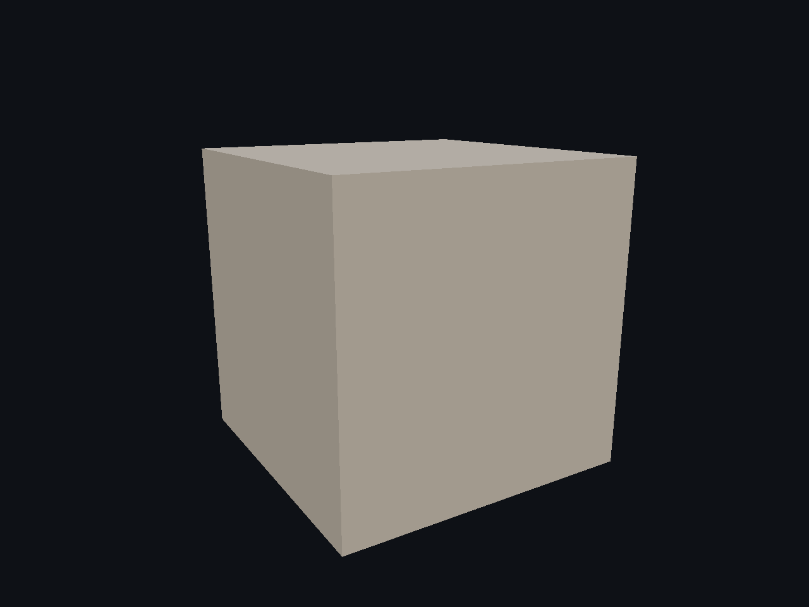
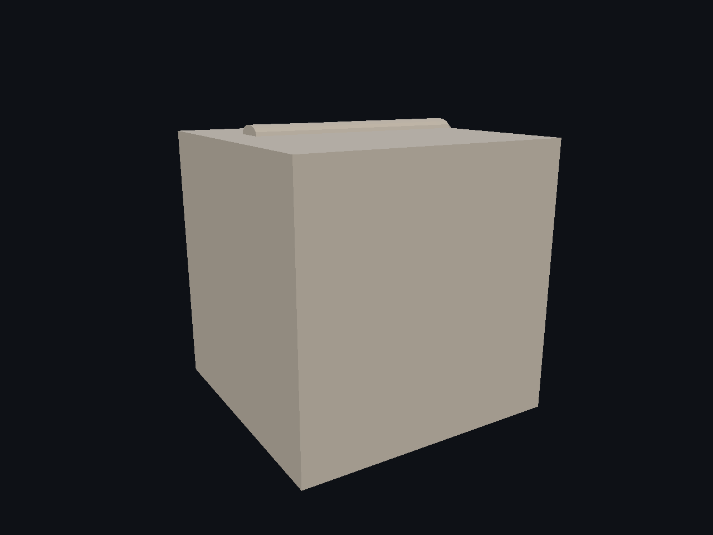
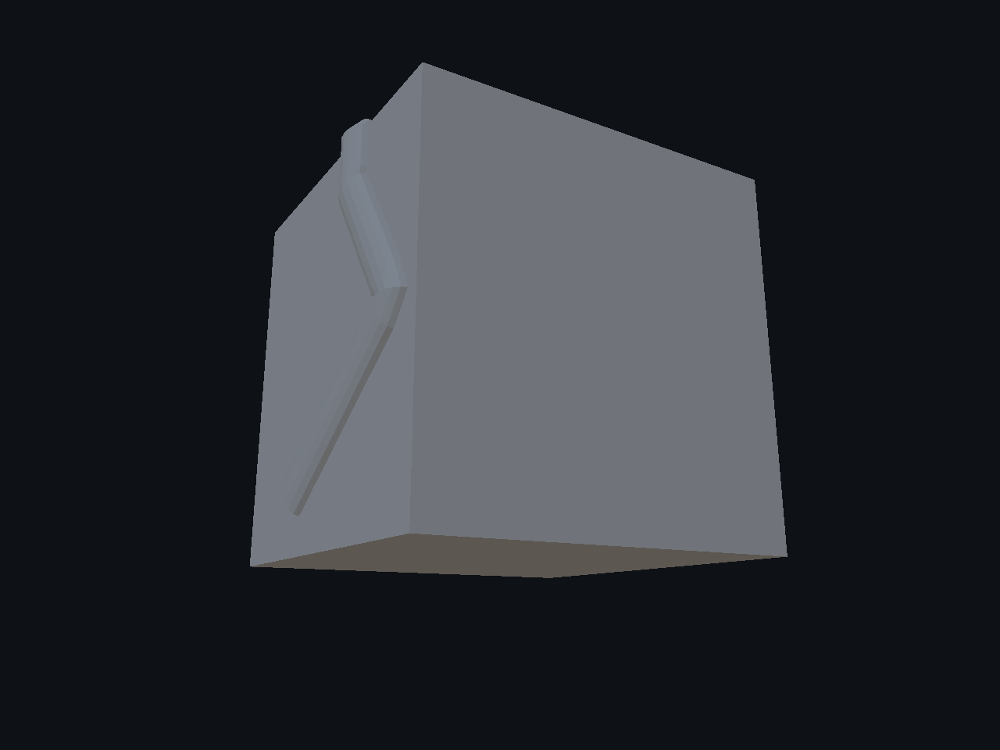
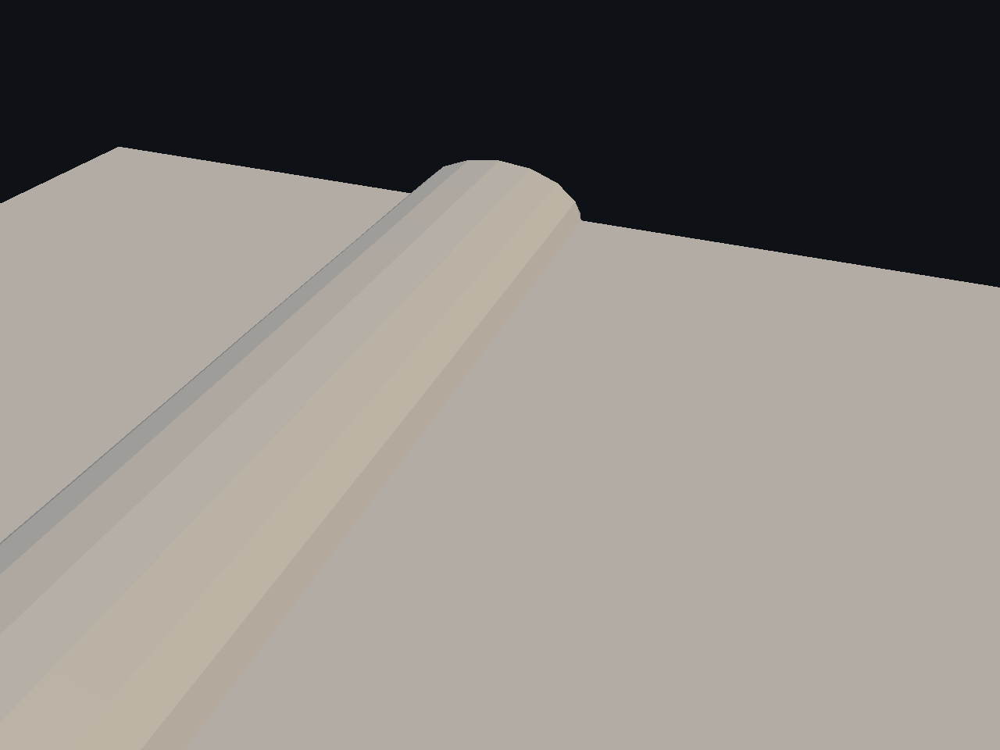

# Splines — 7/10

Follow surface adapta la guía al receptor y orienta el perfil, con distancia máxima explícita y refinamiento de los tramos. Ocho suites Release, cuatro AddressSanitizer y recorrido UI comprobados; la regresión posterior de anillo ajustado también pasa. Comparaciones con cámaras idénticas, replay/off y modo libre. El error indicado es muestreado en cuartos/punto medio, no una cota global. Anchura/profundidad siguen autoradas. Persisten facetas, acabado poco natural y pendientes de UX/Undo/Redo y del goal.

[Página 1](page-1.md) · [Página 2](page-2.md) · [Página 3](page-3.md) · [Página 4](page-4.md) · [Página 5](page-5.md) · [Página 6](page-6.md) · [Página 7](page-7.md) · [Página 8](page-8.md) · [Página 9](page-9.md) · [Página 10](page-10.md)

[Todas las familias](../README.md)

[Mediciones](surface-follow-2026-11-04/spatial-damage-proof.json) · [Ejecución](surface-follow-2026-11-04/execution.json) · [ASan](surface-follow-2026-11-04/asan-summary.json) · [Controles](surface-follow-2026-11-04/ui-result.json).

### cube after 0

### cube after 1

### cube after 2

### cube before 0

### cube before 1

### cube before 2

### cube decal after 0

### cube decal after 1

### cube decal after 2

### cube decal before 0

### cube decal before 1

### cube decal before 2

### cube decal off 0

### cube decal off 1

### cube decal off 2

### cube decal replay 0

### cube decal replay 1

### cube decal replay 2

### cube decal surface after 0

### cube decal surface after 1

### cube decal surface after 2

### cube decal surface before 0

### cube decal surface before 1

### cube decal surface before 2

