# Vías mineras — 1/1

Pruebas visuales históricas de vías y sus casos de edición.

[Página 1](page-1.md)

[Todas las familias](../README.md)

### case 0 overview

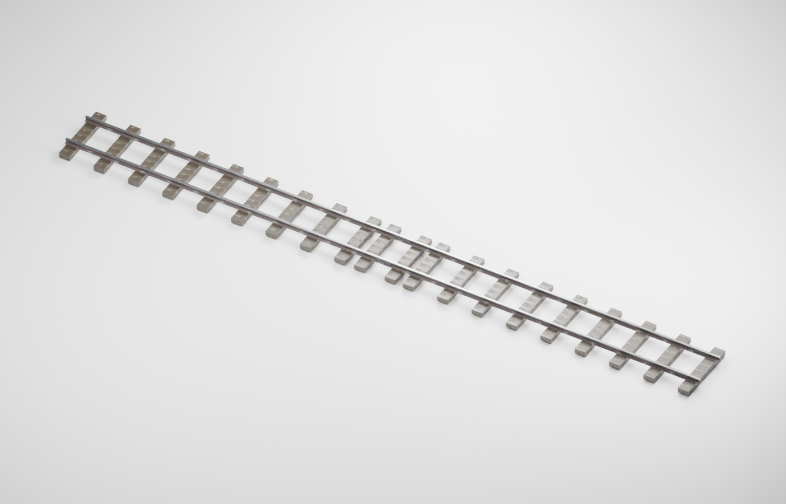

Fuente: `Evidence/2026-10-09-mining-track/images/case-0-overview.png`.

### case 1 overview

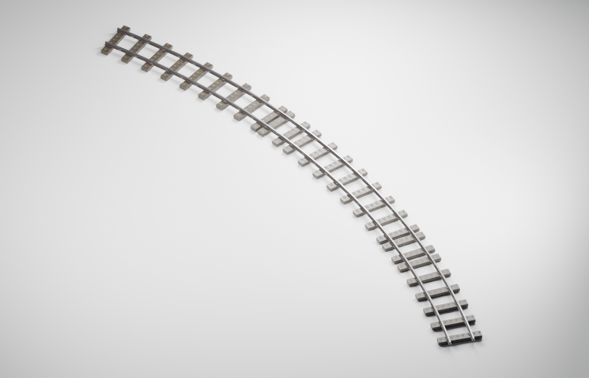

Fuente: `Evidence/2026-10-09-mining-track/images/case-1-overview.png`.

### case 2 overview

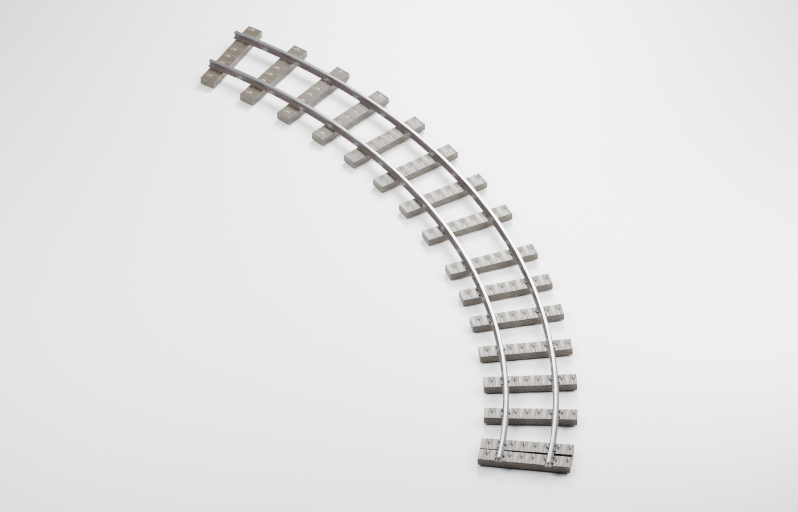

Fuente: `Evidence/2026-10-09-mining-track/images/case-2-overview.png`.

### case 3 overview

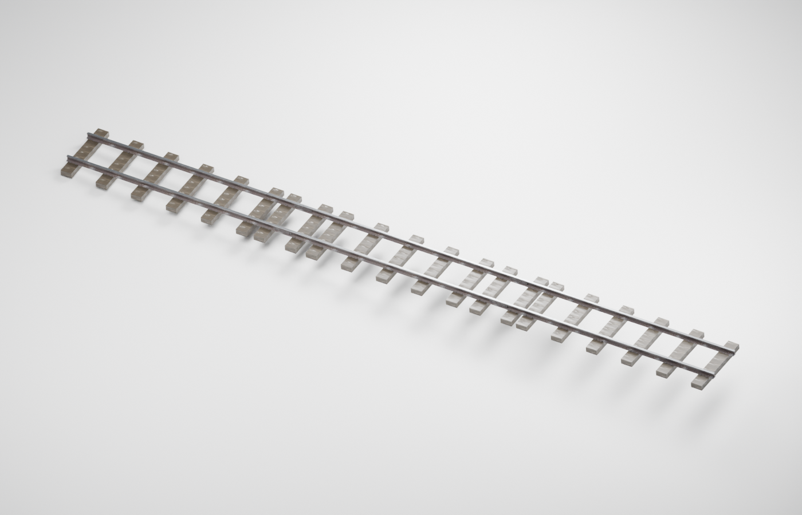

Fuente: `Evidence/2026-10-09-mining-track/images/case-3-overview.png`.

### case 4 overview

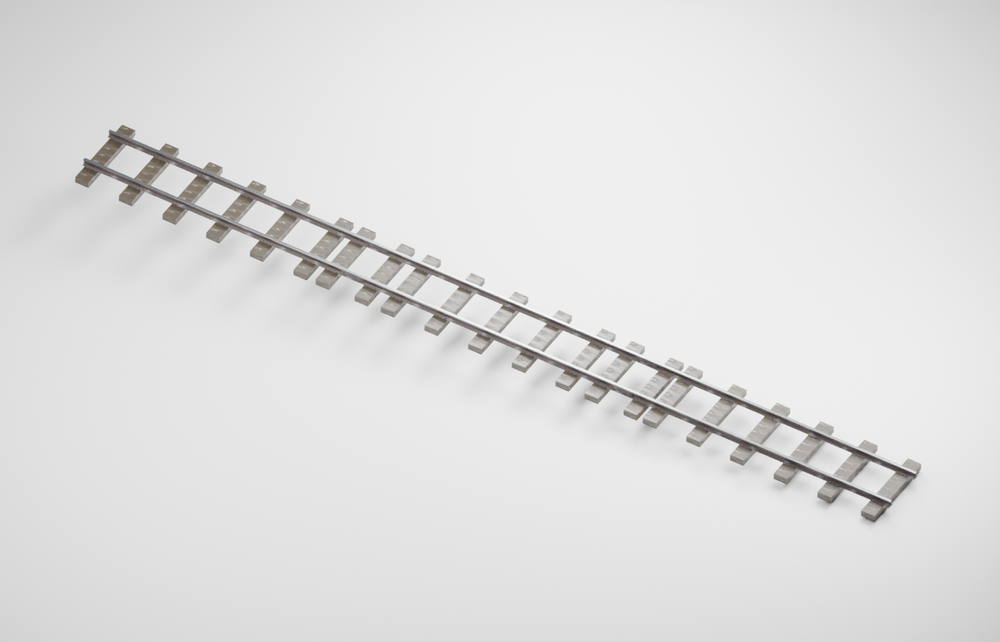

Fuente: `Evidence/2026-10-09-mining-track/images/case-4-overview.png`.

### case 5 overview

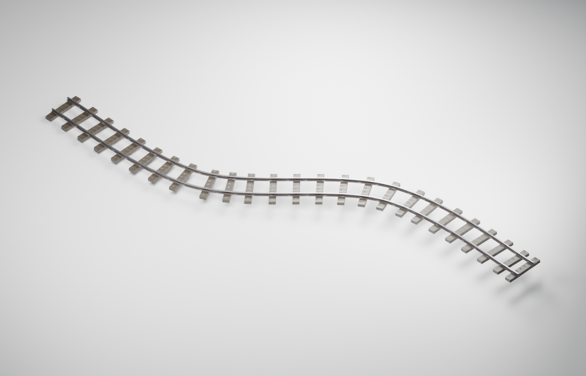

Fuente: `Evidence/2026-10-09-mining-track/images/case-5-overview.png`.

### fastening detail

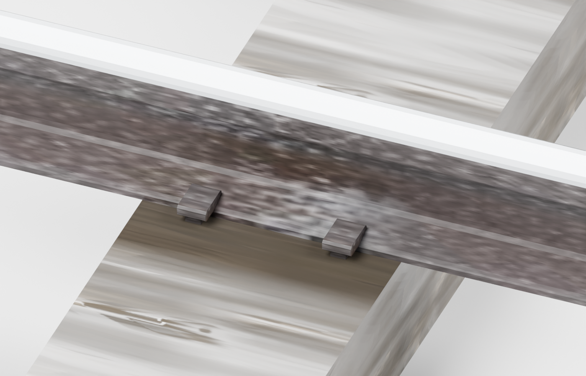

Fuente: `Evidence/2026-10-09-mining-track/images/fastening-detail.png`.

### joint detail

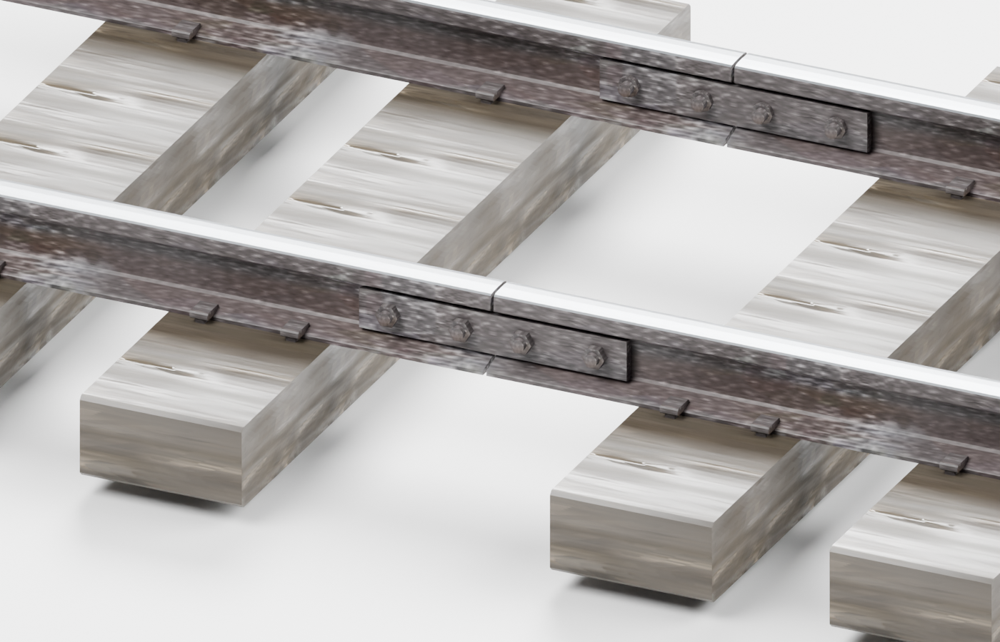

Fuente: `Evidence/2026-10-09-mining-track/images/joint-detail.png`.

### rail profile

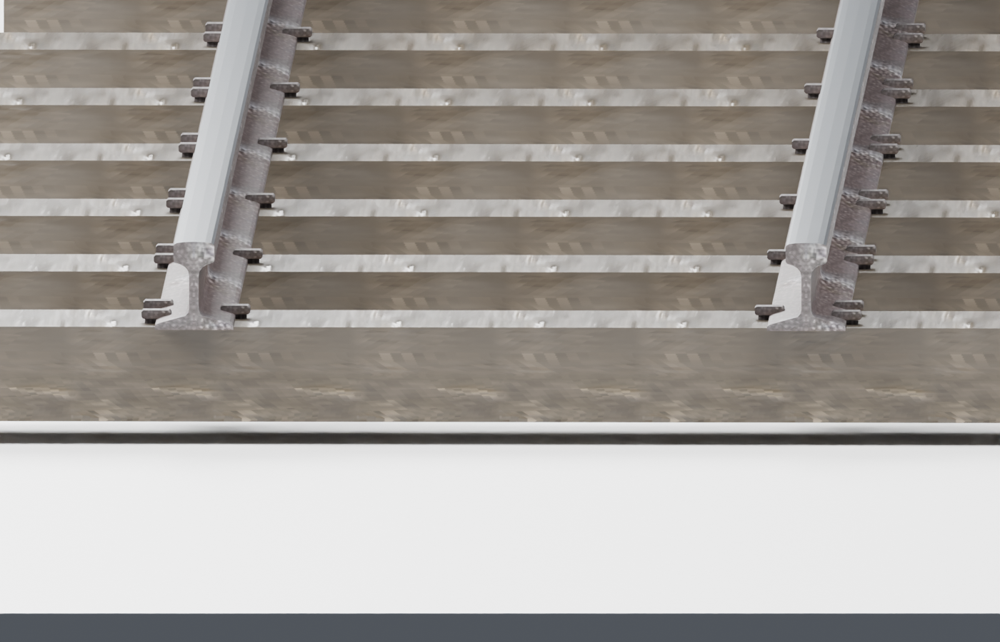

Fuente: `Evidence/2026-10-09-mining-track/images/rail-profile.png`.

### HSE fastening

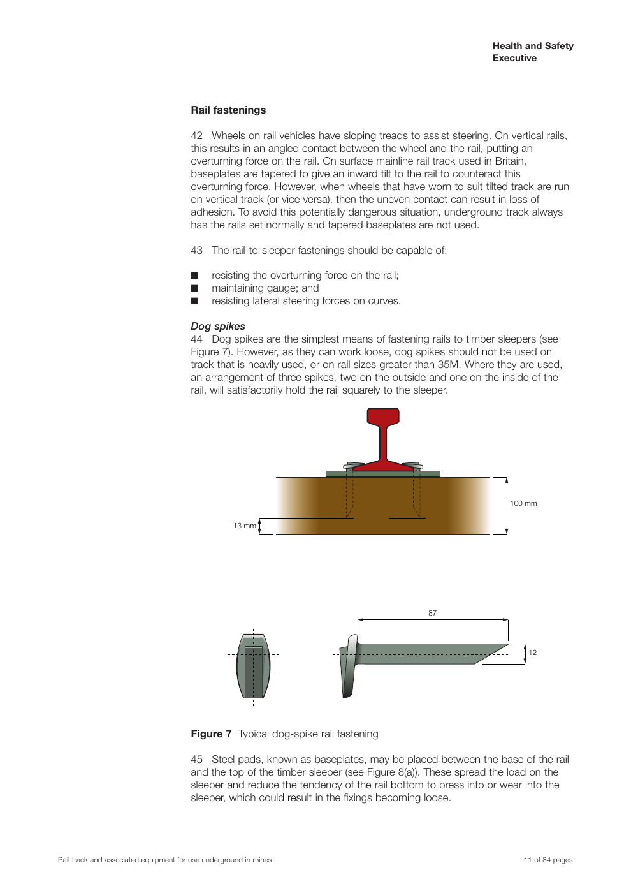

Fuente: `Evidence/2026-10-09-mining-track/references/HSE-fastening.png`.

### HSE joint

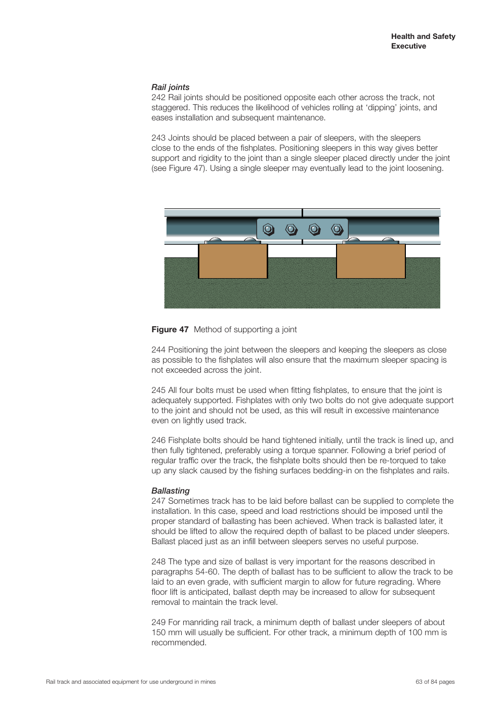

Fuente: `Evidence/2026-10-09-mining-track/references/HSE-joint.png`.

### Patry section

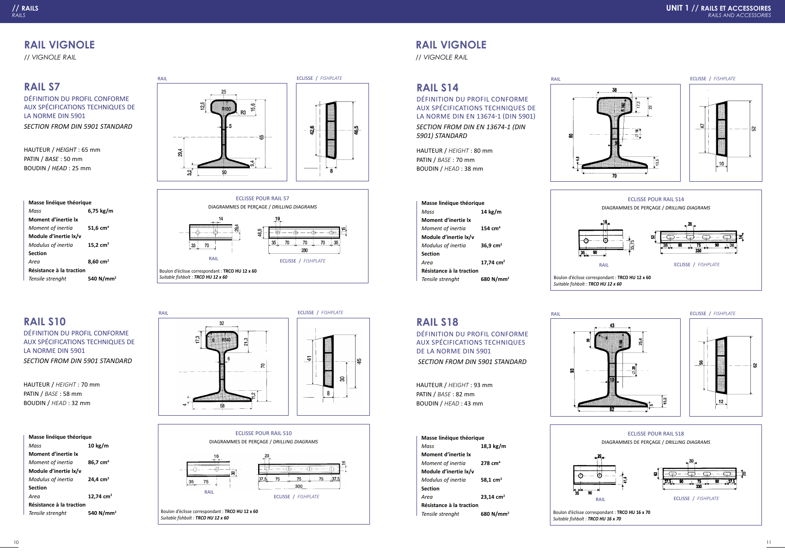

Fuente: `Evidence/2026-10-09-mining-track/references/Patry-section.png`.

### S18 section

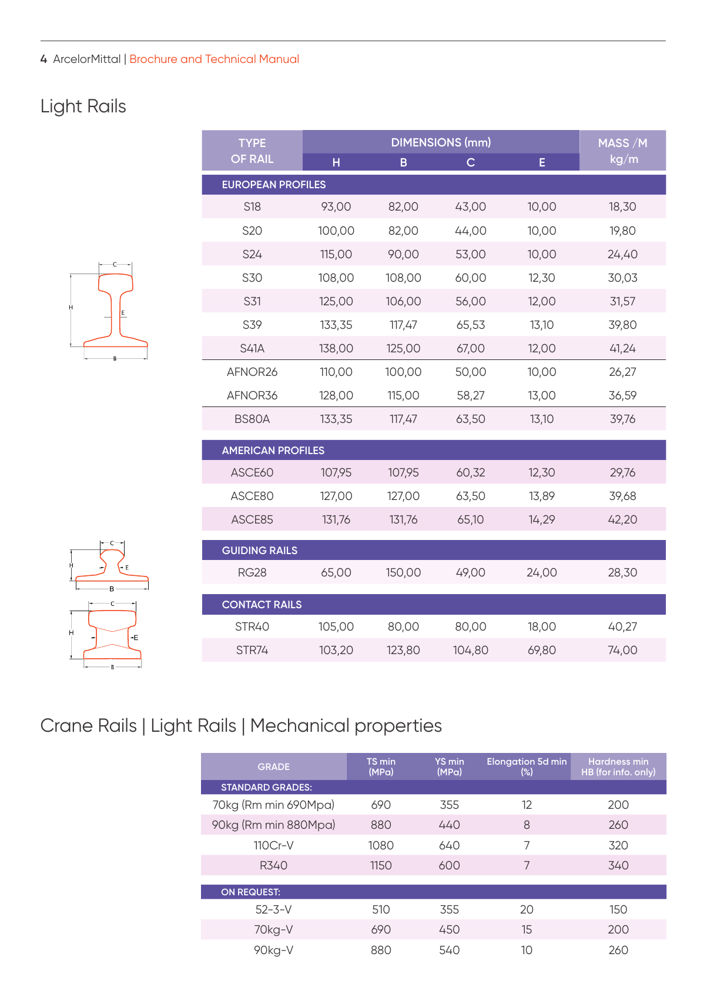

Fuente: `Evidence/2026-10-09-mining-track/references/S18-section.png`.

### precision16

Fuente: `Evidence/2026-10-09-mining-track/unified-regression/precision16.png`.
